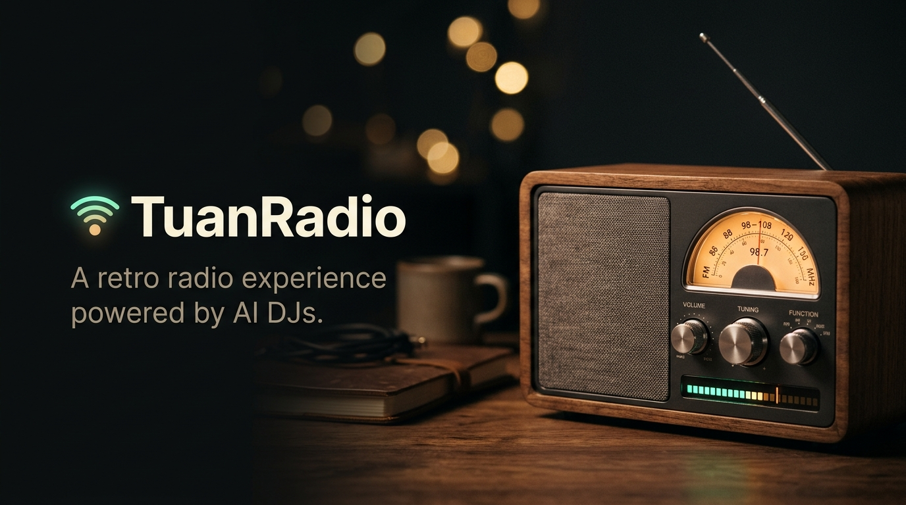
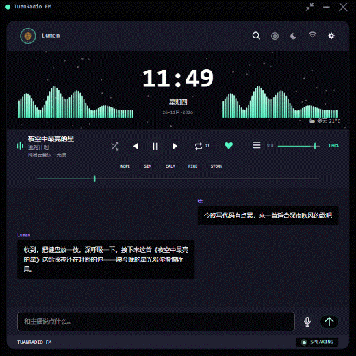
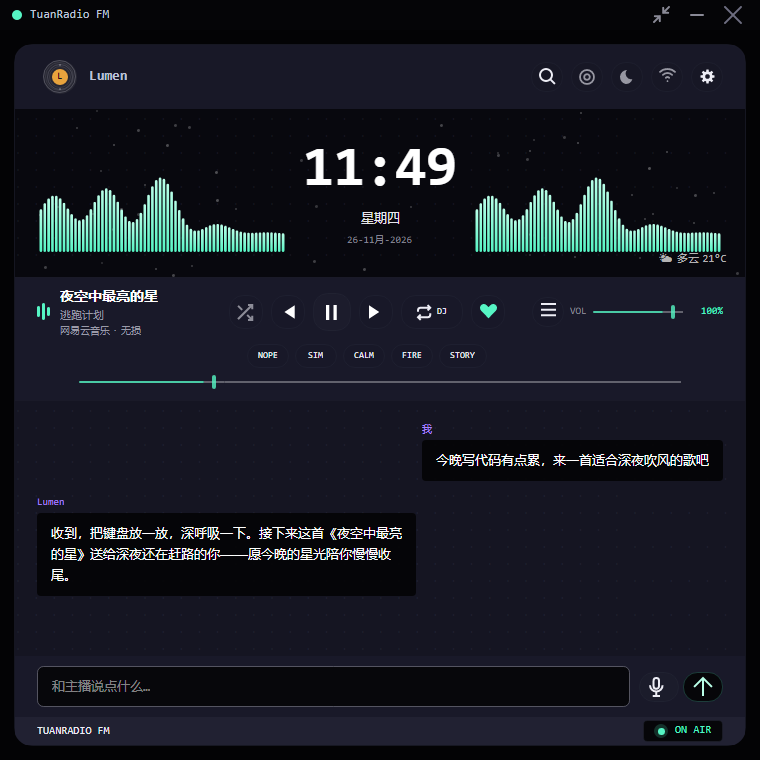
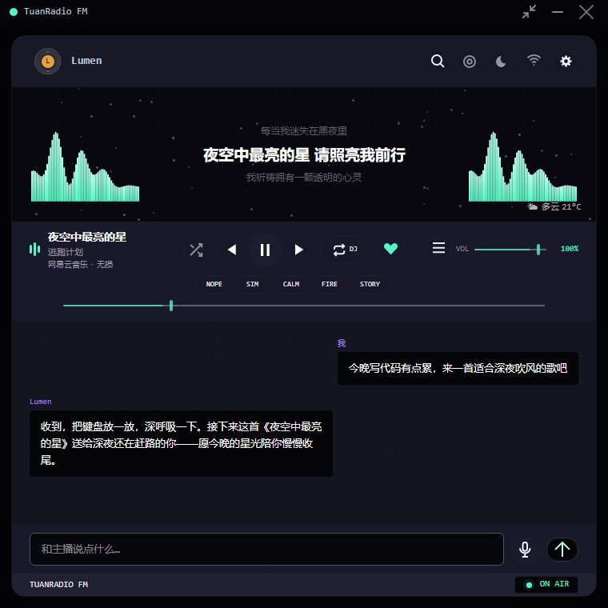
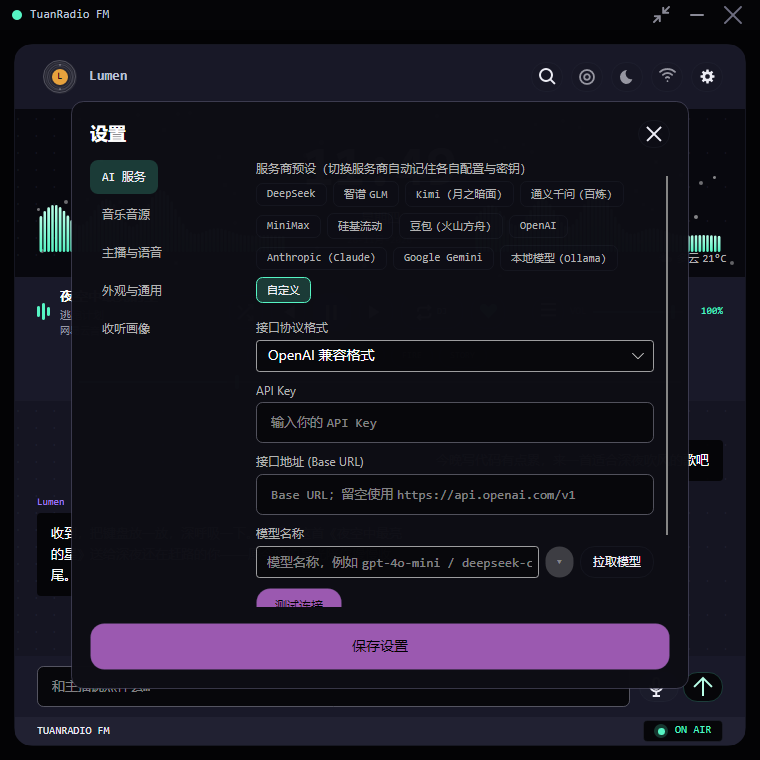
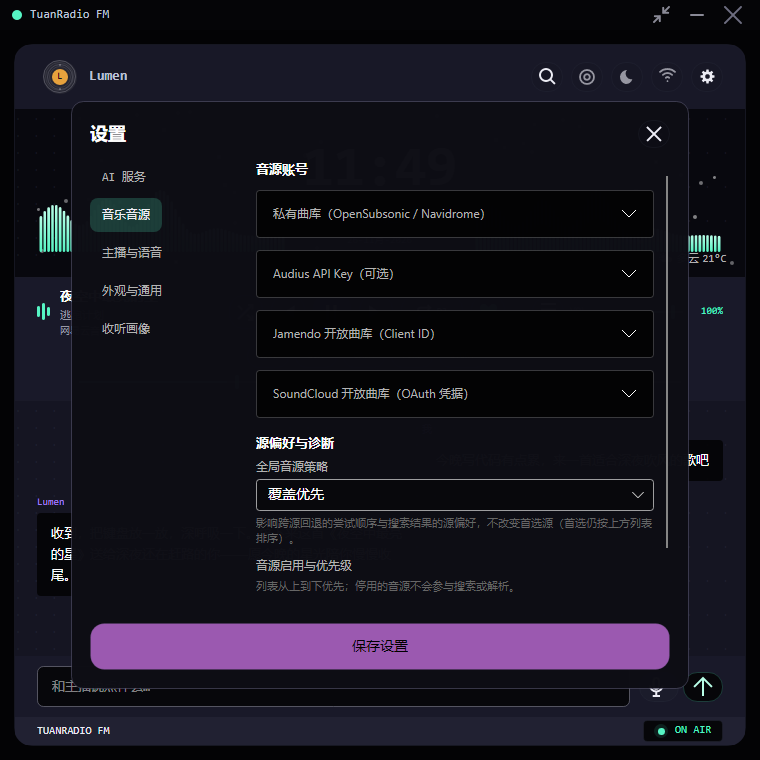
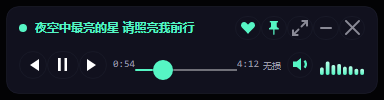

<div align="center">



# TuanRadio

**A retro radio experience powered by AI DJs.**

[](https://github.com/chenlianwd/TuanRadio/releases)
[](https://github.com/chenlianwd/TuanRadio/releases)
[](https://dotnet.microsoft.com/)
[](LICENSE)

**English** | [简体中文](README.zh-CN.md)

</div>

---

TuanRadio is a Windows desktop AI radio player built with **.NET 10** and **Avalonia**. It pairs a tactile retro radio aesthetic with conversational AI DJs, free Edge TTS voice hosting, offline Whisper voice requests, real-time WASAPI hardware loopback spectrum visuals, multi-source self-healing playback, global internet radio, podcasts with AI 1-minute digests, and a zero-dependency LAN Web Remote.

<div align="center">
  
  <br />
  <sub><em>Live demo: real-time spectrum visuals, seamless Clock ↔ Synced Lyrics stage switching, and conversational AI DJ song requests.</em></sub>
</div>

---

## Quick Start

### Option 1: Install & Listen in 1 Minute (Recommended for Users)

No build tools or API keys required to start listening right away (local library, Audius, global internet radio, and podcasts work out of the box):

1. Download the latest release from **[GitHub Releases](https://github.com/chenlianwd/TuanRadio/releases)**:
   - **Installer (Recommended):** `TuanRadio-win-Setup.exe` — no admin rights needed, self-contained .NET runtime, desktop shortcut, and one-click in-app delta auto-updates via Velopack.
   - **Portable ZIP:** `TuanRadio-v*-win-x64.zip` — unzip anywhere and launch `AIRadio.exe`.
2. Launch TuanRadio and press play — or open **Settings → AI Service** to connect any OpenAI-compatible, Anthropic-compatible, or local Ollama LLM to unlock AI DJ hosting, voice requests, and smart curation.

> **Windows Notes**
> - **Minimum OS:** Windows 10 2004 (Build 19041) or later, x64.
> - **SmartScreen:** Releases are currently unsigned. On first launch, click **More info → Run anyway** if prompted.
> - **On-Demand Downloads:** Hold-to-talk voice requests download the offline Whisper model (`ggml-base.bin`, ~140 MB) on first use (can also be placed manually at `%LOCALAPPDATA%\AIRadio\models\ggml-base.bin`). Official release packages bundle a SHA256-verified Node.js runtime (`runtime/node/node.exe`).

### Option 2: Run from Source in 3 Minutes (For Developers)

**Prerequisites:** Windows 10/11 (x64) and [.NET 10 SDK](https://dotnet.microsoft.com/download/dotnet/10.0). *(Node.js is optional—use the slim core flag below to build without Node.)*

```bash
# 1. Clone the repository
git clone https://github.com/chenlianwd/TuanRadio.git
cd TuanRadio

# 2. Build & run (Full build — auto-detects Node.js if installed)
dotnet run --project AIRadio.Desktop/AIRadio.Desktop.csproj

# Or build the slim core variant without Node.js / experimental streaming proxies:
dotnet build AIRadio.Desktop/AIRadio.Desktop.csproj -p:TuanRadioEnableNodeProviders=false -v:minimal

# 3. Run the automated test suite (1,470+ xUnit & Avalonia headless tests)
dotnet test AIRadio.Desktop.Tests/AIRadio.Desktop.Tests/AIRadio.Desktop.Tests.csproj -v:minimal -p:UseSharedCompilation=false
```

> **Tip:** In Git Bash, always use `-p:` instead of `/p:` for MSBuild properties. You can also specify a custom Node directory via `-p:TuanRadioNodeDir=<path>`.

---

## Screenshots

| Clock Stage (Default) | Synced Lyrics Mode |
| :---: | :---: |
|  |  |

*Left: Retro digital clock + real-time 1024-point WASAPI loopback spectrum + ambient weather + conversational AI DJ chat. Right: Click the center stage to toggle between the clock and line-by-line synced lyrics while keeping live dual-side spectrums active.*

| Settings: AI Service & Presets | Settings: Music Sources & Governance |
| :---: | :---: |
|  |  |

<div align="center">
  
  <br />
  <sub><em>Compact Mode: one-click collapse to a 2-row mini player with live single-line lyrics, synced mini spectrum, lossless badge, and optional always-on-top pinning.</em></sub>
</div>

---

## Key Features

- 🎙️ **Conversational AI DJ & Offline Voice Requests**: Chat naturally or hold the mic button for offline Whisper speech recognition (with LLM homophone correction). Enjoy automatic track transitions and on-demand `STORY` song trivia voiced via free **Edge TTS** with customizable DJ personas and voices.
- 📻 **Retro Radio Aesthetics & Scene Modes**: Procedurally synthesized FM static and station chimes (zero bundled audio bloat), 1024-point WASAPI hardware loopback FFT spectrum (4 clickable styles: Bar / Mirror / Wave / Particle), **Focus Mode** (instrumental-friendly, uninterrupted playback), and **Sleep Timer + Bedtime Mode** (gentle fade-out, calmer curation, softer DJ whisper cadence).
- 🌍 **Global Internet Radio & Custom Streams**: Built-in global open radio directory with 8 curated offline fallback genres, custom stream URL entry with ICY metadata probing (supports LAN streams), and batch M3U / M3U8 / PLS playlist import.
- 🎧 **Podcast RSS / OPML & AI 1-Minute Digests**: Subscribe to RSS/Atom feeds, import/export OPML, persist episode resume positions, and control playback with dedicated **0.75x–2.0x speed** and **-15s / +30s** skip buttons. Tap **AI Digest** for a 1-minute spoken briefing from Shownotes—automatically falling back to built-in Whisper transcription when Shownotes are missing.
- 📱 **Zero-Dependency LAN Web Remote**: Embedded HTTP/WebSocket server with QR code pairing and constant-time token auth. Control playback, volume, seeking, podcast speed, Focus/Sleep modes, live synced lyrics, AI DJ chat, and browse playlists/radio/podcasts right from your phone on the same Wi-Fi.
- 🧠 **Local Long-Term Taste Profile**: Privacy-first local listening profile (30-day half-life artist affinity, language mix, time-of-day preferences, dislike blacklist, and LLM taste digest) injected into both Radio Mode curation and AI DJ conversations while actively preventing filter bubbles.
- 🔀 **Self-Healing Multi-Source Broker**: Works out of the box with Local Library, OpenSubsonic/Navidrome, and Audius; supports Jamendo CC and SoundCloud (OAuth credentials stored securely), plus NetEase, KuGou, and YouTube in full builds. Includes 3-track lookahead preflighting and automatic cross-source recovery on expired URLs or preview clips.
- 💎 **Transparent True Audio Quality**: Displays live quality badges (`Standard` / `HQ` / `Lossless` / `Preview`) with real codec, bitrate, sample rate, and channels decoded directly from LibVLC in tooltips.
- 🎨 **WCAG-Verified Themes & Palettes**: System / Light / Dark modes paired with 4 accent palettes (Mint / Warm Amber / Vapor Purple / Ice Blue), automatically verified against WCAG 2.1 contrast gates.
- 🖥️ **Deep Windows Integration**: Velopack in-app delta auto-updates, hardware media key support, Windows SMTC lockscreen/overlay metadata, and system tray minimization.

---

## Interface & Settings Tour

### Main Window Regions

- **Brand Header**: Vinyl DJ badge (halo pulses with live Edge TTS output; click to switch DJ personas), action cluster (multi-source search overlay, Focus Mode, Sleep Timer, LAN Web Remote QR pairing, Settings), and one-click Compact Mode toggle.
- **Clock Stage & Lyrics**: Center retro digital clock and line-by-line synced lyrics toggled with a single click, flanked by 1024-point real-time WASAPI loopback spectrums (click to cycle 4 styles) and an Open-Meteo ambient weather indicator.
- **Player Deck**: Track metadata and true audio quality badge, transport controls and heart favorite, library/radio/podcast drawer button, retro tuning-needle volume slider, instant feedback row (`NOPE` / `SIM` / `CALM` / `FIRE` / `STORY`; automatically switches to podcast speed & `-15s / +30s` controls during podcast episodes), and seamless hairline progress rail.
- **Chat & Status Bar**: Text chat and hold-to-talk offline Whisper voice requests, paired with a unified state-machine broadcast indicator (`ON AIR` / `CURATING` / `SEARCHING` / `SPEAKING` / `ERROR`).

### Settings Navigation (5 Sections)

| Section | What You Can Configure |
| :--- | :--- |
| **AI Service** | One-click presets (DeepSeek, Zhipu GLM, Kimi, Qwen, SiliconFlow, OpenAI, Anthropic, Gemini, local Ollama), protocol format, DPAPI-encrypted API Key, Base URL, model picker, and one-click connection test with diagnostics |
| **Music Sources** | NetEase / KuGou QR login & yt-dlp browser cookies (full builds), OpenSubsonic / Audius / Jamendo / SoundCloud credentials, local library folders, per-source enable/priority ordering, global source policy, and per-source health/entitlement/risk/version diagnostics |
| **Host & Voice** | Built-in DJ persona selection, Edge TTS voice tuning, custom system prompt, voice broadcast toggle, procedural FM static/chimes toggle, and music ducking vs. pause-on-speak mixing |
| **Appearance & General** | English / Chinese UI & AI reply language, weather city search or IP auto-location, System / Light / Dark themes × 4 WCAG-checked palettes, starfield & spectrum style, Compact Mode pinning/lyrics, close-to-tray behavior, LAN Web Remote settings, and Velopack in-app updates |
| **Listening Profile** | Local-only taste learning toggle, LLM taste digest & listener impression, language mix and time-of-day preferences, favorite/avoided artists, Dislike blacklist management, and one-click profile reset |

> **Data & Logs:** All settings, playlists, local taste profiles, and logs are stored locally under `%APPDATA%\AIRadio\` (check `logs\airadio-*.log` if troubleshooting playback).

---

## Project Structure

```text
AIRadio.Desktop/            Host app (Avalonia 11.3.9 + ReactiveUI + Velopack)
  Assets/                   App icons and vector assets
  Converters/               Shared XAML value converters
  Models/                   RadioState, VoiceOption, and desktop models
  Services/                 AudioService (LibVLC), AI DJ, LLM, Edge TTS, Lyrics, Whisper STT,
                            Podcast transcription, Weather, Sleep Timer, Scene Modes,
                            LAN Web Remote (WebRemote/), System Tray & SMTC
  Themes/                   Colors.axaml tokens + 4 WCAG-checked accent palettes
  ViewModels/ Views/        ReactiveUI ViewModels & Avalonia views (Main, Settings, Compact, Search, Drawer)
  server/ server-kugou/     Optional Node.js music source proxies (excluded in slim core builds)
AIRadio.Desktop.Music/      Standalone music domain library (one-way reference from host)
  Models/                   Track, RadioStation, PodcastFeed, PodcastEpisode, RadioSceneMode
  Services/Music/           Contracts, Broker (orchestration, policy, cache),
                            Providers (Local, OpenSubsonic, Audius, Jamendo, SoundCloud, Radio, Podcast),
                            Adapters, and Playback security (MediaUriPolicy & redirect guard)
AIRadio.Desktop.Tests/      xUnit & Avalonia headless test suite (1,470+ tests)
tools/                      Release pipeline (publish.ps1), branding scripts, screenshot utilities
```

---

## Architecture & Reliability

- **Decoupled Service Broker**: `AudioService` centralizes LibVLC playback, TTS ducking/interruption, and procedural FM audio; `MusicSourceBroker` orchestrates multi-source search, health circuit-breaking, policy ranking, and cross-source recovery behind `IMusicSourceBroker`.
- **Defense-in-Depth Playback Security**: Every external media URL passes fail-closed validation (`MediaUriPolicy`: scheme allowlist, private IPv4/IPv6 blocking, DNS re-check, no embedded credentials) plus hop-by-hop redirect inspection (`PlaybackRedirectGuard`).
- **Atomic Local Persistence**: Settings, playlists, podcast progress, and listener profiles use temp-file write-and-replace atomic saves with immutable cross-thread snapshots.

---

## Known Limitations

- Third-party streaming APIs may change due to upstream rate limits or regional restrictions; mitigated via strict timeouts, health circuit breakers, lookahead preflighting, and cross-source fallback.
- Playback `Referer` headers are best-effort due to an upstream LibVLC 3 HTTP client limitation (`User-Agent` and `Cookie` headers are delivered reliably).
- Long-term taste profiles stay strictly local (`listener-profile.json`) by design—no cloud sync or telemetry.

---

## License

Released under **GPL-3.0-only** (see [LICENSE](LICENSE)), Copyright (C) 2026 chenlianwd.  
Third-party component licenses and attributions are listed in [THIRD-PARTY-NOTICES.md](THIRD-PARTY-NOTICES.md).
