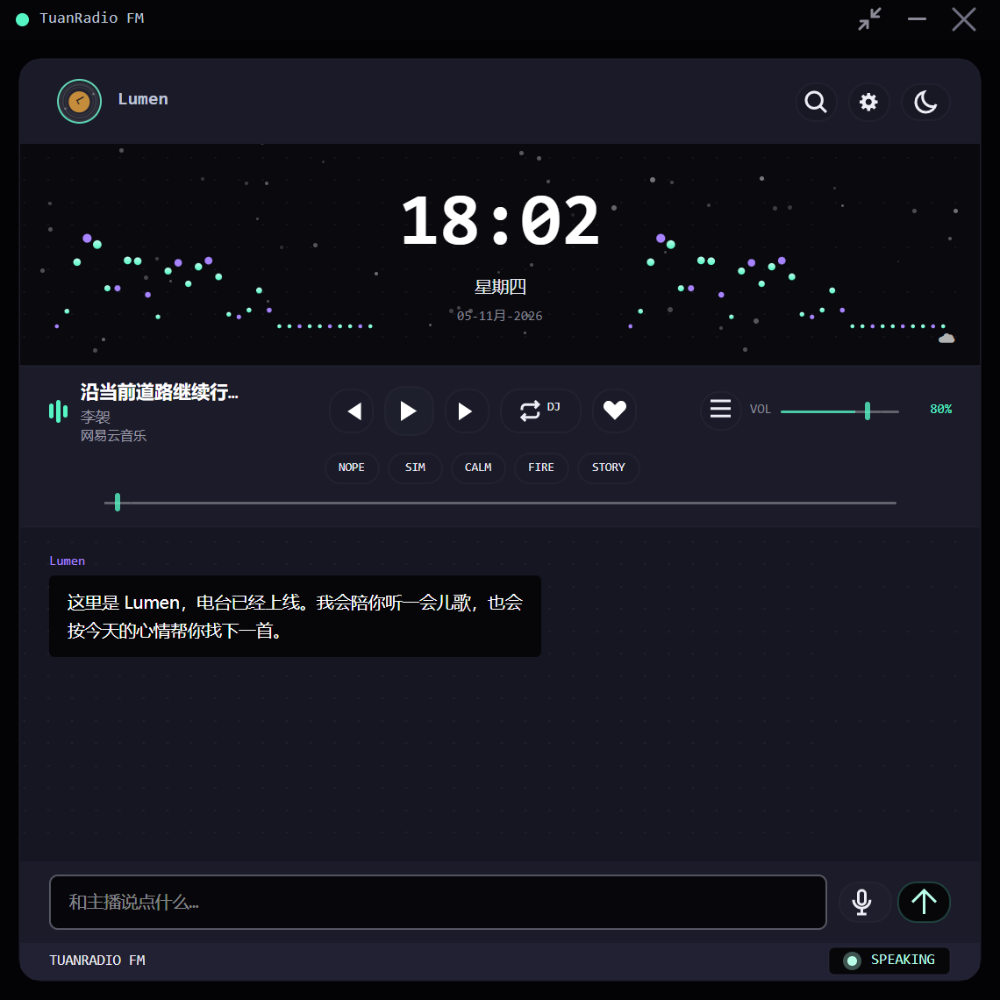
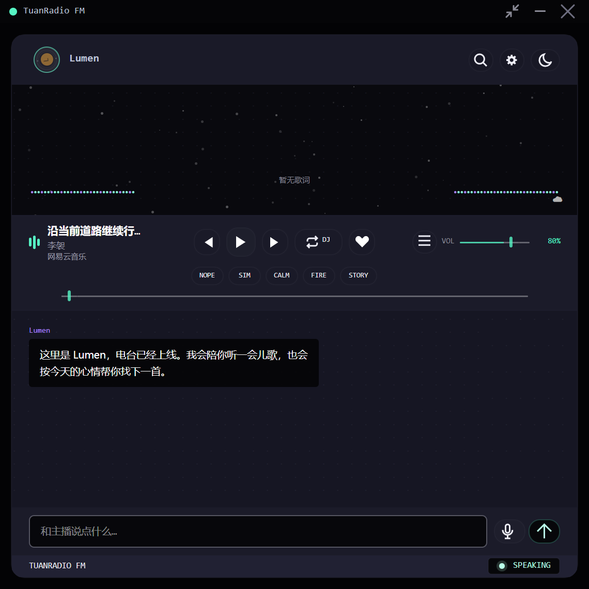
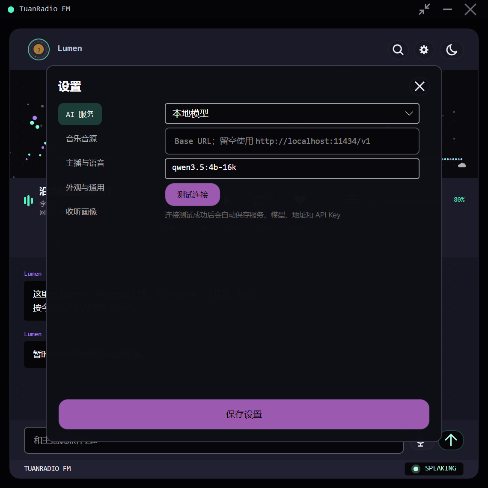
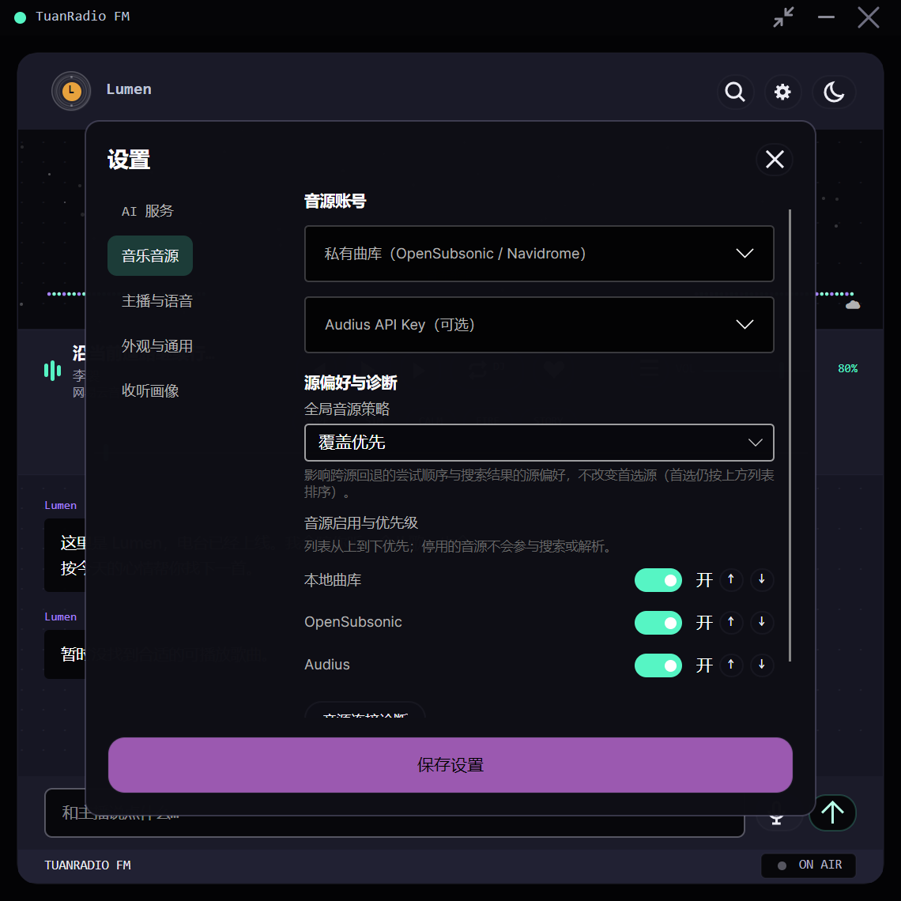
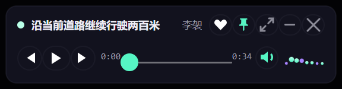

# TuanRadio

TuanRadio 是一个基于 .NET 10 与 Avalonia 构建的 Windows 桌面 AI 电台播放器：复古电台界面、AI DJ 对话与串场、Edge TTS 零成本播报、离线 Whisper 语音点歌、多音源搜索自愈、节目单智能推荐、长期收听画像、逐行同步歌词、真实硬件回环频谱以及无感知应用内自动更新。

## 截图

| 主界面：时钟舞台（默认） | 主界面：歌词模式 |
| --- | --- |
|  |  |

*左：中央大字号复古时钟 + 两侧真实硬件回环频谱，DJ 播报时主播徽章辉光随真实音量呼吸；右：点击中栏无缝在时钟与逐行歌词间平滑切换（记忆偏好），两侧动态频谱常驻。*

| 设置：AI 服务与模型配置 | 设置：音源账号与音源治理 |
| --- | --- |
|  |  |



*简洁播放模式（Compact Mode）：标题栏一键收缩为两行紧凑卡，行 1 为单行动态歌词、无词时平滑退回曲目信息，迷你频谱样式与主界面实时同步（点击循环），可选窗口置顶。*

---

## 界面导览

### 主界面架构

主界面从上到下分为四个核心区域：

- **品牌头（Brand Header）**：
  - **主播身份**：黑胶唱片徽章与主播名。AI DJ 说话时徽章辉光随 Edge TTS 真实输出音量呼吸起伏、主播名点亮；点击徽章可快速切换主播角色。
  - **功能按钮簇**：全局曲库与多源搜索按钮（弹出搜索抽屉）、设置按钮、明暗主题即时切换按钮。
  - **窗口控制**：除标准最小化、最大化、关闭外，内置**一键收缩至简洁播放模式按钮**。
- **时钟舞台（Clock Stage & Lyrics）**：
  - **中央主屏**：大字号复古时钟显示（时:分:秒），鼠标轻点即可在**时钟舞台**与**逐行同步滚动歌词**间平滑切换，自动记忆用户偏好。
  - **两侧动态频谱**：接入 Windows WASAPI 硬件回环采集的 1024 点真实 FFT 频谱，直接点击频谱条可循环切换 4 种视觉效果（柱状 Bar / 镜像 Mirror / 波形 Wave / 粒子 Particle）。
  - **环境指示器**：右下角常驻基于 Open-Meteo 的天气指示器，显示实时温度与天气图标，悬停 ToolTip 展开湿度、风速与天气详情。
- **播放甲板（Player Deck）**：
  - **曲目与真声音质**：显示歌曲标题、歌手；展示**音源与音质品级徽标**（如 `网易云音乐 · 高清` / `酷狗音乐 · 标准` / `无损`），悬停 ToolTip 展示以 LibVLC 底层解码在播流为准的实际编码格式（MP3/FLAC/AAC）、真实码率、采样率与声道；遇到试听片段显式展示 `试听` 徽标。
  - **播放控制**：上一首、播放/暂停、下一首、循环模式切换（单曲循环/列表循环/随机循环）、红心收藏（同时作为强喜好信号沉淀进长期口味画像）。
  - **右侧音量区**：曲库/播放列表抽屉开关；**复古收音机调谐针音量滑条**（同位显影机制：静止发丝暗显、悬停自动展开高亮）及精准百分比。
  - **即时反馈行（Feedback Row）**：
    - `NOPE`：不喜欢并跳过当前曲目（记入长期画像 Dislike 避坑黑名单）；
    - `SIM`：再来类似曲目；
    - `CALM`：换安静柔和一点的风格；
    - `FIRE`：换热烈有活力的风格；
    - `STORY`：歌曲故事（AI DJ 现曲创作背景与趣闻讲述，并经 Edge TTS 播报）。
  - **进度轨道**：**无缝轨道补线与绿调谐指针发丝线进度条**（静止态 0.8 透明度连续发丝线、悬停/拖动时全亮展开，两侧时间文本淡入淡出，消除断口缺口）。
- **聊天交互区与状态栏（Chat & Status Bar）**：
  - **AI DJ 对话**：与当前主播文字交互、点歌或倾诉心情。
  - **语音点歌**：**按住麦克风离线语音点歌**（本地 Whisper 模型推理 + 绑定 LLM 拼音/同音纠错，自动归一化为歌名触发多源搜索）。
  - **广播状态栏**：由统一电台状态机驱动，实时呈现广播生命周期指示灯（`ON AIR`、`CURATING`、`SEARCHING`、`SPEAKING`、`ERROR`），支持电台睡眠定时与深夜伴眠场景模式。

---

### 设置页导航导览

设置页采用清晰的左侧 5 分组导航架构，全面覆盖各项偏好配置：

| 分组 | 导航项 | 详细配置内容 |
| :--- | :--- | :--- |
| **AI 服务** | `AI 服务` | 接口协议（OpenAI 兼容 / Anthropic 兼容 / 本地模型如 Ollama）、API Key（系统安全存储与掩码保护）、Base URL、模型名、一键连接测试与错误诊断 |
| **音源与曲库** | `音源与曲库` | **流媒体账号**：网易云扫码登录（免登录可用免费库）、酷狗扫码登录（支持滑块风控验证）、yt-dlp 浏览器 Cookie<br>**开放与私有云**：OpenSubsonic 服务器连接与音质偏好（自动/原始/128k 省流量）、Audius 开放曲库接入<br>**本地曲库**：文件夹路径管理、曲库扫描与索引状态<br>**音源治理**：逐源启停与优先级排序、全局源策略（覆盖/稳定/音质优先）、逐源连接健康记录与熔断监控 |
| **主播与播报** | `主播与播报` | **主播人设**：内置主播角色切换（小夏/阿星等）、音色微调、自定义人设提示词（System Prompt）<br>**语音播报**：Edge TTS 播报总开关、纯程序化 FM 调频杂音与台呼音效开关、播报与音乐混音方式（压低音乐 Ducking / 暂停音乐） |
| **外观与通用** | `外观与通用` | **语言与地区**：界面及 AI 回复语言（中文/英文）、天气城市（搜索候选点选 / 自动 IP 定位）<br>**配色与主题**：深浅双变体 × 四套调色板（薄荷绿 / 暖琥珀 / 蒸汽波紫 / 冰蓝，全数通过 WCAG 门禁）<br>**视觉开关**：星空背景开关、频谱初始样式、简洁模式窗口置顶记忆、单行动态歌词开关<br>**版本与更新（v1.0.1 新增）**：当前版本信息与安装渠道、应用内一键检查更新、静默差分下载与重启平滑升级 |
| **收听画像** | `收听画像` | 口味学习总开关（纯本地存储，无云端数据泄露）、生成/重新归纳口味摘要（LLM Digest）、听众性格印象（LLM Impression）、Top 喜爱歌手排行、避开/反感歌手排行、Dislike 黑名单管理（支持手动逐项解封，带 30 天半衰期衰减提示）、一键清除画像 |

---

## 功能亮点

- 🎙️ **AI DJ 双模交互**：文字畅聊或按住麦克风离线语音点歌（Whisper 本地识别 + LLM 同音纠错）；自动曲目串场与 SongStory 现曲讲述，全部经 Edge TTS 高质量多音色播报（完全免费，零 API 账单）；主播角色（名称/声音/人设）可自由定制。
- 📻 **复古电台拟物视听美学与伴眠体验**：纯数学算法程序化合成调频静电杂音与台呼（零外部音频体积）、WASAPI 回环硬件采集 1024 点真实 FFT 频谱驱动星空与舞台、时钟/歌词双模无缝切换、紧凑迷你摸鱼卡片（带迷你动态歌词与独立置顶记忆）、最小化至系统托盘，以及睡眠定时渐弱淡出与深夜伴眠 AI DJ 柔声模式。
- 🌍 **全球网络电台与自定义流导入**：集成全球开源网络电台与 8 大离线精选流派保底库，支持单流 URL 手动录入（含 ICY 流可用性探测与局域网自建电台直连）及 M3U/M3U8/PLS 批量列表导入与收藏隔离。
- 🧠 **长期口味画像与防茧房推荐**：Radio Mode 自动续播按收听意图生成会话节目单（3~5 首候选及推荐理由）；长期收听画像（歌手亲和度 30 天半衰期、Dislike 黑名单、LLM 口味摘要与性格印象）同时注入推荐与 DJ 对话双链路，并强制引入探索方向防止茧房。
- 🔀 **高可用多音源自愈中枢（Broker）**：本地曲库、OpenSubsonic 私有云、Audius 开放曲库开箱即用，完整构建另含网易云、酷狗与 YouTube；候选经标题/歌手/时长/源优先级四维排重打分；播放队列前瞻 3 首预检解析，播放 URL 失效或返回试听截断时自动跨源重搜自愈。
- 💎 **真声音质透明呈现**：播放区实时显示音质品级（标准/高清/无损），实际音频编码、码率、采样率与声道悬停 ToolTip 可见，以 LibVLC 解析底层在播流为准、音源声明值兜底；试听截断流有专门徽标标记。
- 🎨 **无障碍与多调色板**：深浅双变体 × 四套配色主题（薄荷绿/暖琥珀/蒸汽波紫/冰蓝，设置页即时切换），界面文字与图标全量通过 WCAG 2.1（文字 ≥4.5:1、图形 ≥3:1）自动化对比度门禁测试。
- 🚀 **现代在线自动更新（Velopack）**：安装版集成 Velopack 差分升级，直连 GitHub Releases 静态 CDN（规避 REST API 速率限制），设置页内一键检查更新、下载进度感知、重启秒级升级完成。
- 🖥️ **系统深度整合**：耳机/键盘媒体键直通播放控制（上一首/暂停/下一首），系统媒体浮层与锁屏面板完整显示封面与进度（SMTC），任务栏图标启动自愈。

---

## 下载与安装

普通用户无需本地构建，从 [GitHub Releases](https://github.com/chenlianwd/TuanRadio/releases) 选择以下任一方式下载：

- **一键安装版（推荐）**：下载 `TuanRadio-win-Setup.exe` 双击即可完成安装（无需管理员权限、自带 .NET 运行时、自动创建桌面快捷方式，支持在「设置 → 外观与通用 → 版本与更新」中应用内检查并一键静默差分升级）。
- **绿色免安装版**：下载 `TuanRadio-v*-win-x64.zip`，解压到任意目录，直接运行其中的 `AIRadio.exe` 即可（便携版同样支持在设置页一键跳转最新 Release 下载）。

> **运行环境与系统说明**：
> - 最低系统要求：Windows 10 2004（内部版本 19041）及以上，x64。
> - 应用未购买商用数字签名，首次运行如遇 SmartScreen「Windows 已保护你的电脑」：点击「更多信息」→「仍要运行」。
> - 首次运行按需联网下载：「按住说话」语音识别首次使用时下载 Whisper 模型（约 140MB，来自 huggingface.co——该域名在部分网络不可达，下载失败仅影响语音点歌，可手动获取 `ggml-base.bin` 放到 `%LOCALAPPDATA%\AIRadio\models\ggml-base.bin`）；正式发布包已内置经 SHA256 校验的 Node.js 运行时（`runtime/node/node.exe`），网易/酷狗代理开箱即用无需额外联网下载。

---

## 快速上手

### 前置要求

- Windows 10/11，.NET 10 SDK
- 本地与在线播放、搜索、频谱等基础功能**不依赖 LLM**；AI DJ 对话、串场、歌曲故事与节目单意图推荐需在设置页配置任一 LLM 提供商
- Node.js **非必需**：完整源码构建会自动探测 PATH 与常见安装目录中的 Node.js（也可用核心构建完全跳过）；应用运行时在缺失代理运行时可按需自动下载便携版并作 SHA256 校验，而官方打包版本已内置校验好的运行时。

### 构建与测试

```bash
# 完整构建并运行
dotnet build AIRadio.Desktop\AIRadio.Desktop.csproj -v:minimal
dotnet run --project AIRadio.Desktop\AIRadio.Desktop.csproj

# 运行自动化测试套件（1300+ 测试）
dotnet test AIRadio.Desktop.Tests\AIRadio.Desktop.Tests\AIRadio.Desktop.Tests.csproj -v:minimal -p:UseSharedCompilation=false
```

> **提示**：Git Bash 下 MSBuild 属性的 `/p:` 斜杠会被 MSYS 吞掉，属性一律用 `-p:` 形式；项目路径用正斜杠。

### 构建变体

```bash
# 不含 Node/yt-dlp 音源的轻量纯净核心构建（设置页不显示实验性流媒体音源区块）：
dotnet build AIRadio.Desktop\AIRadio.Desktop.csproj -p:TuanRadioEnableNodeProviders=false -v:minimal
```

非标准 Node 安装位置可用 `-p:TuanRadioNodeDir=<目录>` 指定；首次完整构建联网执行 `npm ci --ignore-scripts` 安装音源代理依赖。VSCode 中 F5 会先构建再启动（`preLaunchTask` 配置随仓库共享）。

### 首次配置要点

- **LLM 配置**：进入设置页「AI 服务」，选择 OpenAI 兼容 / Anthropic 兼容 / 本地模型三种接口格式之一，填入 API Key、Base URL 与模型名，支持一键连接测试与失败原因精准诊断。
- **音源账号**：本地曲库（文件夹索引）与 Audius（无 Key 可用）默认可用；OpenSubsonic 在设置页配置服务器与账号，凭据存入系统安全存储；网易云可免登录使用免费曲库（黑胶 VIP 登录后解锁完整高码率库）；酷狗建议扫码登录使用。
- **数据存储位置**：用户设置、本地歌单、收听画像、本地曲库索引与运行日志均保存在 `%APPDATA%\AIRadio\`（日志在 `logs\airadio-*.log`，播放异常优先从此处排查）。

---

## 项目结构

```text
AIRadio.Desktop/            宿主应用（Avalonia 11.3.9 + ReactiveUI + Velopack）
  Assets/                   应用图标与矢量资源
  Converters/               共享 XAML Converter
  Models/                   ChatMessage、DJProfile、推荐数据模型等
  Services/                 播放中枢 (AudioService)、AI DJ、LLM、Edge TTS、歌词、Whisper ASR、天气等
  Services/Music/Playback/  播放队列预检与调度（依赖 Avalonia UI 线程）
  Themes/                   Colors.axaml 主题 token + Palettes/ 四套调色板叠加层
  ViewModels/ Views/        ReactiveUI ViewModel 与 Avalonia 视图（主界面/设置/迷你模式/抽屉）
  server/ server-kugou/     网易 / 酷狗 Node.js 代理进程与补丁基线
AIRadio.Desktop.Music/      音乐领域独立类库（宿主单向引用，命名空间保持稳定）
  Models/                   Track、Album 等核心实体
  Services/Music/           Contracts（抽象契约）、Broker（中枢聚合、策略编排与解析缓存）、
                            Providers（本地/OpenSubsonic/Audius）、Adapters（流媒体适配）、
                            Playback（MediaUriPolicy 安全白名单与重定向复检）
AIRadio.Desktop.Tests/      xUnit 自动化测试套件（1300+ 测试用例）
tools/                      tools/publish.ps1 自动化出包流水线、品牌图标导出脚本与实机截图工具
```

---

## 架构与稳定性

- **服务解耦与中枢模式**：`AudioService` 集中管理 LibVLC 播放状态、TTS 语音播报插播与调频音效；`MusicSourceBroker` 承接多音源搜索编排、逐源状态监控、跨源回退择优、连接诊断与熔断；业务层依赖 `IMusicSourceBroker` 契约，与具体实现彻底解耦。
- **推荐闭环与画像学习**：`RecommendationService` 生成会话候选节目单，`ListeningProfileService` 维护本地 30 天半衰期收听画像，`DJService` 负责上下文感知闲聊与串场，`MainWindowViewModel` 在 Radio Mode 下驱动自动续播。
- **播放安全与纵深防御**：播放 URL 进 LibVLC 前经两层严格校验：`MediaUriPolicy`（fail-closed 校验 scheme 白名单、IPv4/IPv6 私网禁段、DNS 解析后复查、禁内嵌凭据），`PlaybackRedirectGuard` 在解析期逐跳复检重定向链；OpenSubsonic 私有服务器严格限制同源流媒体路径。
- **解析缓存与自愈回退**：播放解析结果内存级缓存（重复点播直接命中，账号凭据变更自动清源缓存）；URL 失效或遇试听片段时依次触发当前源刷新、跨源重匹配自愈、续播回退，避免陷入试听死循环。
- **资源管理与并发保护**：LibVLC、WASAPI 与 NAudio 操作统一串行调度、句柄释放采用严格有界等待；网络搜索、LLM 调用、TTS 生成全链路受 `CancellationToken` 与应用生命周期统一管控。
- **持久化原子性**：本地歌单、应用设置、收听画像均采用临时文件落盘再替换的原子写入机制，跨线程读取返回不可变快照。

---

## 已知限制

- 外部流媒体音乐 API 可能因上游风控、地区限制或版权状态变动失效；当前以硬超时、逐源健康度监控、队列后 3 首预检和跨源自动自愈降级应对。酷我、咪咕接口已在上游失效，仅作环境变量开启的遗留通道保留。
- 网易云代理固定 `NeteaseCloudMusicApi` 4.32.0，`npm audit --omit=dev` 余 7 项（1 中危、6 高危）锁死在上游依赖链；酷狗代理生产依赖审计保持 0 漏洞（源码基线见 `server-kugou/VENDOR.md`）。
- 音源声明的 Referer 播放请求头为尽力投递——LibVLC 3 原生核心 HTTP 客户端不支持动态设置该请求头，属上游限制；UA 与 Cookie 传输通道完全可靠。
- 长期收听画像保存在本地文件（`listener-profile.json`），暂不支持跨设备漫游同步（有意保障用户隐私，不做云端收集）。
- 深浅双变体 × 四套配色主题经严格 WCAG 2.1 对比度审计（文字 ≥4.5:1、图形 ≥3:1，含自动化门禁测试），后续界面定制需保持该标准。

---

## 许可证

本项目以 **GPL-3.0-only** 许可证发布（见 [LICENSE](LICENSE)），Copyright (C) 2026 陈亮。随包分发的第三方开源组件（LibVLC、LibVLCSharp、TagLibSharp、Velopack、npm 依赖等）许可声明与版权见 [THIRD-PARTY-NOTICES.md](THIRD-PARTY-NOTICES.md)。
