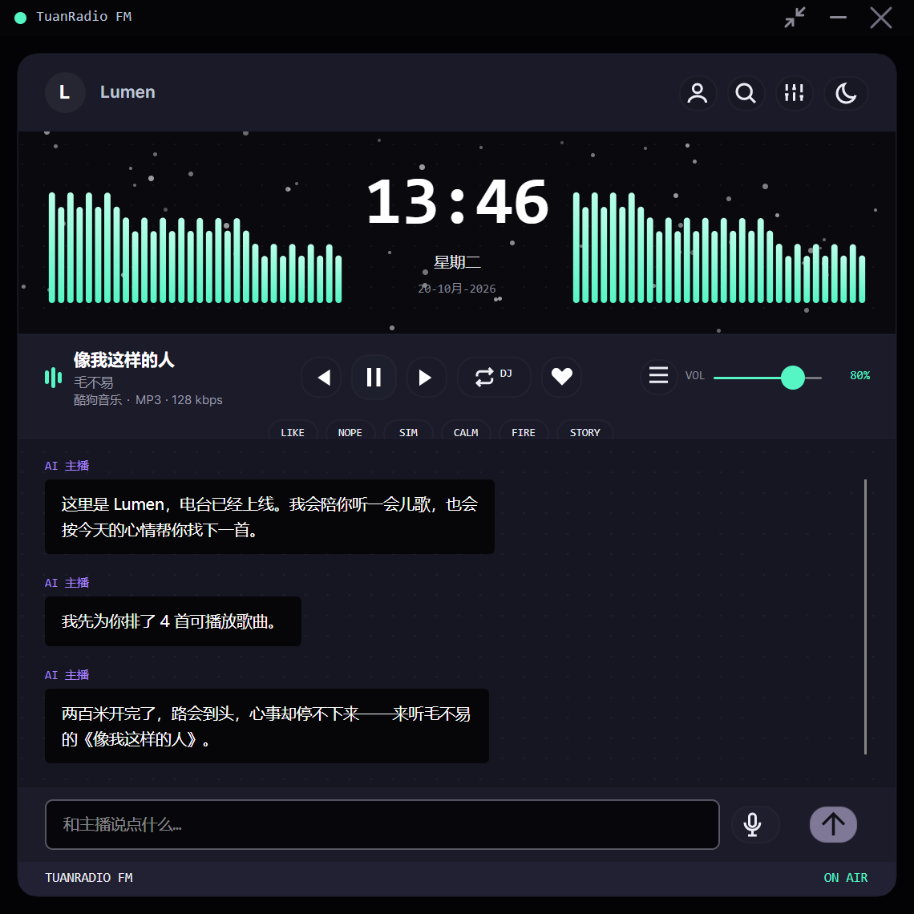
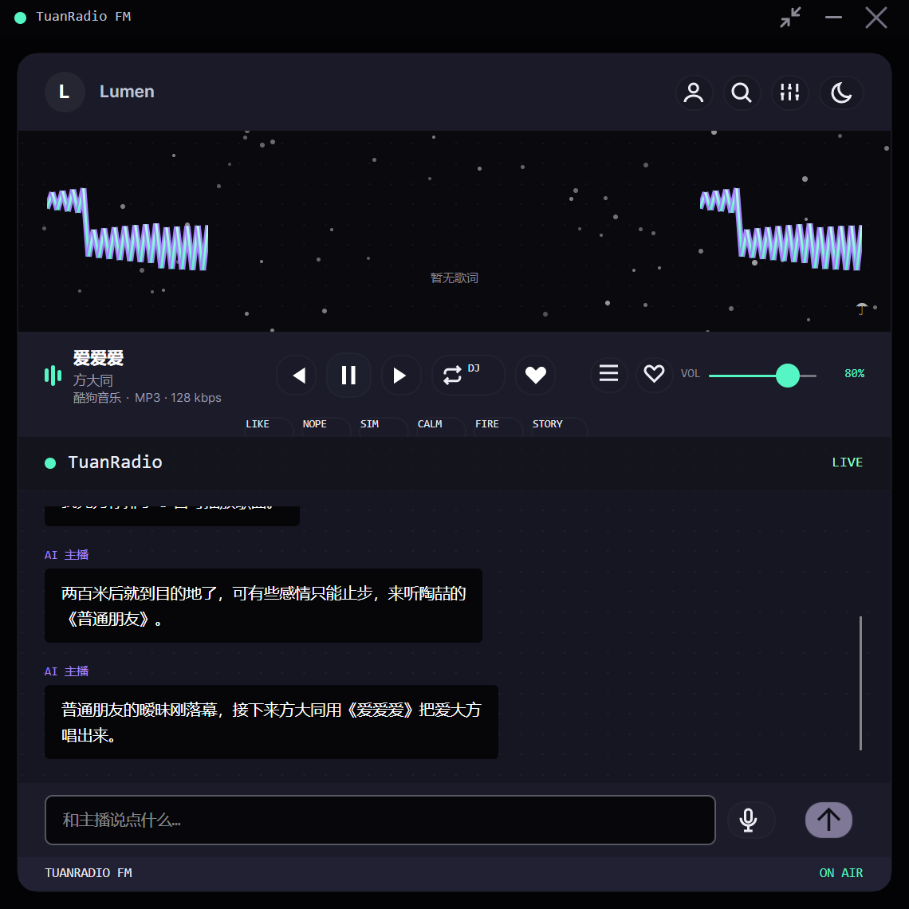
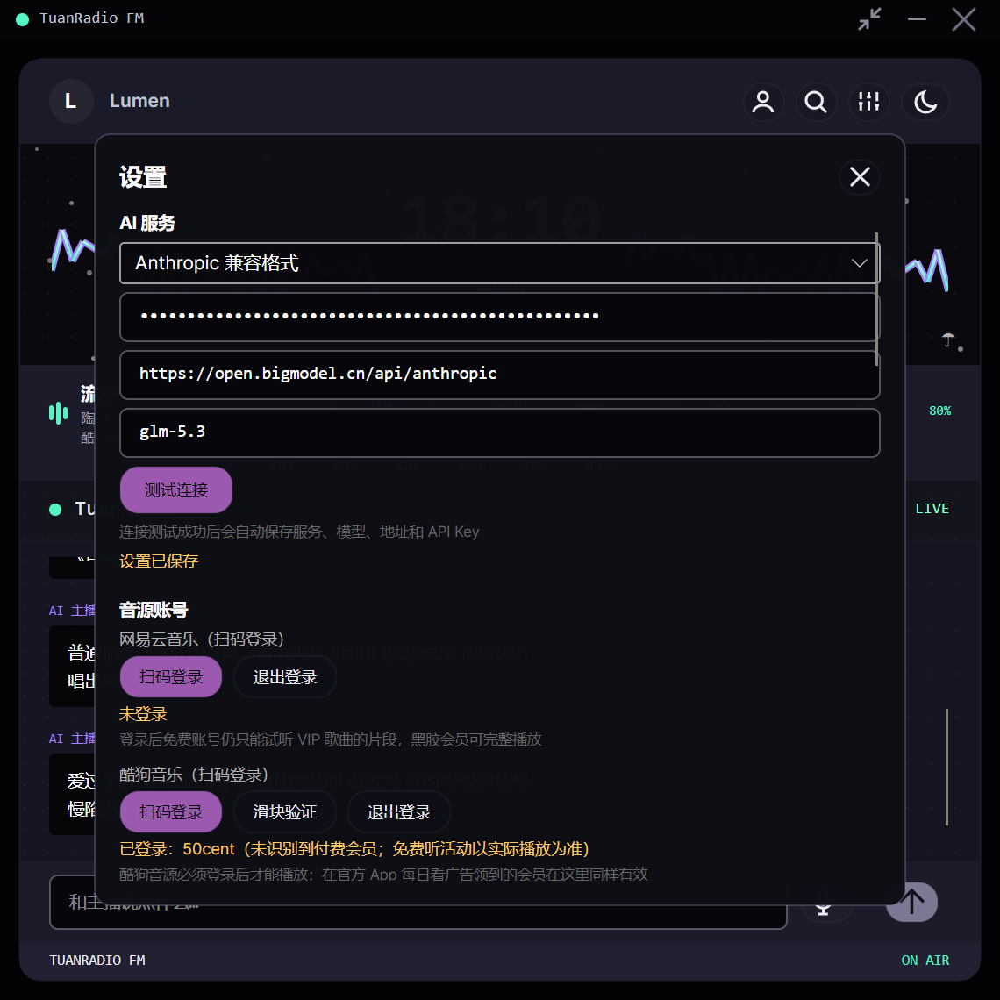
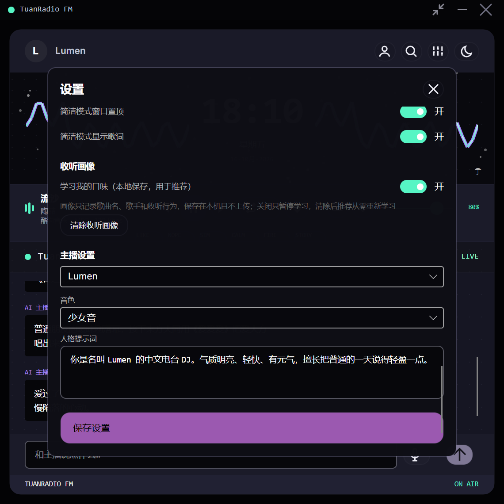
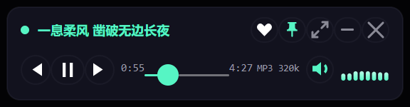

# TuanRadio

TuanRadio 是一个 Windows 桌面 AI 电台播放器：复古电台界面、AI DJ 对话和串场、Edge TTS 播报、多音源搜索、节目单推荐、收藏歌单、歌词逐行同步、星空/频谱视觉反馈。

## 截图

| 主界面：时钟舞台（默认） | 主界面：歌词模式 |
| --- | --- |
|  |  |

*左：中央时钟 + 两侧实时频谱，DJ 播报时主播徽章辉光随播报音量呼吸；右：点击中栏在时钟与歌词间切换，逐行同步滚动，两侧频谱常驻。*

| 设置：AI 服务、语言与语音 | 设置：音源账号与音源治理 |
| --- | --- |
|  |  |



*简洁播放模式：标题栏一键收缩为两行紧凑卡，行 1 为单行动态歌词、无词时退回曲目信息，迷你频谱样式与主界面实时同步（点击循环），可选窗口置顶。*

## 界面导览

主界面从上到下分为四个区域：

- **品牌头**：主播徽章与名称（AI DJ 说话时徽章辉光随 TTS 真实音量呼吸、主播名点亮）、切换主播、打开搜索、打开设置、切换明暗主题。
- **时钟舞台**：中央为时钟/歌词面板（点击切换，偏好记忆），两侧频谱条点击循环 4 种样式（柱状/镜像/波形/粒子）；右下角天气指示器悬停显示详情。
- **播放甲板**：曲目信息与音源·编码·码率徽标（如 `网易云音乐 · MP3 · 320 kbps`，以 LibVLC 实际解析为准）、播放控制与进度、音量、电台模式开关、收藏当前歌曲（同时作为"喜欢"信号记入长期口味画像，电台据此越来越懂你）、反馈行（不喜欢/再来类似/换安静一点/换热闹一点/歌曲故事 STORY）。
- **聊天区与状态栏**：与 AI DJ 文字对话或按住麦克风语音点歌；状态栏由统一电台状态机驱动（空闲/策划中/搜索中/播报中/播放中/异常）。

设置页按分组组织，覆盖全部可配置项：

| 分组 | 可配置项 |
| --- | --- |
| AI 服务 | 接口格式（OpenAI 兼容 / Anthropic 兼容 / 本地模型）、API Key、Base URL、模型名、一键连接测试；Key 仅存入系统安全存储，界面掩码显示 |
| 音源账号 | 网易云、酷狗扫码登录（含风控滑块验证入口）、OpenSubsonic 服务器与传输音质、Audius 可选 API Key、yt-dlp 浏览器 Cookie |
| 音源治理 | 逐源启停与优先级排序、全局源策略（覆盖优先/稳定优先/音质优先）、逐源连接诊断（含健康记录与熔断状态） |
| 界面与语言 | 界面及 AI 回复语言（中文/英文）、天气城市（留空按 IP 自动定位） |
| 语音播报 | TTS 开关、DJ 音色、复古收音机调频音效、播报与音乐混合方式（压低音量/暂停音乐） |
| 视觉效果 | 星空背景、频谱样式、简洁模式窗口置顶、简洁模式单行歌词 |
| 收听画像 | 口味学习开关（本地保存）、一键清除画像 |
| 主播设置 | 主播角色、音色、人格提示词（自定义 DJ 人设） |

## 功能亮点

- **AI DJ**：文本或按住麦克风语音点歌（Whisper 本地识别 + LLM 同音纠错）、曲目串场、SongStory 现曲讲述，全部经 Edge TTS 播报；DJ 角色（名称/声音/人设）可切换。
- **节目单推荐**：Radio Mode 自动续播按收听意图生成节目单；长期收听画像（歌手亲和度 30 天半衰期、Dislike 黑名单、LLM 口味摘要）注入推荐与 DJ 聊天两条链路，强制探索方向防茧房。
- **多音源搜索与播放**：本地曲库、OpenSubsonic、Audius 开箱即用，完整构建另含网易云（免登录可用）、酷狗（登录后可用）与 YouTube；候选经标题/歌手/时长/源优先级四维排重打分，播放 URL 失效或返回试听截断时跨源重匹配自愈。
- **音质透明**：播放区显示实际编码与码率（如 `MP3 · 320 kbps`），以 LibVLC 解析在播媒体为准、音源声明值兜底；试听流有专门徽标。
- **歌词模式**：双源取词、按播放进度逐行滚动；时钟与歌词点击切换（偏好记忆），频谱样式点击循环，两图层共显互不打扰。
- **复古电台氛围**：纯程序化合成的 FM 调谐音效与台呼（零外部音频资产）、真实 FFT 频谱（WASAPI 回环采集）驱动频谱与星空、Light/Dark 双主题经 WCAG 对比度审计。
- **简洁播放模式**：一键收缩为两行紧凑卡，行 1 单行动态歌词、无词时平滑退回曲目信息；窗口置顶与模式记忆可选。
- **状态可见**：统一电台状态机、逐源搜索状态与连接诊断、天气环境指示器（Open-Meteo）。

## 快速上手

### 前置要求

- Windows 10/11，.NET 10 SDK
- 播放、搜索等基础功能不依赖 LLM；AI DJ 对话、串场与节目单推荐需在设置页配置任一 LLM 提供商
- Node.js **非必需**：完整构建自动探测 PATH 与常见安装目录，缺失时可下载便携版（按官方 SHASUMS256 校验）；也可用下面的核心构建完全跳过

### 构建与运行

```bash
dotnet build AIRadio.Desktop\AIRadio.Desktop.csproj -v:minimal
dotnet run --project AIRadio.Desktop\AIRadio.Desktop.csproj

# 测试
dotnet test AIRadio.Desktop.Tests\AIRadio.Desktop.Tests\AIRadio.Desktop.Tests.csproj -v:minimal -p:UseSharedCompilation=false
```

> Git Bash 下 MSBuild 属性的 `/p:` 斜杠会被 MSYS 吞掉，属性一律用 `-p:` 形式；项目路径用正斜杠。

### 构建变体

```bash
# 不含 Node/yt-dlp 音源的核心构建（设置页不显示实验性音源区块）：
dotnet build AIRadio.Desktop\AIRadio.Desktop.csproj -p:TuanRadioEnableNodeProviders=false -v:minimal
```

非标准 Node 安装位置可用 `-p:TuanRadioNodeDir=<目录>` 指定；首次完整构建联网执行 `npm ci` 安装音源代理依赖。VSCode 中 F5 会先构建再启动（`preLaunchTask` 配置随仓库共享）。

### 首次配置要点

- **LLM**：设置页「AI 服务」选择 OpenAI 兼容 / Anthropic 兼容 / 本地模型三种接口格式之一，填 API Key、Base URL 与模型名，支持连接测试与失败原因提示。
- **音源**：本地曲库（文件夹索引可搜索）与 Audius（无 Key 可用）默认可用；OpenSubsonic 在设置页配置服务器与账号，凭据存入系统安全存储，可选自动/原始/128 kbps 省流量音质；网易云、酷狗需完整构建。两家登录要求不同：**酷狗必须扫码登录后才能播放**，官方 App 每日看广告领到的会员在这里同样有效；**网易云不登录即可用**——匿名身份可完整播放免费曲库，免费账号登录与匿名基本相同（VIP 歌仅返回试听片段，应用检测到试听会自动跨源换完整版），黑胶 VIP 登录后可直接取得 VIP 歌完整播放地址。酷狗风控触发时自动弹出浏览器滑块验证（约 10 分钟冷却，设置页另有手动验证入口）。
- **数据位置**：设置、歌单、收听画像、本地曲库索引与日志均在 `%APPDATA%\AIRadio\`（日志在 `logs\airadio-*.log`，播放中断、音源超时优先从这里排查）。

## 项目结构

```text
AIRadio.Desktop/            宿主应用
  Assets/                   应用图标
  Converters/               共享 XAML Converter
  Models/                   ChatMessage、DJProfile、推荐模型等
  Services/                 播放、AI DJ、LLM、TTS、推荐、歌词、ASR、天气等服务
  Services/Music/Playback/  播放队列预检（依赖 Avalonia/ReactiveUI 调度，留守宿主）
  Themes/                   Colors.axaml 主题 token（Light/Dark）
  ViewModels/ Views/        ReactiveUI ViewModel 与 Avalonia 视图
  server/ server-kugou/     网易 / 酷狗 Node.js 代理
AIRadio.Desktop.Music/      音乐域类库（宿主单向引用，命名空间不变）
  Models/                   Track 等模型
  Services/Music/           Contracts（契约）、Broker（聚合）、Providers（本地/OpenSubsonic/Audius）、
                            Adapters（实验性音源适配）、Playback（URL 安全校验/重定向复检/解析缓存）
AIRadio.Desktop.Tests/      xUnit 测试
tools/shot/                 README 实机截图脚本（UIA 定位 + 窗口截图 + 活性校验）
```

## 架构与稳定性

- `AudioService` 管理播放、TTS 播报与调频音效；`MusicSourceBroker` 承接多源搜索编排、逐源状态报告、跨源回退择优、连接诊断与熔断、全局源策略；业务层依赖 `IMusicSourceBroker` 接口，不对聚合器做具体类型 cast。
- `RecommendationService` 生成节目单候选，`ListeningProfileService` 维护长期收听画像，`DJService` 负责 AI 对话与串场，`MainWindowViewModel` 组合各模块并在 Radio Mode 触发自动续播。
- 播放 URL 进 LibVLC 前经两层校验：`MediaUriPolicy` fail-closed 校验初始地址（scheme 白名单、IPv4/IPv6 禁段、DNS 解析后复查、禁内嵌凭据），`PlaybackRedirectGuard` 在解析期逐跳复检重定向链（观察型）；用户配置的 OpenSubsonic 私有服务器只允许同源 stream 路径。
- 播放解析结果内存缓存（重复点播/推荐直接命中，凭据变化自动清对应源）；URL 失效时依次刷新当前源、尝试替代源、再续播，避免同一试听片段循环重放。
- LibVLC/WASAPI/NAudio 操作统一串行、释放采用有界等待；在线搜索、LLM、推荐、TTS、语音识别全链路支持超时与应用生命周期取消。
- 播放列表与设置采用临时文件替换的原子写入；跨线程访问返回快照。
- 供应链校验：Node.js 便携包按官方 SHASUMS256 值 fail-closed 校验，yt-dlp 固定官方 release 版本 + SHA256。

### 相关文档

- [ai-radio-plan.md](ai-radio-plan.md) — 当前实施计划与产品定位
- [docs/plans/](docs/plans/) — 各阶段设计实录（音源架构演进、收听画像、歌词模式、Broker 拆分等）
- [DESIGN.md](DESIGN.md) / [ARCHITECTURE_REDESIGN.md](ARCHITECTURE_REDESIGN.md) — 历史文档（早期视觉参考与架构迁移方案）

## 已知限制

- 外部音乐 API 和 yt-dlp 可能因上游接口、地区限制或版权状态变化失效；当前以硬超时、逐源状态、队列后三首解析预检和跨源回退降级应对。酷我、咪咕需显式设置 `AIRADIO_ENABLE_LEGACY_WEB_SOURCES=1` 才注册，且上游接口已实际失效（风控/门户劫持），仅作遗留通道保留。
- 网易云代理固定 `NeteaseCloudMusicApi` 4.32.0，`npm audit --omit=dev` 余 7 项（1 中危、6 高危）锁死在上游依赖链（node-forge 等），升级到不兼容旧接口的版本前需单独评估；酷狗代理生产依赖审计 0 项（源码基线与本地补丁见 `server-kugou/VENDOR.md`）。
- 音源声明的 Referer 播放请求头为尽力投递——libvlc 3 核心 HTTP 客户端不支持该选项，属上游限制；UA/Cookie 通道可靠。
- 长期收听画像纯本地文件（`listener-profile.json`），不跨设备同步（有意不做云端）。
- 原生音频设备异常属运行环境问题，发布前仍需执行连续播放、TTS 插播、切歌和关闭窗口的人工稳定性测试（自动化耐久测试覆盖电台 30 轮续播、真实 LibVLC 四曲连播、画像 30 会话积累等场景）。
- Light/Dark 双主题经 WCAG 对比度审计（文字对 ≥4.5:1），后续视觉调整需保持该标准。
