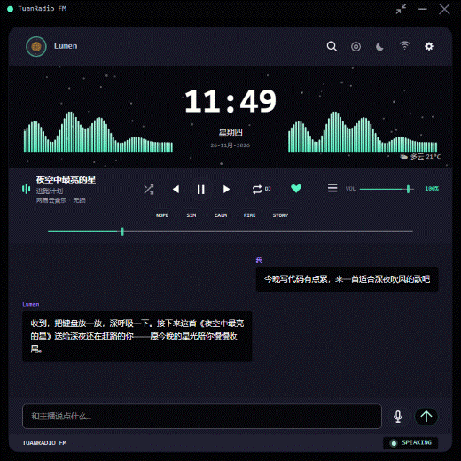
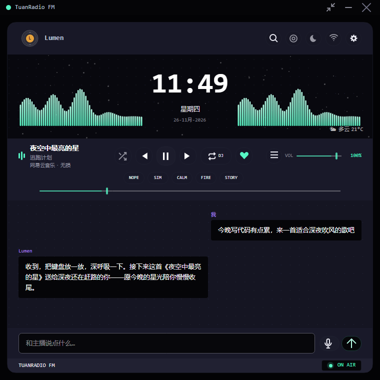
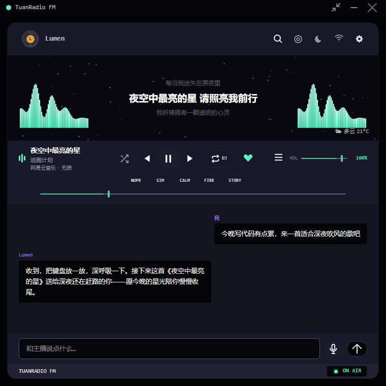
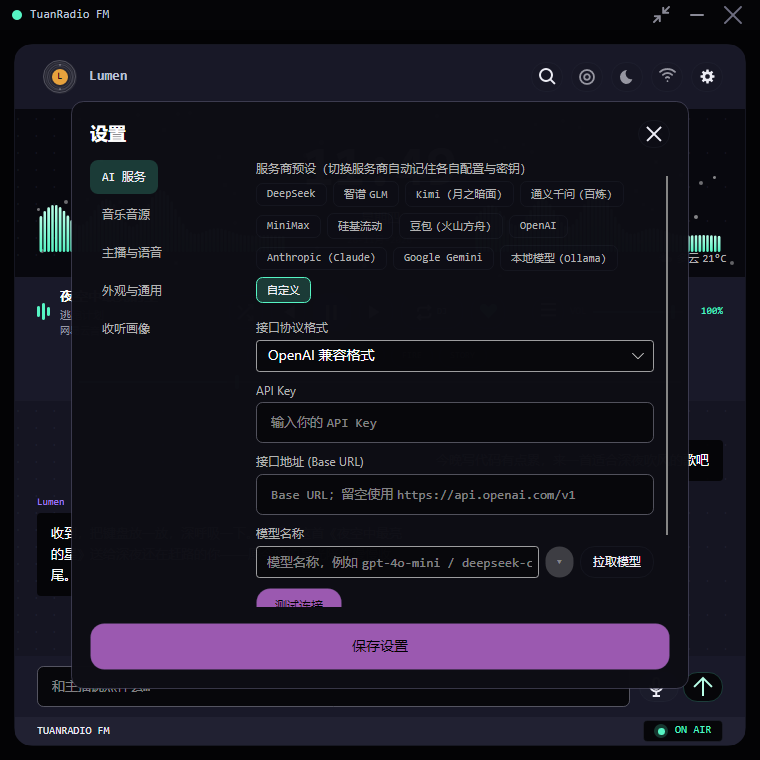
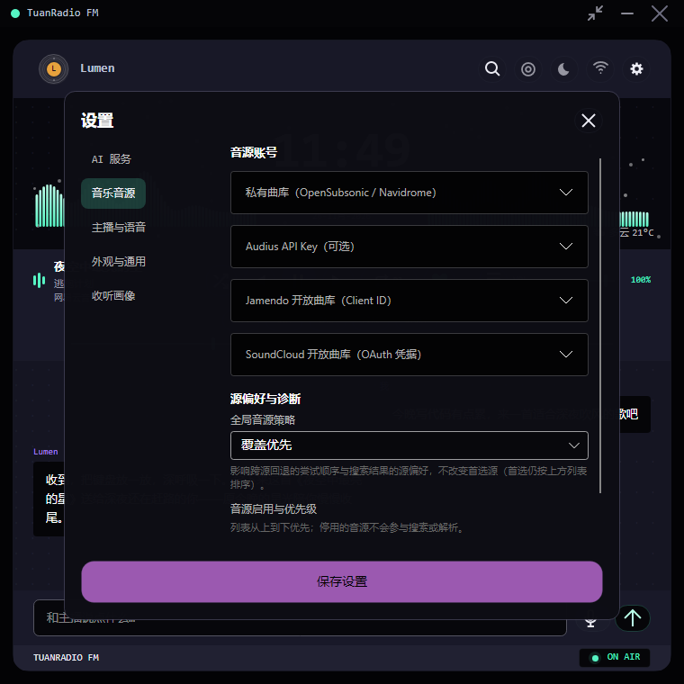
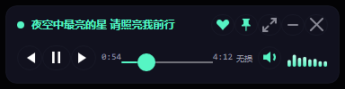

<div align="center">


# TuanRadio

**A retro radio experience powered by AI DJs.**  
*由 AI DJ 驱动的复古桌面电台体验。*

[](https://github.com/chenlianwd/TuanRadio/releases)
[](https://github.com/chenlianwd/TuanRadio/releases)
[](https://dotnet.microsoft.com/)
[](LICENSE)

[English](README.md) | **简体中文**

</div>

---

TuanRadio 是一个基于 **.NET 10** 与 **Avalonia** 构建的 Windows 桌面 AI 电台播放器：复古电台界面、AI DJ 对话与串场、Edge TTS 零成本播报、离线 Whisper 语音点歌、多音源搜索自愈、全球网络电台与播客订阅（含 OPML 迁移与 AI 一分钟速读）、局域网 Web 手机遥控器、节目单智能推荐、长期收听画像、逐行同步歌词、真实硬件回环频谱以及无感知应用内自动更新。

<div align="center">
  
  <br />
  <sub><em>实机运行效果：实时硬件回环频谱律动、时钟 ↔ 逐行同步歌词无缝切换、AI DJ 拟人点歌对话。</em></sub>
</div>

---

## 快速开始

### 方式一：普通用户 1 分钟开箱（推荐）

无需本地编译，也**无需先配置 AI Key** 即可立即听歌（本地曲库、Audius 开放曲库、全球网络电台与精选播客开箱即用）：

1. 前往 **[GitHub Releases](https://github.com/chenlianwd/TuanRadio/releases)** 下载最新版本：
   - **一键安装版（推荐）**：下载 `TuanRadio-win-Setup.exe` 双击安装（无需管理员权限、自带 .NET 运行时、自动创建桌面快捷方式，支持在「设置 → 外观与通用 → 版本与更新」中一键静默差分升级）。
   - **绿色免安装版**：下载 `TuanRadio-v*-win-x64.zip`，解压到任意目录，直接运行 `AIRadio.exe`。
2. 打开即可收听；如需体验 AI DJ 串场、歌曲故事与智能点歌，进入 **「设置 → AI 服务」** 一键选择 DeepSeek / 智谱 GLM / Kimi / 通义千问 / 硅基流动 / 本地 Ollama 等预置并填入 API Key 即可。

> **运行环境与系统说明**
> - **最低系统要求**：Windows 10 2004（内部版本 19041）及以上，x64。
> - **SmartScreen 提示**：应用未购买商用数字签名，首次运行如遇「Windows 已保护你的电脑」，点击「更多信息」→「仍要运行」。
> - **按需下载说明**：「按住说话」语音识别首次使用时自动下载离线 Whisper 模型（约 140MB，可手动放置 `ggml-base.bin` 至 `%LOCALAPPDATA%\AIRadio\models\ggml-base.bin`）；官方发布包已内置经 SHA256 校验的 Node.js 运行时（`runtime/node/node.exe`），网易/酷狗代理开箱即用。

### 方式二：开发者 3 分钟源码运行

**前置要求**：Windows 10/11 (x64)、[.NET 10 SDK](https://dotnet.microsoft.com/download/dotnet/10.0)。（Node.js **非必需**，可用下方纯净核心命令完全跳过 Node 代理构建。）

```bash
# 1. 克隆仓库
git clone https://github.com/chenlianwd/TuanRadio.git
cd TuanRadio

# 2. 完整构建并运行（自动探测本机 Node.js）
dotnet run --project AIRadio.Desktop/AIRadio.Desktop.csproj

# 或构建不含 Node / 实验性流媒体代理的轻量纯净核心版本：
dotnet build AIRadio.Desktop/AIRadio.Desktop.csproj -p:TuanRadioEnableNodeProviders=false -v:minimal

# 3. 运行自动化测试套件（1470+ xUnit 与 Avalonia Headless 测试）
dotnet test AIRadio.Desktop.Tests/AIRadio.Desktop.Tests/AIRadio.Desktop.Tests.csproj -v:minimal -p:UseSharedCompilation=false
```

> **提示**：Git Bash 下 MSBuild 属性请统一使用 `-p:` 形式（`/p:` 会被 MSYS 转换）；非标准 Node 安装路径可通过 `-p:TuanRadioNodeDir=<目录>` 指定。VSCode 中按 `F5` 可自动构建并启动。

---

## 产品截图

| 主界面：时钟舞台（默认） | 主界面：逐行同步歌词模式 |
| :---: | :---: |
|  |  |

*左：中央大字号复古时钟 + 两侧真实硬件回环频谱 + 右下角实时天气 + AI DJ 互动对话，播报时主播徽章辉光随真实音量呼吸；右：点击中栏无缝在时钟与逐行同步歌词间切换（自动记忆偏好），两侧动态频谱常驻。*

| 设置：AI 服务与快捷预置 | 设置：音乐音源与治理 |
| :---: | :---: |
|  |  |

<div align="center">
  
  <br />
  <sub><em>简洁播放模式（Compact Mode）：标题栏一键收缩为两行紧凑卡，实时滚动单行动态歌词（无词时退回曲目信息），迷你频谱与无损徽标实时同步，支持窗口置顶。</em></sub>
</div>

---

## 功能亮点

- 🎙️ **AI DJ 双模交互**：文字畅聊或按住麦克风离线语音点歌（Whisper 本地识别 + LLM 同音纠错）；自动曲目串场与 `STORY` 现曲讲述，全部经 Edge TTS 高质量多音色播报（完全免费，零 API 账单）；主播角色（名称/声音/人设）可自由定制。
- 📻 **复古电台视听美学与专注/伴眠场景**：纯数学算法程序化合成调频静电杂音与台呼（零外部音频体积）、WASAPI 回环硬件采集 1024 点真实 FFT 频谱（点击循环切换柱状/镜像/波形/粒子）、时钟/歌词双模切换、简洁迷你卡与系统托盘、**专注伴学模式**（偏向纯音乐、曲间静默免打扰）以及**睡眠定时渐弱淡出与深夜伴眠柔声模式**。
- 🌍 **全球网络电台与自定义流导入**：集成全球开源网络电台与 8 大离线精选流派保底库，支持单流 URL 手动录入（含 ICY 流可用性探测与局域网自建电台直连）及 M3U / M3U8 / PLS 批量列表导入与收藏隔离。
- 🎧 **播客 RSS / OPML 订阅与 AI 一分钟速读**：曲库抽屉内置精选公开播客与自定义 RSS / Atom 订阅，支持标准 OPML 文件批量导入导出、长音频断点续播持久化以及专属 **0.75x–2.0x 倍速播放与 -15s / +30s 快捷跳转**；每期提供独立「AI 速读」按钮由 AI DJ 基于 Shownotes 语音导听，无文字简介时自动安全截取开头音频经内置 Whisper 转写后再提炼导听。
- 📱 **局域网 Web 遥控器（Web Remote）**：零第三方依赖内嵌 HTTP/WebSocket 局域网服务与令牌鉴权，同一 Wi-Fi 下手机扫码直连离线 SPA 遥控台；支持播控、音量、进度拖拽、播客倍速与快退快进、专注/睡眠模式切换、实时滚动点击跳转歌词、AI DJ 点歌对话，以及按需浏览点播节目单、歌单、收藏夹、网络电台与播客单集。
- 🧠 **长期口味画像与防茧房推荐**：Radio Mode 自动续播按收听意图生成会话节目单；本地 30 天半衰期长期收听画像（歌手亲和度、语种配比、分时段偏好、Dislike 黑名单、LLM 口味摘要与性格印象）同时注入推荐与 DJ 对话双链路，并主动引入探索方向防止茧房。
- 🔀 **高可用多音源自愈中枢（Broker）**：本地曲库、OpenSubsonic 私有云、Audius 开放曲库开箱即用，配置开发者凭据后可接入 Jamendo CC 与 SoundCloud 开放曲库，完整构建另含网易云、酷狗与 YouTube；播放队列前瞻 3 首预检解析，URL 失效或遇试听截断时自动跨源重搜自愈。
- 💎 **真声音质透明呈现**：实时展示音质品级（标准 / 高清 / 无损 / 试听），悬停 ToolTip 可见以 LibVLC 底层解码为准的真实编码（MP3/FLAC/AAC）、码率、采样率与声道。
- 🎨 **无障碍与多调色板**：跟随系统 / 浅色 / 深色三态主题 × 四套调色板（薄荷绿 / 暖琥珀 / 蒸汽波紫 / 冰蓝），全量通过 WCAG 2.1 自动化对比度门禁测试。
- 🚀 **现代自动更新与系统整合**：安装版内置 Velopack 差分升级；完整支持耳机/键盘媒体键、Windows SMTC 锁屏封面与进度联动及最小化到托盘。

---

## 界面与设置导览

### 主界面四大区域

- **品牌头（Brand Header）**：黑胶唱片主播徽章（播报时辉光随 TTS 音量呼吸，点击切换主播）、功能按钮簇（多源搜索、专注模式、睡眠定时、局域网 Web 遥控器、设置）以及一键收缩至简洁播放模式按钮。
- **时钟舞台（Clock Stage & Lyrics）**：中央复古大字时钟与逐行同步滚动歌词轻点切换，两侧 1024 点真实 FFT 动态频谱（点击切换 4 种样式），右下角常驻 Open-Meteo 实时天气指示器。
- **播放甲板（Player Deck）**：曲目信息与真声音质徽标、播控与红心收藏、曲库/电台/播客抽屉入口、复古调谐针音量滑条、即时反馈行（`NOPE` / `SIM` / `CALM` / `FIRE` / `STORY`；播客模式下自动切换为倍速与 `-15s / +30s` 控制条）与无缝发丝线进度轨道。
- **聊天交互区与状态栏（Chat & Status Bar）**：文字聊天与按住麦克风离线语音点歌，底部统一状态机指示灯（`ON AIR` / `CURATING` / `SEARCHING` / `SPEAKING` / `ERROR`）。

### 设置页 5 大分组

| 分组 | 核心配置内容 |
| :--- | :--- |
| **AI 服务** | 一键快捷预置（DeepSeek / 智谱 GLM / Kimi / 通义千问 / 硅基流动 / OpenAI / Anthropic / Gemini / 本地 Ollama）、三格式协议切换、API Key 系统安全存储、一键连接测试与错误诊断 |
| **音乐音源** | 网易云/酷狗扫码登录与 yt-dlp Cookie（完整构建）、OpenSubsonic / Audius / Jamendo / SoundCloud 配置、本地曲库文件夹索引、逐源启停/排序、全局源策略与逐源健康/权益/风控/版本诊断 |
| **主播与语音** | 主播角色切换、Edge TTS 音色与自定义人设提示词、播报总开关、程序化 FM 调频杂音/台呼开关、播报混音方式（压低音乐 / 暂停音乐） |
| **外观与通用** | 中英文界面与 AI 回复语言、天气城市搜索/自动定位、三态主题 × 四套调色板、星空与频谱样式、简洁模式置顶与单行歌词、关闭动作与局域网 Web 遥控器、应用内版本检查与胶囊进度更新 |
| **收听画像** | 纯本地口味学习开关、LLM 口味摘要与性格印象生成、语种配比与时段偏好、喜爱/避开歌手排行、Dislike 黑名单逐项解封与一键清除 |

> **数据与日志位置**：用户设置、本地歌单、收听画像、本地曲库索引与运行日志均保存在 `%APPDATA%\AIRadio\`（播放排查优先查看 `logs\airadio-*.log`）。

---

## 项目结构

```text
AIRadio.Desktop/            宿主应用（Avalonia 11.3.9 + ReactiveUI + Velopack）
  Assets/                   应用图标与矢量资源
  Converters/               共享 XAML Converter
  Models/                   RadioState、VoiceOption 等桌面数据模型
  Services/                 播放中枢 (AudioService)、AI DJ、LLM、Edge TTS、歌词、Whisper ASR、播客转写、天气、睡眠定时、专注/伴眠场景、局域网 Web 遥控器 (WebRemote/)、系统托盘与 SMTC 等
  Services/Music/Playback/  播放队列预检与调度
  Themes/                   Colors.axaml 主题 token + Palettes/ 四套调色板叠加层
  ViewModels/ Views/        ReactiveUI ViewModel 与 Avalonia 视图（主界面/设置/简洁模式/曲库抽屉/独立搜索浮层）
  server/ server-kugou/     网易 / 酷狗 Node.js 代理进程与补丁基线（精简核心构建不打包）
AIRadio.Desktop.Music/      音乐领域独立类库（宿主单向引用）
  Models/                   Track、RadioStation、PodcastFeed、PodcastEpisode、RadioSceneMode 等核心实体
  Services/Music/           Contracts、Broker（中枢聚合、策略编排与解析缓存）、
                            Providers（本地/OpenSubsonic/Audius/Jamendo/SoundCloud、Radio/ 网络电台、Podcast/ RSS 与 OPML）、
                            Adapters、Playback（MediaUriPolicy 安全白名单与重定向复检）
AIRadio.Desktop.Tests/      xUnit 自动化测试套件（1470+ 测试用例）
tools/                      publish.ps1 自动化出包流水线、品牌图标导出与截图工具
```

---

## 架构与稳定性

- **服务解耦与中枢模式**：`AudioService` 集中管理 LibVLC 播放状态、TTS 语音插播与调频音效；`MusicSourceBroker` 承接多音源搜索编排、逐源熔断、跨源回退择优与连接诊断。
- **播放安全纵深防御**：外部媒体 URL 进 LibVLC 前经 `MediaUriPolicy`（fail-closed scheme 白名单、私网禁段、DNS 复查、禁内嵌凭据）与 `PlaybackRedirectGuard`（逐跳重定向复检）双重把关。
- **持久化原子性**：本地歌单、应用设置、播客进度与收听画像均采用临时文件落盘再替换的原子写入机制，跨线程读取返回不可变快照。

---

## 已知限制

- 外部流媒体音乐 API 可能因上游风控、地区限制或版权状态变动失效；应用通过硬超时、逐源健康度监控、队列前瞻 3 首预检和跨源自动自愈降级应对。
- 音源声明的 `Referer` 播放请求头为尽力投递——LibVLC 3 原生核心 HTTP 客户端不支持动态设置该请求头，属上游限制；`User-Agent` 与 `Cookie` 通道完全可靠。
- 长期收听画像严格保存在本地文件（`listener-profile.json`），有意不做云端收集与跨设备同步以保护隐私。

---

## 许可证

本项目以 **GPL-3.0-only** 许可证发布（见 [LICENSE](LICENSE)），Copyright (C) 2026 chenlianwd。  
随包分发的第三方开源组件许可声明与版权见 [THIRD-PARTY-NOTICES.md](THIRD-PARTY-NOTICES.md)。
