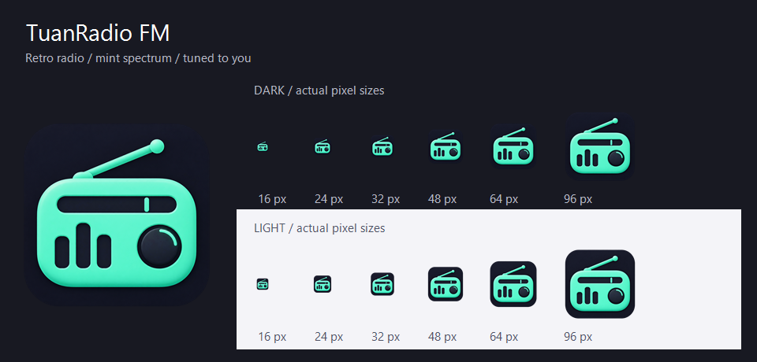

# TuanRadio FM 应用图标

设计日期：2026-10-23。使用内置 imagegen 生成，保留透明圆角外缘。

## 设计含义

- 收音机与天线：个人 FM 电台，直接传达产品用途。
- 三根频谱条：音乐与主舞台频谱，呼应应用内的真实音频反馈。
- 调频槽与旋钮：按用户口味调台，对应 AI DJ 与个性化推荐。
- 薄荷绿与深色底：沿用应用的强调色与暗色视觉，适量立体层次提高图形分辨。

图形不含文字，放大主体并减少细节，适配 Windows 任务栏。exe 通过 ApplicationIcon 使用图标，MainWindow 显式指定同一资源，使窗口和外壳保持一致。

## 交付与重新导出

- 源图：`AIRadio.Desktop/Assets/airadio.png`。
- Windows 图标：`AIRadio.Desktop/Assets/airadio.ico`，包含 16、20、24、32、40、48、64、96、128、256 像素的透明 PNG 帧。
- 深浅背景与实际尺寸预览：`docs/branding/app-icon-preview.png`。
- 在项目根目录运行 `./tools/branding/Export-AppIcon.ps1`，从源图重新导出 ICO 与预览；仅重采样和封装，不重新绘制设计。



## 最终生成提示词

```text
Use case: logo-brand
Asset type: final Windows desktop application icon, a single square 1024x1024 image, NOT a presentation board or a mockup.
Primary request: Design the new app icon for TuanRadio FM, a personal AI radio player with a retro FM atmosphere, conversational DJ, music and a spectrum display. The icon should instantly read as a little radio and feel like the app's own mint-green controls.
Design: a bold, highly simplified front-facing retro portable radio. A generous compact rounded horizontal radio body, a single short diagonal antenna rising above the body. The face has one simple horizontal tuning slot across its top and three bold vertical equalizer speaker bars of different heights in its lower-left area, with one solid round tuning knob at lower right. Keep the face layout intentional and spare; no tiny grille perforations, no tick marks or decorative microdetails. The antenna and overall silhouette must remain recognizable at 24px. Aim for a strong memorable silhouette, wide chunky forms, rounded ends and consistent visual weight. There must be just one radio.
Color palette: deep midnight charcoal #131320 for the app tile, luminous but controlled mint #56F5C4 for the main radio body, very dark #131320 negative-space face details. Subtle restrained mint highlight and gentle tonal depth only, predominantly crisp flat vector-like forms. Avoid glossy plastic, neon bloom, excessive glow and multicolor gradients.
Composition: one centered icon tile, rounded square with radius about 22% of the tile width. Tile nearly fills the canvas with about 3% transparent outer margin. Radio body plus antenna occupies roughly 76-80% of tile width and is optically centered as one composition, large enough for Windows taskbar use; avoid large empty margins. The square tile is flat front-on, not perspective. Transparent outside the rounded square, opaque dark inside.
Meaning: a radio tuned to you, with the equalizer quietly suggesting the musical and AI-driven experience. Welcoming, calm, precise and contemporary, with a retro radio identity.
Text: none. No letters, no wordmark, no FM text.
Avoid: abstract rings, orbit symbols, waveform wreaths, chatbot bubbles, robot heads, sparkles, stars, music notes, play triangles, headphones, photorealistic render, external drop shadows, checkerboard transparency simulation, backgrounds outside the tile, captions, sample sizes, multiple options, watermark.
Deliver one polished production app icon only.
```
