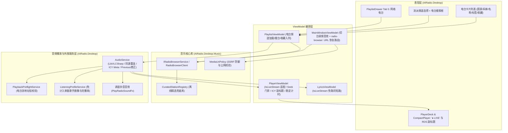

# 全球网络电台接入与流媒体波段调谐架构设计（P1）

日期：2026-11-09  
状态：已完成三轮深度对抗性自审修订 / 终版定稿待确认实施  
关联规划：[`AI电台竞品差距与迭代建议.md`](../../AI电台竞品差距与迭代建议.md) 第四章 P1 核心任务（内容护城河）

---

## 1. 背景、价值与设计原则

### 1.1 背景与用户痛点
1. **版权猫鼠游戏与 URL 失效痛点**：
   - 现有多源聚合播放器（如网易、酷狗、酷我等）主要依赖逆向网页接口或第三方代理，不可避免地受到上游风控封禁、VIP 会员权限限制、海外地区版权锁（Geo-blocking）以及音源直链时效性（15~30 分钟过期）的困扰。
   - 即使 TuanRadio 已经具备完善的跨源智能重试与自动自愈机制，在面对极端版权管控时，部分曲目依然可能出现全源不可播的情况。
2. **复古电台定位的天然契合（DNA 级共鸣）**：
   - TuanRadio 定位为“Windows 桌面复古 AI 电台”，拥有拟物化调频指针、时钟舞台、调谐杂音、1024 点真实音频频谱与 AI DJ 伴播。
   - 在传统的调频广播体验中，用户最享受的是“拧开旋钮、波段扫描、未知奇遇、伴随式聆听”的氛围。
   - **全球网络电台（Internet Radio Streams）**由世界各地的公共广播电台、独立广播机构、社区流媒体及音乐爱好者运营（采用 Icecast/Shoutcast/HLS 协议）。其流地址**长期有效、24 小时不断流、零版权纠纷、即点即播**，是构建 TuanRadio 永恒声音护城河的关键拼图。

### 1.2 核心目标
- **接入全球最大的开源广播数据库（Radio-Browser API）**：
  - 基于社区驱动且完全开放的 `radio-browser.info` 开放 API，免 API Key、免用户注册，直接访问全球活跃广播电台。
- **高可用与多镜像集群容灾机制**：
  - 设计具备故障感知与自动轮转的镜像客户端（`de1.api.radio-browser.info`、`nl1.api.radio-browser.info`、`at1.api.radio-browser.info`），并内置精选离线兜底电台库（Curated Stations），杜绝因单点 DNS 故障或服务端波动导致的空白页面。
- **拟物化波段调谐与分类漫游体验**：
  - 在侧边抽屉面板新增专门的「网络电台（Radio）」页签（Tab 5），提供直观的流派分类选择（Lo-Fi 慢调、午夜爵士、古典雅乐、赛博电音、公共资讯、环球流行、华语电台、热门精选）及关键词搜台，点按切台伴随收音机调谐杂音。
- **全链路直播流（Live Stream）播放适配与全子系统边界隔离**：
  - 复用 LibVLC 对 Icecast/Shoutcast 流媒体的原生支持（`:network-caching=5000` 与 `:http-reconnect`）；
  - **直播流全链路防护**：识别 `Track.IsLiveStream`，跳过 `media.Parse(ParseNetwork)` 二次连接探测、将直播流意外 `EndReached` 纳入同源自动重连、跳过跨源歌曲回退、**解除 `Previous()` 误入 Seek 的按钮失灵锁**、在 `PlaybackPreflightService` / `LyricsViewModel` / `ListeningProfileService` 中做针对性短路保护；
  - `PlayerDeck`、`CompactPlayer` 与 `PlayerViewModel` 智能适配直播流，时间轴展示 **`"● LIVE"` / `"● 直播"`** 标识与可靠累计收听时长（规避 LibVLC `_player.Time == -1` 缺陷）；
  - 尽力而为采集 LibVLC `Media.MetaChanged` 派发的 ICY 实时曲目元数据（`NowPlaying`），在展示层动态呈现正在播出的节目/曲目信息，且**绝不污染底层 `Track` 持久化标题**。
- **与收藏/歌单及 AI DJ 无缝融合**：
  - 支持一键收藏或加入主歌单（安全落盘至既有 `playlist.json` v3 结构，重启后由 `MainWindowViewModel.ResolveTrackUrlAsync` 拦截恢复，经 `MediaUriPolicy` 公网校验后播放）；
  - AI DJ 感知直播电台流，生成契合广播调频语境的伴播台呼。

### 1.3 非目标（本期边界）
- **不将网络电台混入 `MusicSourceBroker` 常规单曲搜索与推荐池**（见 §2.2 自审架构决策）。
- 不自建任何流媒体转发或转码服务器（客户端直连上游流媒体，零服务器成本）。
- 不引入 TuneIn 等收费或需商业授权的闭源 API。
- 不改变 `playlist.json` 的磁盘持久化版本（保持 `PlaylistData.CurrentVersion = 3`）。

---

## 2. 架构设计与三轮自审关键防坑决策

### 2.1 整体分层架构



### 2.2 三轮自审关键架构防坑清单（Codebase Alignment）

1. **[第 1 轮] 网络电台独立为 `IRadioBrowserService`，不挂入 `MusicSourceBroker._providers`**：
   - **防推荐死锁**：若混入单曲 Broker，`RecommendationService` 生成单曲节目单时若搜中 24/7 直播流，因流永不自然结束会导致自动续播停摆；
   - **防回退互串**：单曲播放失败 `TryAlternativeSource` 会搜到广播电台并原位改写 Track；电台断流时则会去网易/酷狗搜同名流行歌覆盖收藏的电台；
   - **防诊断失真**：`Broker.DiagnoseAsync` 硬编码 `"周杰伦"` 探测，电台源必报 0 条失败。
2. **[第 1 轮] 直播流跳过 `AudioService.CollectTrackMediaInfoAsync` 的 `ParseNetwork`**：
   - LibVLC 对在线 URL 执行 `media.Parse(ParseNetwork, 8000)` 会向同一流地址发起**第二条并发 HTTP GET 连接**。对无限长的 Icecast/Shoutcast 直播流，不仅卡满 8s 超时，还会触发服务器单 IP 连接数限制导致主连接被踢断。音质徽标直接消费元数据自带的 `DeclaredCodec` 与 `DeclaredBitrateKbps`。
3. **[第 2 轮] `AudioService.LooksLikeEarlyEnd` 将直播流 `EndReached` 判定为非预期断流并重连**：
   - 原代码 `if (track.Duration.TotalMilliseconds < 90_000) return false;` 会把 `Duration == 0` 的直播流断线误判为“单曲正常播完”而切歌。修正后识别 `track.IsLiveStream` 直接进入同源重连（`RefreshCurrentSource`），且恢复动作**禁止进入 `TryAlternativeSource`**。
4. **[第 2 轮] `PlaybackPreflightService` 对队列中的电台执行纯公网地址安全校验**：
   - 队列后 3 首抽检若送入单曲 Broker 会被判 `NotFound` 标红。修正后遇到 `track.IsLiveStream` 仅走 `MediaUriPolicy.ValidateAsync` 校验公网地址，合法即置 `Playable`。
5. **[第 2 轮] 外围服务（`LyricsViewModel`、`ListeningProfileService`、`RecommendationService`）短路保护**：
   - 歌词服务遇到电台免搜词免重试；画像服务免将流派标签当歌手收录、免因直播流不触发 `Completed` 而拉低完播率；推荐服务免将电台作为单曲历史入库。
6. **[第 3 轮新增] `AudioService.Previous()` 在收听电台 >3 秒后按钮失灵修复**：
   - `AudioService.cs:1041` 处 `if (GetLastKnownPositionMs() > 3000)` 会调用 `Seek(TimeSpan.Zero)`。由于直播流禁止 Seek（no-op），用户听电台超过 3 秒后点“上一首”按钮完全没有反应！
   - **修正**：在 `AudioService.cs:1041` 增加 `if (GetLastKnownPositionMs() > 3000 && CurrentTrack?.IsLiveStream != true)`，对直播流直接执行切向上一首（`TryMovePlaybackContext(-1)` 或 `PlayPreviousCanonicalTrack()`）。
7. **[第 3 轮新增] 规避 LibVLC `_player.Time == -1` 缺陷，保证伴听时间可靠显示**：
   - 某些 Icecast / Shoutcast 纯直播流在 LibVLC 中因不可 Seek，`_player.Time` 会恒定返回 `-1` 或 `0`，导致 `_positionTimer` 不发射或发射 `0`，时间轴卡死在 `0:00`。
   - **修正**：`PlayerViewModel` 在 `IsLiveStream == true` 时，记录开播时刻 `_liveStreamStartedTicks`，利用 1 秒时钟推进计算实际收听时长，确保任何传输协议下伴听时间轴都稳定步进。
8. **[第 3 轮新增] 脏协议与 HTML 实体转义清洗**：
   - 社区电台数据存在 `icy://` 伪协议、HTML 转义实体（如 `Jazz&amp;Blues`）、不可解析的非 HTTP 协议。
   - **修正**：`RadioBrowserClient` 做前置清洗：`icy://` 规整为 `http://`；`WebUtility.HtmlDecode` 清洗名称与标签；非 `http://` / `https://` 的条目直接剔除，避免进入 `MediaUriPolicy` 报假错。
9. **[第 3 轮新增] ICY 原生事件回调生命周期守卫**：
   - LibVLC `Media.MetaChanged` 为原生背景线程回调，且换台时旧 Media 延迟释放。
   - **修正**：回调内部先校验 `requestId == Volatile.Read(ref _playRequestId) && !IsDisposed`，防止旧电台晚到的 ICY 标题覆盖新电台；对外发射经 `_liveMetadataSubject`，UI 端使用 `ObserveOn(RxApp.MainThreadScheduler)` 接收。
10. **[第 3 轮新增] `MainWindowViewModel.ResolveTrackUrlAsync` 对 `"radio-browser:"` 恢复链路完全闭环**：
    - 应用重启后从 `playlist.json` 恢复收藏的电台，点播时 `_trackUrlResolver` 进入 `MainWindowViewModel.ResolveTrackUrlAsync`。
    - **修正**：必须前置拦截 `sourceId.StartsWith(RadioStation.SourcePrefix)`，优先从 `track.ProviderMetadata["stream_url"]` 取出并经 `MediaUriPolicy.ValidateAsync` 校验（缺失则查 `IRadioBrowserService.ResolveStationUrlAsync`），`requireAlternative` 时明确返回 `null`，确保重启后收藏的电台可正常播放。

---

## 3. 详细设计：组件与交互规范

### 3.1 Radio-Browser 开放接口与高可用客户端 (`RadioBrowserClient`)

#### 3.1.1 镜像集群与容灾轮转
`radio-browser.info` 采用全球分布的社区镜像，客户端配置如下：
- **官方镜像列表**：
  1. `https://de1.api.radio-browser.info`
  2. `https://nl1.api.radio-browser.info`
  3. `https://at1.api.radio-browser.info`
- **请求与安全配置**：
  - `SocketsHttpHandler { AllowAutoRedirect = false }`（与 `AudiusProvider` 安全纪律对齐，防止 API 被恶意重定向到内网）；
  - `User-Agent`: `TuanRadio/1.0.1 (+https://github.com/chenlianwd/TuanRadio)`；
  - 单镜像请求超时：`5000ms`；
  - 响应体大小上限：`2 MB`（防异常超大响应耗尽内存）；
  - 自动故障转移：当当前优先镜像抛出 `HttpRequestException`、超时、重定向或返回 5xx/4xx 时，立即顺延尝试下一镜像，并将成功响应的镜像提升为当前优先节点；
  - 内存缓存：同一流派/搜索关键词结果在内存中缓存 `15 分钟`（支持 `forceRefresh` 强刷）。

#### 3.1.2 核心 API 端点与流派映射
1. **预设频道查询路由**：
   - `lofi` / `jazz` / `classical` / `synthwave` / `news` / `pop`：
     `GET /json/stations/bytag/{tag}?limit=40&order=clickcount&reverse=true&hidebroken=true`
   - `chinese`（华语电台）：
     `GET /json/stations/bycountrycodeexact/CN?limit=40&order=clickcount&reverse=true&hidebroken=true`
   - `top`（全球热门）：
     `GET /json/stations/topclick/40?hidebroken=true`
2. **按关键词搜台**：
   - `GET /json/stations/search?name={keyword}&limit=40&order=clickcount&reverse=true&hidebroken=true`
3. **按 UUID 解析单台详情**：
   - `GET /json/stations/byuuid?uuids={uuid}`

#### 3.1.3 本地精选离线兜底库 (`CuratedStationRegistry`)
内置一份不可变的高可用公共广播与经典电台种子表（覆盖全部 8 大频道，如 SomaFM Groove Salad、SomaFM Secret Agent、Swiss Classic、Swiss Jazz、Nightride FM、BBC World Service 等）。
- 当所有在线镜像均不可达时，`RadioBrowserClient` 自动无缝回退至 `CuratedStationRegistry`，并通过返回结果 `RadioStationQueryResult(IReadOnlyList<RadioStation> Stations, bool IsOfflineFallback)` 告知调用方，确保列表永远有台可播。

---

### 3.2 实体模型与契约映射 (`RadioStation` & `Track`)

#### 3.2.1 `RadioStation` 模型（位于 `AIRadio.Desktop.Music/Models/RadioStation.cs`）
```csharp
public sealed class RadioStation
{
    public const string SourcePrefix = "radio-browser:";

    public string StationUuid { get; init; } = string.Empty;
    public string Name { get; init; } = string.Empty;
    public string StreamUrl { get; init; } = string.Empty;
    public string Tags { get; init; } = string.Empty;
    public string Country { get; init; } = string.Empty;
    public string CountryCode { get; init; } = string.Empty;
    public string Codec { get; init; } = "MP3";
    public int Bitrate { get; init; }

    public string DisplayCountryAndTags =>
        string.IsNullOrWhiteSpace(Country)
            ? Tags
            : string.IsNullOrWhiteSpace(Tags) ? Country : $"{Country} · {Tags}";

    public string DisplayQuality =>
        Bitrate > 0 && !string.IsNullOrWhiteSpace(Codec)
            ? $"{Codec.ToUpperInvariant()} {Bitrate}k"
            : !string.IsNullOrWhiteSpace(Codec)
                ? Codec.ToUpperInvariant()
                : Bitrate > 0 ? $"{Bitrate}k" : "LIVE";

    public Track ToTrack()
    {
        var sourceId = SourcePrefix + StationUuid;
        return new Track
        {
            Id = sourceId,
            Title = Name,
            Artist = DisplayCountryAndTags,
            Album = AppLanguage.T("网络电台", "Internet Radio"),
            Duration = TimeSpan.Zero,
            FilePath = StreamUrl,
            SourceId = sourceId,
            DeclaredCodec = string.IsNullOrWhiteSpace(Codec) ? null : Codec.ToUpperInvariant(),
            DeclaredBitrateKbps = Bitrate > 0 ? Bitrate : null,
            ResolvedAtUtc = DateTimeOffset.UtcNow,
            ProviderMetadata = new Dictionary<string, string>(StringComparer.OrdinalIgnoreCase)
            {
                ["station_uuid"] = StationUuid,
                ["stream_url"] = StreamUrl,
                ["country"] = Country,
                ["tags"] = Tags,
                ["codec"] = Codec,
                ["bitrate"] = Bitrate > 0 ? Bitrate.ToString(CultureInfo.InvariantCulture) : string.Empty,
                ["is_live"] = "true"
            }
        };
    }
}
```

#### 3.2.2 `Track.IsLiveStream` 扩展与 `playlist.json` 恢复回填
在 `AIRadio.Desktop.Music/Models/Track.cs` 中：
- 新增只读属性：
  ```csharp
  [System.Text.Json.Serialization.JsonIgnore]
  public bool IsLiveStream =>
      (SourceId?.StartsWith("radio-browser:", StringComparison.OrdinalIgnoreCase) ?? false) ||
      (ProviderMetadata.TryGetValue("is_live", out var flag) &&
       string.Equals(flag, "true", StringComparison.OrdinalIgnoreCase));
  ```
- 在 `PlaylistViewModel.LoadAsync` 从 `playlist.json` 还原在线曲目时，若 `ProviderMetadata` 含有 `"codec"` / `"bitrate"`，自动回填 `DeclaredCodec` 与 `DeclaredBitrateKbps`。

---

### 3.3 音频播放与外围服务层适配

#### 3.3.1 `AudioService` 直播流安全门禁与 ICY 采集
1. **跳过 `CollectTrackMediaInfoAsync` 网络预解析**：
   - 入口增加 `if (track.IsLiveStream) return;`，避免对直播流发起二次 HTTP GET 连接。
2. **`Seek` 门禁与 `Previous()` 修复**：
   - `Seek(TimeSpan position)` 入口增加 `if (CurrentTrack?.IsLiveStream == true) return;`；
   - `Previous()` 中判定 `if (GetLastKnownPositionMs() > 3000 && CurrentTrack?.IsLiveStream != true)`，收听电台 >3 秒点按“上一首”直接切向上一首，绝不卡死。
3. **断流重连与错误恢复隔离**：
   - `LooksLikeEarlyEnd(Track track)` 入口增加 `if (track.IsLiveStream) return true;`（直播流意外 `EndReached` 视为非预期断流，触发同源重连）；
   - 新增辅助方法 `GetRecoveryActionForTrack(Track track, int retryCount)`：当 `track.IsLiveStream == true` 时，`retryCount <= 0` 返回 `RefreshCurrentSource`，其余直接返回 `Advance`（**跳过 `TryAlternativeSource`**）。
4. **ICY 实时元数据采集（`LiveMetadataChanged`）**：
   - `IAudioService` 提供默认接口实现 `IObservable<string?> LiveMetadataChanged => Observable.Empty<string?>();`（保持现有测试中 `Mock<IAudioService>` 零破坏兼容！），并在 `AudioService` 中实现 `_liveMetadataSubject`；
   - 在 `PlayTrackCore` 准备播放新曲目时，先推送 `_liveMetadataSubject.OnNext(null)` 复位旧状态；若 `track.IsLiveStream && isUrl`，订阅 `newMedia.MetaChanged`（受 `requestId` 与 `IsDisposed` 双重守卫，并在 `DisposeMediaAfterDelayAsync` 释放前安全解订）；
   - 当 `e.MetadataType` 为 `MetadataType.NowPlaying` 或 `MetadataType.Title` 时，读取 `newMedia.Meta(MetadataType.NowPlaying)`，经 `PromptHygiene.StripControlMarkers` 清洗，若非空且不等于 `track.Title`，向 `_liveMetadataSubject` 推送最新在播节目/曲目串。

#### 3.3.2 `PlayerViewModel` 直播状态与时间轴呈现
- 新增 `[Reactive] public partial bool IsLiveStream { get; set; }` 与私有字段 `private string? _liveStreamNowPlaying;` 及 `private long _liveStreamStartedTicks;`；
- 在 `TrackChanged` 订阅中：
  - `_liveStreamNowPlaying = null;`
  - `IsLiveStream = track?.IsLiveStream ?? false;`
  - 若 `IsLiveStream == true`：
    - `TotalSeconds = 0;`
    - `CurrentSeconds = 0;`
    - `_liveStreamStartedTicks = Environment.TickCount64;`
    - `PositionText = "0:00";`
    - `DurationText = AppLanguage.Get("S_LiveBadge");`
- 订阅 `_audioService.LiveMetadataChanged.ObserveOn(RxApp.MainThreadScheduler)`（在 `Dispose` 中释放）：
  - 当收到 `nowPlaying` 且 `_audioService.CurrentTrack is { IsLiveStream: true } current` 时，更新 `_liveStreamNowPlaying = nowPlaying` 并刷新 `TrackArtist = FormatTrackArtist(current, _liveStreamNowPlaying)`；
- 在 `StartSeek()`、`EndSeek(double)` 与 `SeekTo(double)` 中：若 `IsLiveStream` 为 `true` 直接返回；
- 伴听时间稳健推进：在 `PositionChanged` 或时钟事件中，若 `IsLiveStream == true` 且 `IsPlaying == true`，取 `TimeSpan.FromMilliseconds(Math.Max(0, Environment.TickCount64 - _liveStreamStartedTicks))` 格式化为 `PositionText`，彻底规避 LibVLC 返回 `-1` 导致时间卡死的问题；
- 在 `_onLanguageChanged` 中：若 `currentTrack.IsLiveStream` 为 `true`，同步刷新 `DurationText = AppLanguage.Get("S_LiveBadge")` 并保留 `_liveStreamNowPlaying` 合成的 `TrackArtist`。

#### 3.3.3 `PlaybackPreflightService`、`LyricsViewModel`、`ListeningProfileService` 与 `MainWindowViewModel`
- `PlaybackPreflightService.CheckAsync`：若 `track.IsLiveStream` 为 `true`，取 `track.FilePath`（空则取 `track.ProviderMetadata["stream_url"]`）经 `MediaUriPolicy.ValidateAsync(ProviderNetworkScope.PublicInternet, ...)` 校验，通过置 `Playable`，否则置 `TransportRejected`。
- `LyricsViewModel.OnTrackChanged`：若 `track.IsLiveStream` 为 `true`，直接 `SetStatus(StatusKind.NoLyrics); return;`。
- `ListeningProfileService`：`NotifyPlaybackStarted`、`NotifyPlaybackEndedNaturally`、`NotifyPositionSampled` 入口若 `track.IsLiveStream` 为 `true` 直接 `return`；`MainWindowViewModel` 仅对 `!current.IsLiveStream` 记录单曲播放历史。
- `MainWindowViewModel.ResolveTrackUrlAsync`：拦截 `sourceId.StartsWith(RadioStation.SourcePrefix)`，优先从 `ProviderMetadata["stream_url"]` 取出并经 `MediaUriPolicy` 校验后返回，`requireAlternative == true` 时返回 `null`。

---

### 3.4 界面设计与交互体验（`PlaylistDrawer` Tab 5）

#### 3.4.1 顶部工具栏入口
在 `PlaylistDrawer.axaml` 顶部 `StackPanel`（第 56 行）新增「网络电台」Tab 按钮：
- 绑定 `Command="{Binding OpenRadioStationsCommand}"`（设置 `PlaylistVM.TabIndex = 5`，若 `RadioStations` 为空则触发首次默认流派加载）；
- `ToolTip.Tip="{DynamicResource S_RadioStationsTab}"`，`AutomationProperties.Name="{DynamicResource S_RadioStationsTab}"`；
- 图标采用收音机矢量 `Path`（`Width="14" Height="14" Stretch="Uniform" Stroke="{DynamicResource C_FFEDEDF5}" StrokeThickness="2"`）。

#### 3.4.2 流派选择器与电台搜索栏（Tab 5 头部）
当 `PlaylistVM.TabIndex == 5` 时显示：
- **第 1 行（流派频道与刷新）**：
  - `ComboBox` 绑定 `ItemsSource="{Binding PlaylistVM.RadioCategories}"`、`SelectedItem="{Binding PlaylistVM.SelectedRadioCategory, Mode=TwoWay}"`；
  - 右侧配刷新按钮 `↻`（绑定 `Command="{Binding PlaylistVM.RefreshRadioStationsCommand}"`）。
- **第 2 行（电台搜索框）**：
  - `TextBox` 绑定 `Text="{Binding PlaylistVM.RadioSearchText, Mode=TwoWay}"`、`Watermark="{DynamicResource S_RadioSearchWatermark}"`（支持回车触发 `SearchRadioStationsCommand`）+ 搜索按钮。
- **状态提示行**：
  - 显示 `PlaylistVM.RadioStatusMessage`（如加载中、找到 N 个电台、或离线精选兜底提示）。

#### 3.4.3 电台列表卡片（Tab 5 主体区）
复用 `Border.library-row` 样式规范（确保深浅双主题下 WCAG 2.1 AA 对比度 100% 达标）：
- **主标题**：电台名称（`TextBlock.track-title`，`13px SemiBold`）；
- **副标题**：`DisplayCountryAndTags`（国家/地区 + 流派标签，前景 `C_FF8E8E9E`）；
- **右侧徽标与操作按钮组**：
  - 码率徽标：`DisplayQuality`（如 `MP3 128k`，`Consolas 10px`，前景 `C_FFB8B6C8`）；
  - `▶` 调频播放按钮（绑定 `PlaylistVM.PlayRadioStationCommand`）：点击时先触发 `_audioService.PlayRadioSoundFx(RadioFxKind.Tuning)`，再校验公网地址后调用 `_audioService.PlayOneShot(stationTrack, AppLanguage.T("网络电台", "Internet Radio"))`；
  - `♥` 加入歌单并收藏按钮（绑定 `PlaylistVM.FavoriteRadioStationCommand`）：将电台转正加入主歌单与收藏夹（`playlist.json`）。

---

### 3.5 AI DJ 智能台呼联动 (`DJService`)

在 `DJService.BuildFallbackIntroduction` 中识别 `next.IsLiveStream`：
- 当 `next.IsLiveStream == true` 时，自动切换为**电台波段连线台呼**（中英双语，按 `variant` 轮转）：
  - **开台连线（`current == null`）**：
    - 中文：`“现在是 {HH:mm}，{weatherClause}欢迎收听 TuanRadio，我是{djName}。正在为你接通全球网络电台《{nextTitle}》，一起听听此刻电波里的声音。”`
    - 英文：`"{timeBandGreeting}, it's {HH:mm}. {weatherClause}Welcome to TuanRadio, I'm {djName}. Tuning in live to \"{nextTitle}\" — enjoy the broadcast."`
  - **切台串场（`current != null`）**：
    - 中文：`“这里是 TuanRadio，我是{djName}。接下来为你切换波段，连线网络电台《{nextTitle}》，让这段实时电波继续陪你。”`
    - 英文：`"{timeBand} vibes on TuanRadio with {djName}. Switching frequency now to live station \"{nextTitle}\"."`

---

## 4. 双语本地化（i18n）词条规划

在 `AIRadio.Desktop.Music/Services/AppLanguage.cs` 的 `ZhStrings` 与 `EnStrings` 中同步新增：

| 资源键名 | 中文文本 (`ZhStrings`) | 英文文本 (`EnStrings`) | 场景 |
| :--- | :--- | :--- | :--- |
| `S_RadioStationsTab` | `网络电台` | `Radio Stations` | 抽屉工具栏 Tab 提示 |
| `S_RadioSearchWatermark` | `搜索全球电台名称或标签...` | `Search global radio stations...` | 电台搜索框水印 |
| `S_LiveBadge` | `● 直播` | `● LIVE` | PlayerDeck / CompactPlayer 时间轴徽标 |
| `S_TuneInStation` | `调频收听` | `Tune in` | 电台列表行播放提示 |

同时在 `AppLanguage.MusicSourceName(string source)` 中新增 `"radio-browser" or "网络电台" or "Internet Radio" => T("网络电台", "Internet Radio")`。

---

## 5. 实施路线图（分阶段落地）

### 阶段 1：核心数据模型、容灾客户端与离线精选库（P1-1）
1. 在 `AIRadio.Desktop.Music` 中新增：
   - `Models/RadioStation.cs`（含 `ToTrack()` 映射）与 `Track.IsLiveStream` 属性；
   - `Services/Music/Providers/Radio/CuratedStationRegistry.cs`（8 大频道离线精选高可用电台库）；
   - `Services/Music/Providers/Radio/IRadioBrowserService.cs` 与 `RadioBrowserClient.cs`（多镜像自动故障转移、15 分钟缓存、公网 HTTP/HTTPS 规整、离线无缝兜底）。
2. 在 `AppLanguage.cs` 补齐双语词条与 `MusicSourceName("radio-browser")` 映射。
3. 编写离线单元测试 `RadioBrowserClientTests`。

### 阶段 2：直播流播放保护、外围服务隔离、ICY 元数据与 AI DJ 台呼（P1-2）
1. `IAudioService` 与 `AudioService` 直播流改造：
   - `CollectTrackMediaInfoAsync` 跳过 `IsLiveStream` 的 `ParseNetwork`；
   - `Seek` 对 `IsLiveStream` 安全短路；
   - `Previous()` 修复：收听直播流 >3s 免入 Seek 误区，直接切上一首；
   - `LooksLikeEarlyEnd` 与错误恢复对 `IsLiveStream` 支持断流同源重连且禁用跨源歌曲回退；
   - 新增 `LiveMetadataChanged` 采集 LibVLC `Media.MetaChanged` 的 `NowPlaying`（受 `requestId` 守卫）。
2. `PlayerViewModel` 直播状态适配：
   - `IsLiveStream`、`DurationText = "● 直播" / "● LIVE"`、ICY 副标题合成（含语言切换保持）且不污染 `Track` 实体、独立时钟推进伴听时间（规避 `_player.Time == -1`）。
3. `PlaybackPreflightService`、`LyricsViewModel`、`ListeningProfileService` 与 `MainWindowViewModel` 直播流保护分支。
4. `DJService.BuildFallbackIntroduction` 直播电台专属台呼分支。
5. 编写单元测试 `LiveStreamPlaybackTests` 与 `DJServiceTests` 增补用例。

### 阶段 3：抽屉「网络电台」面板与全链路接线（P1-3）
1. `PlaylistViewModel` 扩展：
   - 新增电台频道列表 `RadioCategories`、`SelectedRadioCategory`、`RadioStations`、`RadioSearchText`、`RadioStatusMessage`；
   - 新增 `SearchRadioStationsCommand`、`RefreshRadioStationsCommand`、`PlayRadioStationCommand`（联动调频音效 + `MediaUriPolicy` 公网校验 + `PlayOneShot`）、`FavoriteRadioStationCommand`；
   - `LoadAsync` 恢复 `playlist.json` 时回填电台 `DeclaredCodec` / `DeclaredBitrateKbps`。
2. `MainWindowViewModel` 与 `App.axaml.cs` 接线：
   - 新增 `OpenRadioStationsCommand`（`TabIndex = 5`）；
   - `ResolveTrackUrlAsync` 支持 `"radio-browser:"` 前缀电台地址还原与 `MediaUriPolicy` 校验。
3. `PlaylistDrawer.axaml` 新增 Tab 5 视图。
4. 编写 UI 与 VM 单元测试，执行双变体全量编译与测试回归。

---

## 6. 质量保障与验收标准

1. **零外网依赖的自动化单元测试**：
   - 所有新增单测 100% 采用 `HttpMessageHandler` 内存桩与 Mock 服务，在断网沙箱下稳定通过；
   - 双构建变体（完整版与 `TuanRadioEnableNodeProviders=false` 瘦包版）均保持 `0 Warning / 0 Error`。
2. **安全与协议合规（SSRF 防护）**：
   - 电台播放地址进入 LibVLC 前强制经过 `MediaUriPolicy.ValidateAsync(ProviderNetworkScope.PublicInternet, ...)`，阻断回环、RFC1918 私网、链路本地与云元数据地址。
3. **既有测试契约零回归**：
   - `IAudioService.LiveMetadataChanged` 提供默认接口实现，确保现有测试中所有 `new Mock<IAudioService>()` 无需改动即可返回非空 Observable；
   - 不改动 `MusicSourceBroker` 既有 Provider 集合与排序，保持现有 1167 项单元测试全绿。
