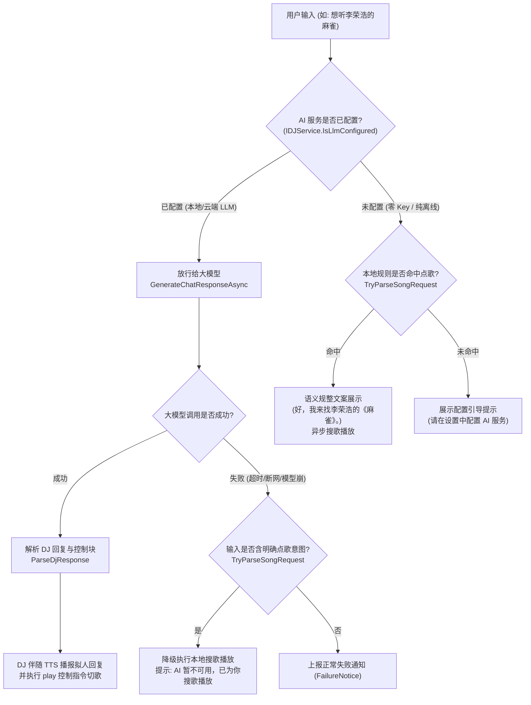

# LLM 优先智能点歌与未配置优雅降级设计方案

日期：2026-11-10  
状态：设计中（待用户评审）  
关联问题：聊天框输入“想听李荣浩的麻雀”被本地正则生硬包裹为《李荣浩的麻雀》且绕过大模型  
涉及模块：`AIRadio.Desktop/ViewModels/ChatViewModel.cs`, `AIRadio.Desktop/Services/IDJService.cs`, `AIRadio.Desktop/Services/DJService.cs`, `AIRadio.Desktop.Tests/ChatViewModelTests.cs`

---

## 1. 背景与核心诉求

### 1.1 现状与痛点剖析
1. **生硬截胡，击碎 AI 拟人感**：
   用户在聊天框对 AI DJ（如 Lumen）说：“想听李荣浩的麻雀”。用户心智期待的是 DJ 带着人设与情感自然回应（如：“*李荣浩的《麻雀》，唱给每个努力生活的普通人。微风正好，这就为你播放～*”）。然而，当前代码在进入大模型前执行了 `TryParseSongRequest`：
   ```csharp
   if (TryParseSongRequest(text, out var songQuery, out var requiresConfidentMatch, out var isArtistRequest) &&
       (!requiresConfidentMatch || await HasConfidentSongMatchAsync(songQuery)))
   {
       var displayText = isArtistRequest
           ? AppLanguage.T($"好，我来找{songQuery}的歌。", $"OK, finding songs by {songQuery}.")
           : AppLanguage.T($"好，我来找《{songQuery}》。", $"OK, let me find \"{songQuery}\".");
       // ...
       return;
   }
   ```
   该逻辑无视用户是否配置了大模型，强行拦截并短路。
2. **“人工智障”的展示文案**：
   本地正则仅简单剔除了“想听/播放”动词，将剩余短语 `"李荣浩的麻雀"` 视作完整歌名，直接给整句套上书名号输出：**《李荣浩的麻雀》**。
3. **技术背景的变化（本地大模型普及）**：
   当初引入本地正则短路主要为了规避“云端 LLM 调用延迟高（2~4 秒）”以及“商业 Token 消耗”。而在用户配置了本地大模型（如 Ollama / LMStudio）或极速云端模型后，延迟与费用已不再是瓶颈，生硬的规则拦截反而成为了破坏交互质感的最大负资产。

### 1.2 目标（Goals）
- **LLM 优先（LLM-First）**：
  当用户已配置 AI 服务（本地模型或云端 API Key，即 `IsLlmConfigured == true`）时，点歌语义全量放行给大模型（`GenerateChatResponseAsync`）。大模型理解上下文与听众口味，生成拟人台词，并输出标准的 `<cmd>{"action":"play","query":"..."}</cmd>` 指令切歌。
- **未配置时优雅降级（Graceful Fallback）**：
  当且仅当未配置 AI 服务（`IsLlmConfigured == false`）时，保留本地点歌快速通道，确保零 Key 用户依然能够通过打字快速点歌。
- **兜底文案语义规范化**：
  在未配置 AI 的本地规则兜底中，增强对「`{歌手} 的 {歌名}`」、「`{歌手} - {歌名}`」、「`{歌手} {歌名}`」的拆解识别，文案规范输出为「好，我来找李荣浩的《麻雀》。」，不再简单粗暴地将整串词塞进书名号。
- **故障弹性容灾**：
  若已配置 LLM 但大模型请求出现异常（如网络超时、本地进程崩溃），且用户输入具备明确的点歌动词意图，系统自动降级尝试本地搜歌播放，避免点歌彻底落空。

### 1.3 非目标（Non-Goals）
- 不改动现有大模型系统提示词中的 JSON 指令块规范（继续使用 `<cmd>{"action":"play","query":"..."}</cmd>`）。
- 不破坏通用新歌推荐通道（如“换一首”、“推荐一首”依然优先由个性化推荐引擎 `RecommendationService` 产生节目单曲目）。

---

## 2. 详细设计与交互流程

### 2.1 决策与状态流转架构



---

## 3. 具体模块变更说明

### 3.1 `IDJService` 与 `DJService`：暴露 LLM 配置状态契约

在 `IDJService` 中增加属性定义，并在 `DJService` 中实现，使 ViewModel 能够清晰获知当前是否具备大模型能力：

```csharp
// AIRadio.Desktop/Services/IDJService.cs
public interface IDJService
{
    // ...
    /// <summary>
    /// 大模型服务是否已完成有效配置（云端 Key 已填或本地模型已选）。
    /// </summary>
    bool IsLlmConfigured { get; }
}
```

在 `AIRadio.Desktop/Services/DJService.cs` 中的实现：
```csharp
public bool IsLlmConfigured => !(_llm is LLMService llmService && !llmService.IsConfigured());
```

---

### 3.2 `ChatViewModel.cs`：分流拦截逻辑改造

#### 1. `SendMessageAsync` 调度重构
原有的前置 `TryParseSongRequest` 不再作为无条件拦截，而是根据 `_djService.IsLlmConfigured` 决定走向：

```csharp
// 如果未配置大模型，才走本地点歌规则快速通道
if (!_djService.IsLlmConfigured)
{
    if (TryParseSongRequest(text, out var songQuery, out var requiresConfidentMatch, out var isArtistRequest, out var parsedArtist, out var parsedTitle) &&
        (!requiresConfidentMatch || await HasConfidentSongMatchAsync(songQuery)))
    {
        var displayText = FormatLocalSongRequestDisplayText(isArtistRequest, parsedArtist, parsedTitle, songQuery);
        var playCommand = isArtistRequest ? $"play_artist:{songQuery}" : $"play:{songQuery}";
        await RespondWithCommandAsync(displayText, playCommand, "happy");
        return;
    }
}

// 已配置大模型：全部放行给大模型
var response = await _djService.GenerateChatResponseAsync(text, _lifetimeCts.Token);
if (_djService.LastChatFailure is { } chatFailure)
{
    // 弹性容灾：若大模型调用失败，检查是否包含明确点歌意图，尝试用本地通道挽救
    if (TryParseSongRequest(text, out var fallbackQuery, out _, out var fallbackIsArtist, out var fbArtist, out var fbTitle))
    {
        Log.Warning("LLM chat failed, falling back to local song request: {Query}", fallbackQuery);
        var fallbackText = FormatLocalSongRequestDisplayText(fallbackIsArtist, fbArtist, fbTitle, fallbackQuery);
        var fallbackCmd = fallbackIsArtist ? $"play_artist:{fallbackQuery}" : $"play:{fallbackQuery}";
        await RespondWithCommandAsync(fallbackText, fallbackCmd, "calm");
        return;
    }

    AddFailureMessage(AppLanguage.T("AI 回复失败", "AI reply failed"), chatFailure);
    SetFailureNotice(chatFailure);
    return;
}
```

---

### 3.3 本地规则解析优化：语义拆解与文案生成

在 `ChatViewModel.cs` 中增强对关键词的结构化提取：

#### 1. 结构化拆解：
扩展 `TryParseSongRequest` 签名与内部解析：
```csharp
private static bool TryParseSongRequest(
    string text,
    out string query,
    out bool requiresConfidentMatch,
    out bool isArtistRequest,
    out string? artist,
    out string? songTitle)
```

支持匹配模式：
1. **歌手专场**：`{歌手} 的 (歌|歌曲|音乐)` $\to$ `isArtistRequest = true, artist = {歌手}`
2. **歌手 + 歌曲**（显式连接）：
   - `{歌手}\s*的\s*{歌名}`（如：“李荣浩的麻雀”、“周杰伦的晴天”）
   - `{歌手}\s*-\s*{歌名}`（如：“王菲 - 红豆”）
   $\to$ 提取 `artist = {歌手}, songTitle = {歌名}, query = "{歌手} {歌名}"`
3. **单一歌曲/关键词**：
   - 提取 `songTitle = {歌名}, query = {歌名}`

#### 2. 优雅文案格式化（`FormatLocalSongRequestDisplayText`）：
```csharp
private static string FormatLocalSongRequestDisplayText(
    bool isArtistRequest,
    string? artist,
    string? title,
    string rawQuery)
{
    if (isArtistRequest)
    {
        return AppLanguage.T($"好，我来找{artist ?? rawQuery}的歌。", $"OK, finding songs by {artist ?? rawQuery}.");
    }

    if (!string.IsNullOrWhiteSpace(artist) && !string.IsNullOrWhiteSpace(title))
    {
        return AppLanguage.T($"好，我来找{artist}的《{title}》。", $"OK, let me find \"{title}\" by {artist}.");
    }

    return AppLanguage.T($"好，我来找《{title ?? rawQuery}》。", $"OK, let me find \"{title ?? rawQuery}\".");
}
```
这样，即使在零 Key 兜底模式下，用户输入“想听李荣浩的麻雀”，文案也是工整的：
> **「好，我来找李荣浩的《麻雀》。」**
彻底告别《李荣浩的麻雀》。

---

## 4. 影响面与向后兼容性（Compatibility & Impact）

1. **单元测试资产**：
   - 目前 `ChatViewModelTests.CreateVm()` 默认构建的 `djMock` 没有显式配置 `IsLlmConfigured`（默认为 `false`）。
   - 现有的“未配置 LLM 时输入歌名直接播放”的 10 余个回归测试用例在契约上代表了**未配置回退分支**，行为完全保持兼容并继续全绿通过。
2. **LLM 协议兼容**：
   - OpenAI 兼容、Anthropic 兼容、本地 Ollama 协议均已自带 `<cmd>` 控制块规范指导，Prompt 无需变动。
3. **性能影响**：
   - 本地模型配置后，输入点歌由本地 LLM 秒级推理出情感化台词与切歌指令，交互生动度大幅提升。
   - 零 Key 用户维持微秒级正则响应，零开销。

---

## 5. 验证与测试计划

### 5.1 自动化测试场景设计（`ChatViewModelTests.cs`）
1. **已配置 LLM 场景**：
   - `SendMessage_WhenLlmConfigured_SongRequestDispatchesToLlm`：
     配置 `djMock.SetupGet(x => x.IsLlmConfigured).Returns(true)`。
     用户输入 `想听李荣浩的麻雀`，断言 `djMock.GenerateChatResponseAsync(...)` 被调用 1 次，**未被本地正则截胡**。
   - `SendMessage_WhenLlmReturnsPlayCommand_ExecutesTrackPlay`：
     大模型回复 `为你播放李荣浩的麻雀[happy]<cmd>{"action":"play","query":"李荣浩 麻雀"}</cmd>`，断言成功解析并在 TTS 结束后或立即触发 `SearchAsync` 与 `PlayOneShot`。
2. **未配置 LLM 回退场景**：
   - `SendMessage_WhenLlmNotConfigured_ArtistAndTitleSplitsGracefully`：
     配置 `IsLlmConfigured == false`。
     用户输入 `想听李荣浩的麻雀`，断言 Assistant 回复文案为 `好，我来找李荣浩的《麻雀》。`，且 `searchMock.SearchAsync("李荣浩 麻雀", ...)` 或 `("李荣浩的麻雀", ...)` 被调用。
3. **LLM 异常弹性容灾场景**：
   - `SendMessage_WhenLlmConfiguredButThrows_FallsBackToLocalSongRequest`：
     已配置 LLM 但大模型接口抛异常时，断言成功回退到本地搜歌播放，不给用户呈现冷冰冰的红字报错。

### 5.2 构建与全量回归
- 运行 `dotnet test`，确保全量 1200+ 单元测试 100% 通过（0 警告、0 错误）。
