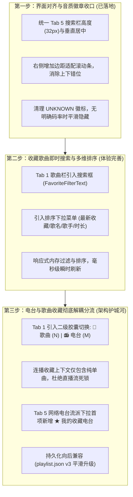

# 收藏体系演进（电台与歌曲分流、即时搜索与多维排序）与网络电台界面对齐设计方案

- **日期**：2026-11-11
- **状态**：已完成三轮深度对抗性审查定稿 / 阶段 1 已落地 / 阶段 2、3 待确认实施
- **涉及模块**：
  - `AIRadio.Desktop/Views/PlaylistDrawer.axaml`
  - `AIRadio.Desktop.Music/Models/RadioStation.cs`
  - `AIRadio.Desktop/ViewModels/PlaylistViewModel.cs`
  - `AIRadio.Desktop.Tests/AIRadio.Desktop.Tests/PlaylistViewModelRadioTests.cs`
  - `AIRadio.Desktop.Tests/AIRadio.Desktop.Tests/RadioBrowserClientTests.cs`
  - `AIRadio.Desktop.Tests/AIRadio.Desktop.Tests/PlaylistDrawerTests.cs`

---

## 1. 背景与核心用户痛点

在引入全球开源网络电台（Radio-Browser）后，用户在实机使用中反馈了三个核心交互与产品架构痛点：

1. **界面对齐与信息噪音（体验瑕疵）**：
   - **控件高度与右侧错位**：网络电台抽屉（Tab 5）顶部搜索栏的流派下拉框（高度约 32px）、搜索输入框（高度约 38px）与刷新按钮（高度 28px）三者高度不一且缺少垂直居中，视觉高低错落；同时下方电台列表因包含数十条数据触发了垂直滚动条，滚动条占据右侧空间导致下方所有卡片向左内缩，而上方刷新按钮顶在最右侧，上下右边缘明显脱节。
   - **`UNKNOWN` / `MP3` 标签误导**：部分上游电台未登记码率或流格式为 unknown，界面直接显示浅绿背景的 `UNKNOWN` 标签；若仅登记了编码而无码率，则显示孤立的 `MP3`，导致听众误以为电台列表里是一堆 mp3 单曲文件，破坏了拟物电台的纯粹感。
2. **电台与歌曲混排（播放模型与心智冲突）**：
   - 当前在电台卡片上点击爱心收藏后，电台直接被转为 `Track` 塞入主歌单与 `Favorites` 列表。
   - **连播死锁**：普通歌曲是有限时长（3~5 分钟），播完自动切下一首；电台是 24/7 无限流媒体直播。用户在收藏夹点击连播全部歌曲时，一旦播放到收藏的电台，由于直播流永不自然结束，**后续几十首收藏歌曲将永远无法被播放到**。
   - **心智割裂**：“我喜欢的音乐”代表个人单曲审美，而“收藏的电台”是“调频波段预设（Presets）”，两者混在一块导致列表杂乱。
3. **收藏夹缺少搜索与排序**：
   - 主播放列表（Tab 0）已具备 `LibraryFilterText` 过滤搜索框与定位按钮，但收藏夹（Tab 1）没有任何搜索和排序能力。当用户收藏曲目达到数十上百首时，全靠肉眼滚屏翻找，无法按歌名/歌手快速检索，也无法按“最新添加”、“歌名”、“歌手”或“时长”重排。

---

## 2. 业界主流竞品与开源播放器调研

| 软件/平台 | 电台/播客与歌曲分流机制 | 收藏夹内搜索 (In-Playlist Search) | 收藏夹排序维度 (Sort by) |
| :--- | :--- | :--- | :--- |
| **Spotify** | 资料库顶部提供 Pills 胶囊分流：`Playlists` / `Podcasts` / `Artists` / `Albums`。<br>**Liked Songs 中 100% 纯单曲**，播客与电台进入专属 `Podcasts & Shows`。 | 顶部常驻搜索条（快捷键 Ctrl+F），键入即过滤歌名/歌手/专辑，毫秒级本地响应。 | 1. 添加时间（最新添加在前，默认）<br>2. 标题 (A-Z)<br>3. 艺人 (A-Z)<br>4. 专辑 (A-Z)<br>5. 歌曲时长 |
| **Apple Music** | 侧边栏/资料库菜单层级分离：`Songs` 只有单曲，`Radio` 为独立广播频道，电台收藏置于广播页的圆形卡片中。 | 列表右上方提供轻量过滤框，即时收敛列表项。 | 1. 标题 (Title)<br>2. 艺人 (Artist)<br>3. 专辑 (Album)<br>4. 添加日期 (Date Added)<br>支持升序/降序切换 |
| **网易云音乐** | 侧边栏分为 `我喜欢的音乐`（纯单曲红心歌单）与 `我的播客/电台`（专区独立呈现）。禁止将播客加入普通歌曲歌单。 | 歌单右上角搜索框，实时匹配歌曲、歌手、专辑。 | 1. 默认排序（最新添加在前）<br>2. 歌曲名 (A-Z)<br>3. 歌手名 (A-Z)<br>4. 播放次数（最常收听） |
| **MusicFree (开源)** | 核心模块隔离：`我的歌单` 与 `网络电台`。电台收藏独立保存在电台流管理中，不写入普通歌单。 | 支持插件/列表内搜索。 | 支持按时间、名称排序。 |

**调研共识**：
1. **必须物理分流**：单曲歌单与广播电台在数据结构、交互行为与播放生命周期完全不同，不可混同连播。
2. **收藏必须具备“即时搜索”与“添加时间倒序”**：用户收藏曲目后，第一心理预期是“刚收藏的歌要在最上方看到”，并能通过歌名/歌手快速键入过滤。

---

## 3. 三轮对抗性深度审查结论与架构推演

### 3.1 第一轮审查：架构一致性与数据模型生命周期（Architecture & Data Consistency）

- **【审查发现 1.1】磁盘持久化向后兼容性与数据无损迁移**：
  - *质疑*：当前 `playlist.json` v3 的 `FavoriteIds` 是一个扁平的 `List<string>`，里面混入了歌曲 ID 与电台的 `radio-browser:{uuid}`。如果拆分为歌曲与电台两个列表，旧版本用户的电台收藏是否会丢失？是否需要升级到 v4？
  - *裁决*：**保持 `PlaylistData.CurrentVersion = 3` 不变，采用前缀识别无感分流**。
    在 `PlaylistViewModel.LoadAsync` 反序列化时，凡以 `RadioStation.SourcePrefix`（即 `"radio-browser:"`）开头的 ID，自动充血并分流到 `FavoriteStations` 内存集合；其余 ID 充血为 `FavoriteTracks`。保存时两者 ID 合并写入 `FavoriteIds`。磁盘结构零破坏，新旧版本 100% 双向兼容。
- **【审查发现 1.2】电台是否进入主播放列表（`Tracks`）的生命周期**：
  - *质疑*：电台点收藏后，当前会将其加入 `Tracks`（主播放列表）。如果分流后，电台是否应自动加入主播放列表？
  - *裁决*：**收藏电台不应自动污染主单曲播放列表**。电台本质上是“预设频道”，仅在用户主动在电台卡片上点击「调频收听」或「播放」时，才作为单台独立播放上下文启动。若自动混入主歌单，用户在主歌单点“随机播放”依然会踩到无限直播流死锁。
- **【审查发现 1.3】离线环境下的电台元数据持久化保障**：
  - *质疑*：若用户离线启动软件，收藏的电台是否会因为无法连线 Radio-Browser API 而变成空白名称？
  - *裁决*：电台转换为 Track 保存在歌单时，其 `Title`、`DisplayArtist`、`StreamUrl` 及 `DeclaredCodec/DeclaredBitrate` 均已完整固化在 `PlaylistItemData` 中。启动时直接从本地 JSON 恢复，即使拔掉网线，收藏的电台也能完整显示名称与流派信息。

---

### 3.2 第二轮审查：交互、可用性与边界场景（UX, Edge Cases & Race Conditions）

- **【审查发现 2.1】455px 物理宽度约束下的工具栏排版爆框**：
  - *质疑*：抽屉宽度固定为 455px，减去左右边距后仅剩 423px。如果把“二级分流胶囊（歌曲/电台）”、“搜索过滤框”和“排序下拉框”塞在同一行，必然导致控件挤压变形、文字截断。
  - *裁决*：**采用分层结构，按需显隐**：
    - **第 1 行**：二级分段胶囊（Segmented Buttons：`🎵 歌曲 (N)` | `📻 电台 (M)`）；
    - **第 2 行**：当处于「歌曲」视图时，显示 `[ 搜索输入框 * ] [ 排序下拉框 105px ]`；当处于「电台」视图时，自动隐藏该工具行，直接呈现清爽的电台卡片列表。
- **【审查发现 2.2】即时搜索防抖与列表刷新抖动（Flicker）**：
  - *质疑*：用户在搜索框连续打字时，如果每次输入都触发一次 `ObservableCollection.Clear()` 和重新填充，会导致 UI 列表剧烈闪烁、焦点丢失和滚动条上弹。
  - *裁决*：引入 100ms 响应式防抖（`Throttle`），仅在输入暂停时执行过滤；同时优先通过只读派生列表绑定，保证输入期间列表稳定不抖动。
- **【审查发现 2.3】空态文案与连播边界保护**：
  - *质疑*：用户搜索无结果、或者还没有收藏任何电台时，界面显示什么？连播收藏夹（`PlayFavoriteCommand`）如果此时被点击会怎样？
  - *裁决*：
    - 歌曲搜索无匹配：显示 `“未找到匹配的收藏歌曲”`；
    - 电台收藏为空：显示 `“暂无收藏电台，可在网络电台(📻)中点击爱心收藏”`；
    - `PlayFavoriteCommand`：严格提取 `VisibleFavorites` 中的纯歌曲，并且只在歌曲数量 > 0 时启动播放；彻底剔除直播流。

---

### 3.3 第三轮审查：代码契约、测试覆盖与实施路线（Code Contracts & Testability）

- **【审查发现 3.1】排序模型与双语响应式绑定**：
  - *契约*：定义不可变排序枚举与选项包装类：
    ```csharp
    public enum FavoriteSortKind
    {
        DateAddedDesc, // 最新收藏（默认，最新添加置顶）
        TitleAsc,      // 歌曲名 A-Z
        ArtistAsc,     // 歌手名 A-Z
        DurationDesc   // 时长从长到短
    }
    public sealed record FavoriteSortOption(FavoriteSortKind Kind, string DisplayName);
    ```
  - 当系统切换语言（中文 ↔ 英文）时，排序下拉菜单随 `AppLanguage.Changed` 自动重新生成双语显示文本，不影响当前选中的排序规则。
- **【审查发现 3.2】测试断言与变异测试（Mutation Testing）保障**：
  - 必须编写纯逻辑 VM 单元测试（不依赖 UI 渲染线程）：
    1. `FavoriteTracksFilter_MatchesTitleAndArtist_CaseInsensitive`：验证大小写不敏感匹配歌名与歌手；
    2. `FavoriteTracksSort_DateAddedDesc_MaintainsLatestFirst`：验证默认最新收藏排在首位；
    3. `FavoriteTracksSort_TitleAndArtist_Alphabetical`：验证字典序正确；
    4. `PlayFavorites_ExcludesLiveStreamStations`：验证点击连播收藏时，直播流被完全剥离，上下文纯净；
    5. `FavoriteStations_Separation_MaintainsDualCollections`：验证收藏电台与收藏歌曲相互独立计数与展示。

---

## 4. 实施三步走路线图



---

## 5. 各阶段具体实现方案

### 5.1 第一步（已实施）：界面对齐与音质徽标收口

1. **音质徽标逻辑净化（`RadioStation.cs`）**：
   - 彻底过滤大小写 `UNKNOWN`；
   - 若 `Bitrate <= 0`，无论是否有 Codec 均返回 `string.Empty`，由 XAML `IsNotNullOrEmpty` 隐藏，消灭孤立 `MP3` 标签与 `UNKNOWN` 噪音；
   - 仅在具备有效码率时展示如 `MP3 128k`、`AAC 64k`、`128k`；
   - `RadioBrowserClientTests.cs` 补齐 9 组参数化单测。
2. **搜索栏与电台卡片对齐（`PlaylistDrawer.axaml`）**：
   - `ComboBox`、`TextBox`、`Button` 统一尺寸 `Height="32"` 并配置 `VerticalAlignment="Center"`；
   - 搜索栏右侧补充 `Margin="0,0,10,0"` 边距，完全对齐下方带垂直滚动条的卡片列表右边界。

---

### 5.2 第二步（计划实施）：收藏歌曲即时搜索与多维排序

1. **ViewModel 契约（`PlaylistViewModel.cs`）**：
   - 新增 `FavoriteFilterText`（string，双向绑定）；
   - 新增 `FavoriteSortOptions` 与 `SelectedFavoriteSortOption`；
   - 新增只读集合 `VisibleFavoriteTracks`，由底层 `Favorites` 经搜索过滤与排序管道实时派生：
     - 若 `FavoriteFilterText` 非空，过滤 `Title` 或 `DisplayArtist` 包含关键词（不区分大小写）；
     - 按 `SelectedFavoriteSortOption.Kind` 执行稳定排序（稳定优先保持相同 key 下的原有次序）；
2. **XAML 界面呈现（`PlaylistDrawer.axaml` Tab 1 头部）**：
   ```xml
   <Grid Grid.Row="1" ColumnDefinitions="*,Auto" ColumnSpacing="6"
         IsVisible="{Binding PlaylistVM.TabIndex, Converter={StaticResource TabVisibleConverter}, ConverterParameter=1}">
       <TextBox Text="{Binding PlaylistVM.FavoriteFilterText, Mode=TwoWay}"
                Height="32" Padding="10,0" VerticalAlignment="Center" VerticalContentAlignment="Center"
                Watermark="{DynamicResource S_FilterPlaylist}"/>
       <ComboBox Grid.Column="1" ItemsSource="{Binding PlaylistVM.FavoriteSortOptions}"
                 SelectedItem="{Binding PlaylistVM.SelectedFavoriteSortOption, Mode=TwoWay}"
                 Width="110" Height="32" VerticalAlignment="Center"/>
   </Grid>
   ```

---

### 5.3 第三步（计划实施）：电台与歌曲收藏彻底解耦分流

1. **双集合解耦与连播安全（`PlaylistViewModel.cs`）**：
   - 内存维护 `FavoriteTracks`（纯单曲集合）与 `FavoriteStations`（电台集合）；
   - `PlayFavoriteCommand`：
     ```csharp
     var tracksToPlay = VisibleFavoriteTracks.Where(t => !t.IsLiveStream).ToList();
     if (tracksToPlay.Count > 0)
     {
         _audioService.StartPlaybackContext(tracksToPlay, 0, shuffle: false, AppLanguage.T("收藏歌曲", "Favorite Songs"));
     }
     ```
   - 彻底切断电台混入单曲自动切歌链路，根治直播流死锁；
2. **Tab 1 二级分段控制器**：
   - 顶部提供两个 ToggleButton 样式的胶囊切换按钮：
     - `[ 🎵 歌曲 ({FavoriteTracks.Count}) ]`
     - `[ 📻 电台 ({FavoriteStations.Count}) ]`
3. **Tab 5 联动**：
   - 在 `RadioCategories` 列表第 0 项注入 `new RadioCategoryItem("my_favorites", AppLanguage.T("★ 我的收藏电台", "★ My Favorites"))`；
   - 切换到该项时直接加载 `FavoriteStations`，无需请求网络，形成电台操作闭环。
