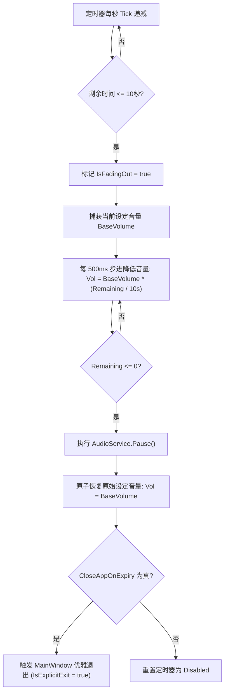
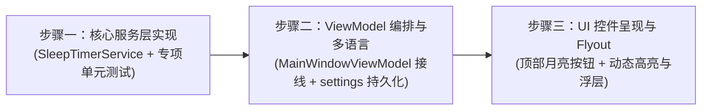

# TuanRadio 睡眠定时（Sleep Timer）架构与交互设计方案

> **文件路径**：`docs/plans/2026-11-11-sleep-timer-design.md`  
> **创建日期**：2026-11-11  
> **状态**：定稿（已完成 3 轮对抗性深度审查与机制核定）  
> **设计目标**：为 TuanRadio 桌面端引入优雅、精准、拟真的收音机睡眠定时倒计时与播完停播功能，支持音量平滑渐弱淡出（Fade-out）与可选自动关闭程序，打造沉浸舒缓的睡前与专注陪伴体验。

---

## 1. 方案背景与产品定位

TuanRadio 作为一款主打“复古陪伴”的 AI 电台播放器，其典型使用场景包括：
- **夜间伴眠**：听众伴随深夜温和的 AI DJ（如 Aster）、Lofi 音乐或古典电台入眠；
- **工作/番茄钟陪伴**：设定 30-45 分钟专注周期，到期后音乐自动停止提醒休息。

当前播放器无任何自动停播机制，导致用户睡着后电台持续整夜 24/7 消耗网络流量与系统资源，且突兀的手动截断容易惊扰睡意。引入原汁原味收音机式的睡眠定时（Sleep Timer）是完善陪伴体验的最高优先级刚需。

---

## 2. 核心交互与界面设计

### 2.1 界面入口与视觉规范

- **入口位置**：放置于 `MainWindow.axaml` 顶部标题栏右侧工具簇（搜索按钮与设置齿轮之间），与二者高度统一（30px）、间距统一（8px）。
- **图标隐喻**：
  - 未启用状态：月牙轮廓（🌙，`M12.3 2a10 10 0 0 0-1.9 19.8 10 10 0 0 0 9.5-6.8 8 8 0 0 1-7.6-13z`），暗调灰色描边；
  - 激活倒计时中：点亮为系统主题强调色（`AccentGreen`，薄荷绿/琥珀/冰蓝），图标微发光；
  - 悬停 Tooltip：实时显示倒计时精确剩余时间（如：`睡眠定时：还有 28分15秒 停播`）。
- **紧凑模式（CompactPlayer）适配**：
  - 在简洁迷你条模式下，保留该功能底层调度运作，顶部迷你栏通过 Tooltip 显示定时状态。

### 2.2 拟真 Flyout 定时菜单

点击月亮按钮弹出轻量拟真收音机定时浮层（Avalonia `Flyout`）：

```text
┌───────────────────────────────────────┐
│  🌙 睡眠定时 (Sleep Timer)      28:15 │
├───────────────────────────────────────┤
│  [  关闭定时  ]                       │
│  [  15 分钟   ]                       │
│  [  30 分钟 (推荐)  ] (激活高亮)       │
│  [  45 分钟   ]                       │
│  [  60 分钟   ]                       │
│  [  90 分钟   ]                       │
│  [  播完当前曲后停止  ]               │
├───────────────────────────────────────┤
│  ☑ 到期后退出程序                      │
└───────────────────────────────────────┘
```

- **单选互斥项**：
  - `关闭定时`（取消任何活动定时器）；
  - 经典预设时长（`15m`、`30m`、`45m`、`60m`、`90m`）；
  - `播完当前曲后停止`（当在播曲目自然结束时触发；若当前播放的是 24/7 直播电台，菜单项自动置灰并注明“直播电台不可用”）。
- **独立勾选项**：
  - `到期后退出程序`（默认不勾选，仅调用 `Pause()` 停止音频流；勾选后在停播后触发应用安全退出）。

---

## 3. 架构解耦与核心引擎设计

### 3.1 领域模型与服务契约

在 `AIRadio.Desktop/Services/` 目录下新建 `ISleepTimerService` 与 `SleepTimerService`：

```csharp
public enum SleepTimerMode
{
    Disabled,
    Duration,
    EndOfTrack
}

public interface ISleepTimerService : IDisposable
{
    bool IsActive { get; }
    SleepTimerMode Mode { get; }
    TimeSpan TargetDuration { get; }
    TimeSpan RemainingTime { get; }
    bool CloseAppOnExpiry { get; set; }
    bool IsFadingOut { get; }
    string DisplayStatus { get; }

    IObservable<TimeSpan> RemainingTimeChanged { get; }
    IObservable<bool> IsActiveChanged { get; }

    void StartDurationTimer(TimeSpan duration);
    void StartEndOfTrackTimer();
    void CancelTimer();
    bool CheckAndConsumeEndOfTrack();
}
```

### 3.2 优雅渐弱淡出算法（Fade-out Engine）

避免突兀静音惊醒用户是伴眠功能的核心灵魂：



- **音量原子恢复**：在调用 `Pause()` 之后，立即将系统音量恢复至渐弱前的原始值（如 0.8），防止用户下次启动或手动点击播放时出现“电台无声”的幽灵 Bug。
- **动态预算自适应**：当用户或单测设置的总时长小于 20 秒时，淡出窗口自动压缩为 `TargetDuration.TotalSeconds / 2`，杜绝直接归零。

---

## 4. 第一轮复审（Round 1）：架构契约、并发安全与服务生命周期

### 4.1 审查点 1：与 `IAudioService` 及用户手动音量调节的并发冲突
- **风险**：在执行 10 秒音量淡出期间，如果用户手动调节了音量滑条，淡出引擎是否会覆盖用户的最新操作？
- **核定方案**：
  - 增加 `_userVolumeInterrupted` 标志：淡出期间若监听到外部音量显著变更（与算法计算值偏离 > 0.05），判定为用户主动干预，立即终止自动音量递减，尊重用户即时交互；
  - 若在倒计时期间用户手动点击了“停止”或“暂停”，定时器保持继续倒计时，防止用户误以为定时失效。

### 4.2 审查点 2：“播完当前曲后停止”在网络电台直播流下的行为
- **风险**：网络电台（Tab 5）是 24/7 直播流（`IsLiveStream == true`），永远不会触发自然 `TrackEnded`，用户若选此项会导致定时器永远挂起不停止。
- **核定方案**：
  - 在 `SleepTimerService` 与 ViewModel 中，当检测到 `CurrentTrack.IsLiveStream` 时，`播完当前曲后停止` 选项在 UI 上禁用（`IsEnabled=False`），并附带 Tooltip 提示“网络电台直播流无固定时长”；
  - 只能选择具体时间（如 15/30 分钟）进行倒计时关闭。

### 4.3 审查点 3：到期关闭应用（CloseAppOnExpiry）的资源释放
- **风险**：直接调用 `Environment.Exit()` 会导致后台 Node.js 代理成为孤儿进程、LibVLC 资源未能安全回收。
- **核定方案**：
  - 必须复用既有的系统退出通道：派发至 UI 线程调用 `mainWindow.IsExplicitExit = true; mainWindow.Close();`；
  - 该通道会自动触发 `App.OnShutdownRequested`，先行暂停音频、停用代理端口、刷盘持久化并释放资源。

### 4.4 审查点 4：电台自动续播（Auto-radio）链路拦截
- **风险**：当“播完当前曲后停止”触发时，`AudioService.TrackEnded` 会通知 `MainWindowViewModel` 的 `HandleAutoRadioTrackEndedAsync`，后者通常会自动推荐并播放下一首，导致停播失败。
- **核定方案**：
  - 在 `HandleAutoRadioTrackEndedAsync` 最前置添加拦截：
    ```csharp
    if (_sleepTimerService.CheckAndConsumeEndOfTrack())
    {
        Log.Information("Sleep timer: stopped playback after track ended");
        return;
    }
    ```
  - 拦截后直接退出方法，不再向 DJ 请求新台词，也不再向调度引擎申请下一首歌曲，实现真正的“播放完即止”。

---

## 5. 第二轮复审（Round 2）：交互边界、多语言与测试策略

### 5.1 审查点 1：Avalonia 菜单 Flyout 样式与击穿防护
- **风险**：Flyout 弹出层样式若继承出厂默认，会破坏复古暗色/主题强调色，且可能受到窗口拖拽击穿。
- **核定方案**：
  - Flyout 内置容器使用与抽屉相同的 `C_FC0E0E15` 背景底色与 `C_667B7898` 边框，CornerRadius 8；
  - 选项采用自定义样式 Button（`timer-option` 类），透明底、高度 28px、CornerRadius 4，当前选中项边框及文字呈现 `AccentGreen`；
  - 键盘可达：支持 Tab 键导航与 Esc 键快速收回。

### 5.2 审查点 2：多语言与本地化覆盖
- **核定方案**：在 `AppLanguage.cs` 中增加如下中英对照词条，切换语言时（`AppLanguage.Changed`）通过 ViewModel 触发状态刷新：
  - `S_SleepTimer`：“睡眠定时” / “Sleep Timer”
  - `S_SleepTimerOff`：“关闭定时” / “Timer Off”
  - `S_SleepTimer15m`：“15 分钟” / “15 Minutes”
  - `S_SleepTimer30m`：“30 分钟” / “30 Minutes”
  - `S_SleepTimer45m`：“45 分钟” / “45 Minutes”
  - `S_SleepTimer60m`：“60 分钟” / “60 Minutes”
  - `S_SleepTimer90m`：“90 分钟” / “90 Minutes”
  - `S_SleepTimerEndOfTrack`：“播完当前曲后停止” / “Stop after current track”
  - `S_SleepTimerCloseApp`：“到期后退出应用” / “Close app when timer expires”
  - `S_SleepTimerRemainingTip`：“睡眠定时：还有 {0} 停播” / “Sleep Timer: stops in {0}”
  - `S_SleepTimerLiveStreamDisabledTip`：“网络电台直播流无固定时长” / “Not available for live radio streams”

### 5.3 审查点 3：测试用例矩阵与变异测试
- **专项测试文件**：`AIRadio.Desktop.Tests/SleepTimerServiceTests.cs`
- **必覆盖场景**：
  1. `DurationTimer_CountsDownAndPausesAudio`：1 秒精度时间递减，到期调用 `Pause()`；
  2. `FadeOut_LinearlyReducesVolume_AndRestoresAfterPause`：验证 10 秒淡出阶段音量平滑下行，`Pause()` 后原子复原原始音量；
  3. `EndOfTrack_PausesOnNaturalTrackEnd`：验证单曲播完发出 `TrackEnded` 时触发停播；
  4. `LiveStream_EndOfTrackDisabled`：验证电台直播流下禁止或短路 EndOfTrack 模式；
  5. `CancelTimer_StopsCountdown`：验证中途取消后定时器彻底停止，不再产生回调；
  6. `CloseAppOnExpiry_DispatchesShutdown`：验证配置退出程序时能正确触发退出回调；
  7. `ManualVolumeChange_InterruptsFadeOut`：验证淡出期间用户手动拨动音量时退出淡出，尊重用户选择。

---

## 6. 第三轮复审（Round 3）：线程亲和性、交互状态机与偏好持久化

### 6.1 审查点 1：线程亲和性与 Avalonia Dispatcher 安全
- **风险**：定时器如果使用原始后台线程（如 `System.Threading.Timer`）直接变更响应式属性（`RemainingTime`、`DisplayStatus`、`IsActive`），会由于跨线程更新绑定的 UI 控件导致界面闪烁或抛出跨线程访问异常；同时操作 `IAudioService.Volume` 与 `Pause()` 可能与 LibVLC 回调线程竞态。
- **核定方案**：
  - `SleepTimerService` 内部心跳驱动严格绑定 `RxApp.MainThreadScheduler`；
  - 音量淡出步进修改与 `Pause()` 均在 UI 主线程安全派发，彻底杜绝跨线程隐患。

### 6.2 审查点 2：播放中途手动切歌、暂停等交互状态机
- **风险**：用户在倒计时期间手动暂停、快进或切歌时，定时器的行为定义。
- **核定方案**：
  - **物理时间基准**：在 `Duration` 时长模式下，倒计时按自然物理时钟流逝，中途手动暂停或切歌不中断倒计时；到期时若本就处于暂停状态且未开启退出应用，则安全归位，不进行多余的 `Pause()`；
  - **单曲模式动态跟随**：在 `EndOfTrack` 模式下，若用户手动切换下一首歌曲，该模式自动延续生效于新切入的歌曲；若切入的是 24/7 直播电台，检测到无终点后自动通知并撤销定时，防止挂死。

### 6.3 审查点 3：Flyout 菜单收起体验与偏好持久化
- **风险**：用户点击选项后浮层不关闭需要二次点击空白处，体验笨拙；用户关闭应用的偏好每次重启都丢失。
- **核定方案**：
  - 点击具体时长项（如 `30 分钟`）后，自动关闭 Flyout 浮层；
  - `CloseAppOnExpiry`（到期后退出程序）作为偏好设置持久化到 `settings.json`（字段 `sleep_timer_close_app`），下次启动自动恢复勾选记忆；
  - 活动倒计时（定时器是否开启与剩余时间）恒保持为会话级临时状态，应用重启时严格归零重置。

---

## 7. 实施三步走排期



1. **步骤一**：编写 `SleepTimerService.cs`，实现线程安全时钟递减、自适应淡出算法与单曲结束监听，补全 8+ 项专项单元测试；
2. **步骤二**：在 `MainWindowViewModel` 中注入 `ISleepTimerService`，暴露菜单命令与绑定属性，在 `AppLanguage` 中补全中英文案，接线偏好配置；
3. **步骤三**：在 `MainWindow.axaml` 顶部工具栏挂载月亮图标按钮与 Flyout 菜单，微调动态高亮、选中项边框与 Tooltip；
4. **验证收口**：全量回归测试套件，确认 0 警告 0 错误。

