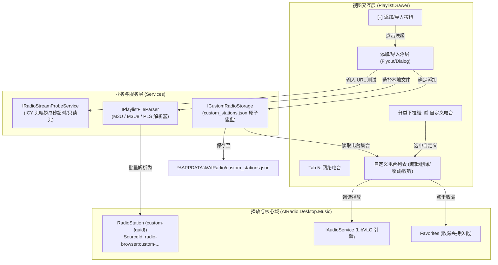

# TuanRadio 自定义网络电台导入与管理（Custom Radio Stream Import & Management）架构与交互设计方案

> **文件路径**：`docs/plans/2026-11-12-custom-radio-station-import-design.md`  
> **创建日期**：2026-11-12  
> **状态**：已实施（2026-11-13 提交 `097d668` 并推送至 `master`）  
> **设计目标**：在已交付的全球网络电台（Radio Browser）与本地收藏体系基础上，构建开放、安全、轻量、高可用的**自定义网络电台导入与管理系统**。支持单流 URL 手动录入、实时 ICY 流可用性探测与元数据自动嗅探、M3U/M3U8/PLS 批量列表导入、自定义流派分类及全生命周期编辑与删除，实现与 LibVLC 播放引擎、ICY 实时元数据更新、收藏夹及伴眠模式的端到端无缝贯通。

---

## 1. 方案背景与需求分析

### 1.1 现状与痛点
TuanRadio 在近期已完成了全球开源网络电台体系（基于 Radio-Browser 集群与离线精选库），覆盖了 8 大主流流派与 24/7 直播流收听。然而，在真实收听场景中，用户仍面临以下诉求：
1. **私人与冷门流无法收听**：许多精品广播、高校网络台、个人自建 Icecast/Shoutcast 流、ACG 专属电台未被收录在全球公共索引库中，用户拥有直链却无法在 TuanRadio 中收听；
2. **列表迁移成本高**：用户在其他收音机软件（如 TuneIn、vRadio、Foobar2000）中积累了 `.m3u` 或 `.pls` 电台歌单，无法一键导入；
3. **参数配置门槛高**：普通用户往往只拿到一个 URL（如 `http://live.example.com/stream`），不知道具体的电台全称、编码格式（MP3/AAC）与码率（128k/320k），手工填表繁琐且容易填错；
4. **无效流与死链缺少前置检验**：如果直接保存错误或无法访问的 URL，播放时可能出现超时卡死或报错，体验割裂。

### 1.2 核心目标
- **即加即播**：支持输入 HTTP/HTTPS 直播音频直链，一键保存并收听；
- **智能探测（Stream Probe）**：通过异步轻量 HTTP 请求嗅探电台状态，自动解析 ICY 头（`icy-name`、`icy-br`、`Content-Type`），自动回填台名与码率；
- **批量导入**：支持标准 M3U、Extended M3U (`#EXTINF`) 以及 PLS 格式播放列表文件的批量导入与智能去重；
- **统一生命周期与分类**：在电台流派下拉框中增设 `📻 自定义电台` 专属分类；在列表内提供调谐收听、爱心收藏、修改编辑与删除功能；
- **安全沙箱与防护**：强制限定 HTTP/HTTPS 协议，杜绝本地文件包含或非法 scheme，探测过程限定只读响应头（ResponseHeadersRead），防止大流耗尽内存。

---

## 2. 核心架构与数据流设计



---

## 3. 详细设计与实现细节

### 3.1 数据模型与唯一标识（Station ID 规范）
自定义电台使用与预置电台相同的 `RadioStation` 实体，但遵循严格的前缀规范：
- `StationUuid`：统一使用 `custom-` 前缀 + 12 位紧凑十六进制 GUID（如 `custom-d41d8cd98f00`）；
- `SourceId`：统一生成为 `radio-browser:custom-d41d8cd98f00`；
- **益处**：
  1. 完美复用 `Track.IsLiveStream`（以 `radio-browser:` 开头自动识别为直播电台）；
  2. 完美复用 `FavoriteRadioStationCommand` 与 `ToggleFavoriteCommand`；
  3. 播放时无缝启用 LibVLC 的 ICY 实时元数据（NowPlaying 滚动）与 24/7 直播防护机制。

### 3.2 自定义电台持久化（`ICustomRadioStorage`）
在独立文件 `%APPDATA%\AIRadio\custom_stations.json` 中维护用户自定义电台列表，与全局推荐和公共电台缓存彻底解耦。

```csharp
public interface ICustomRadioStorage
{
    Task<IReadOnlyList<RadioStation>> LoadStationsAsync(CancellationToken ct = default);
    Task SaveStationsAsync(IReadOnlyList<RadioStation> stations, CancellationToken ct = default);
    Task AddStationAsync(RadioStation station, CancellationToken ct = default);
    Task AddStationsAsync(IEnumerable<RadioStation> stations, CancellationToken ct = default);
    Task RemoveStationAsync(string stationUuid, CancellationToken ct = default);
    Task UpdateStationAsync(RadioStation station, CancellationToken ct = default);
}
```

- **原子写入与并发安全**：
  - 写入流程：内存序列化 $\rightarrow$ 写入 `custom_stations.json.tmp` $\rightarrow$ `File.Move(..., overwrite: true)`；
  - 内部互斥：由 `SemaphoreSlim(1, 1)` 保障单实例异步并发安全；
  - 容错机制：若文件缺失或 JSON 解析损坏，记录日志并返回空集合，不崩溃，不阻塞应用启动。

### 3.3 轻量流媒体嗅探与探测器（`IRadioStreamProbeService`）
为解决用户不知道电台名称、格式、码率以及误输死链的问题，引入专有探测器：

```csharp
public sealed record StreamProbeResult(
    bool Success,
    string? StationName,
    string? Codec,
    int? BitrateKbps,
    string? Tags,
    string? ErrorMessage
);

public interface IRadioStreamProbeService
{
    Task<StreamProbeResult> ProbeAsync(string streamUrl, CancellationToken ct = default);
}
```

- **探测机制与安全防御**：
  1. **URL 合法性预检**：必须为有效且绝对的 HTTP/HTTPS URI，拒绝 `file://`、`data:` 等非法 scheme；
  2. **HTTP GET 请求**：使用 `HttpMethod.Get` 发送请求（部分流媒体服务端对 `HEAD` 返回 405/400），请求头携带：
     - `Icy-MetaData: 1`（告知服务端下发 ICY 扩展元数据）；
     - `User-Agent: TuanRadio/1.0`；
  3. **`HttpCompletionOption.ResponseHeadersRead`**：**关键防御！** 仅读取响应头即完成探测，严禁读取或等待流正文，彻底杜绝 24/7 直播流卡死线程与内存溢出；
  4. **超时熔断**：设定 3~4 秒严格超时。若超时或连接拒绝，返回 `Success = false` 与友好提示；
  5. **元数据提取与映射**：
     - `icy-name` $\rightarrow$ `StationName`
     - `icy-br` $\rightarrow$ `BitrateKbps`（转为整数）
     - `icy-genre` $\rightarrow$ `Tags`
     - `Content-Type` $\rightarrow$ 映射推断 `Codec`：
       - `audio/mpeg` $\rightarrow$ `MP3`
       - `audio/aac`, `audio/aacp`, `audio/x-aac` $\rightarrow$ `AAC`
       - `audio/ogg`, `application/ogg` $\rightarrow$ `OGG`
       - `audio/flac`, `audio/x-flac` $\rightarrow$ `FLAC`
       - `application/x-mpegurl`, `audio/x-mpegurl` $\rightarrow$ `HLS`
  6. **非阻塞警告机制**：探测结果作为表单辅助。即使探测报超时或未知格式（如某些私有加密流），仍允许用户强行保存，保障极端环境下的可播性。

### 3.4 播放列表文件解析器（`IPlaylistFileParser`）
支持常见电台播放列表格式的批量解析与智能导入：
1. **M3U / M3U8 解析**：
   - 逐行扫描，自动识别 `#EXTM3U` 头；
   - 提取 `#EXTINF:-1, [Radio Name]` 中的名称；
   - 提取下一行有效 HTTP/HTTPS URL；
   - 容错处理：忽略空行、注释行（除 `#EXTINF` 外），自动修剪首尾空白。
2. **PLS 解析**：
   - 解析 INI 格式段落 `[playlist]`；
   - 匹配 `File1=...`, `Title1=...`, `File2=...`, `Title2=...` 等键值对；
3. **去重与规整**：
   - 按 `StreamUrl` 进行去重（若库中已存在相同 URL，则跳过或合并更新）；
   - 为每个成功项分配唯一的 `custom-{guid}` 标识。

---

## 4. 界面与交互体验设计（UI & UX）

### 4.1 Tab 5（网络电台）顶部控制栏
- 当前布局：`[流派 ComboBox (105px)] [搜索框 TextBox (*)] [刷新 Button ↻ (32px)]`
- 改造后：在 `↻` 按钮右侧增加 `[Button + (32px)]`（ToolTip: "添加或导入自定义电台 / Add or Import Custom Station"）；
- 视觉风格：延续复古调谐风格，暗灰背景 `#282834`、Accent 绿高亮悬停，与现存控制按钮保持像素级对齐。

### 4.2 添加/导入浮层（Add Station Flyout）
点击 `+` 按钮展开轻量浮层面板（Flyout，宽 380px，高适中，不阻断主窗口操作）：
- **顶部模式切换**：分段按钮或单选切换【手动添加 / Manual】与【从文件导入 / Import File】；
- **【手动添加】视图**：
  - **流地址（Stream URL）**：输入框 + 右侧【探测 / Probe】按钮；
  - **探测状态指示**：紧随 URL 下方，显示动态微标（如“正在探测...”、“✓ MP3 256k”或“⚠ 探测超时，仍可保存”）；
  - **电台名称（Station Name）**：必填输入框（探测成功后自动回填）；
  - **流派与标签（Genre / Tags）**：选填输入框（如 `Jazz, Chillout`）；
  - **编码与码率**：自动填充或手动微调；
  - **操作按钮**：【保存并收听】、【仅保存】、【取消】。
- **【从文件导入】视图**：
  - 【选择播放列表文件 (.m3u, .pls)...】大号虚线拖放/点击按钮；
  - 解析完成后展示摘要与首批项目预览（例如：“已识别 12 个有效电台”）；
  - 【一键导入全部】按钮。

### 4.3 列表管理与操作项
- 在流派分类下拉框中新增固定项：`📻 自定义电台`（位于 `★ 我的收藏` 之后、`Lofi 低保真` 之前）；
- 在自定义电台分类下，列表项右侧的操作按钮区：
  - 【删除 🗑️】：点击即可弹出二次确认并安全移除该自定义电台；
  - 【爱心收藏 ❤️】：与公共电台一致，一键同步到用户“我的收藏”；
  - 【调谐收听 📻】：点击即刻切台播放，触发调谐扫频音效。
- **级联删除防御**：当用户删除自定义电台时，若该电台已被加入收藏夹，同步从收藏夹移除，防止收藏夹留下无法播放的僵尸电台。

---

## 5. 国际化与多语言配置（Localization）

在 `AppLanguage.cs` 中增加完整的中英双语资源键值对：

| 键名 | 中文 | 英文 |
| :--- | :--- | :--- |
| `S_CustomRadioCategory` | 📻 自定义电台 | 📻 Custom Radio |
| `S_AddRadioStation` | 添加自定义电台 | Add Custom Station |
| `S_ImportPlaylistFile` | 导入播放列表文件 | Import Playlist File |
| `S_StreamUrl` | 电台流地址 | Stream URL |
| `S_StreamUrlPlaceholder` | 请输入 http(s) 直播流地址... | Enter http(s) stream URL... |
| `S_StationName` | 电台名称 | Station Name |
| `S_StationNamePlaceholder` | 输入电台名称（可探测自动获取） | Enter station name |
| `S_ProbeStream` | 探测 | Probe |
| `S_Probing` | 正在探测... | Probing... |
| `S_ProbeSuccess` | 探测成功 | Probe Successful |
| `S_ProbeFailed` | 探测失败或超时 | Probe Failed / Timed Out |
| `S_SaveAndPlay` | 保存并播放 | Save & Play |
| `S_SaveOnly` | 仅保存 | Save Only |
| `S_DeleteStationConfirm` | 确定要删除该自定义电台吗？ | Delete this custom radio station? |
| `S_NoCustomStations` | 暂无自定义电台，点击右上角「+」即可添加或导入。 | No custom stations yet. Click '+' above to add or import. |
| `S_ImportSummary` | 成功导入 {0} 个电台 | Successfully imported {0} station(s) |

---

## 6. 测试与质量保证规划

### 6.1 单元测试矩阵（Unit Tests）
1. **`StreamProbeServiceTests`**：
   - Mock HTTP 响应头携带 `icy-name`、`icy-br`、`Content-Type: audio/mpeg`，验证成功解析；
   - 验证不支持的 scheme（如 `file:///`、`ftp://`）直接拒绝；
   - 验证探测超时与网络异常时安全返回错误结果，不抛未处理异常；
   - 验证 `ResponseHeadersRead` 机制不触碰响应体。
2. **`CustomRadioStorageTests`**：
   - 验证电台新增、读取、更新、删除（CRUD）完整闭环；
   - 验证 JSON 文件损坏时的自愈能力与优雅降级；
   - 验证原子写入与文件锁定防并发。
3. **`PlaylistFileParserTests`**：
   - 验证标准 Extended M3U 文件解析（提取 `#EXTINF` 中的名称与 URL）；
   - 验证简单 M3U 文件（无 `#EXTINF`，自动使用文件名/默认名）；
   - 验证 PLS 文件（提取 `FileX` 与 `TitleX`）；
   - 验证重复 URL 自动去重。
4. **`PlaylistViewModelCustomRadioTests`**：
   - 验证添加自定义电台后在 `RadioStations` 列表与自定义分类中立即可见；
   - 验证删除电台时同步清理收藏夹关联项；
   - 验证多语言动态切换时分类名称与提示文本正确重载。

---

## 7. 实施计划与里程碑

1. **阶段 1：服务层与基础设施落地**
   - 实现 `ICustomRadioStorage` 与 `CustomRadioStorage`；
   - 实现 `IRadioStreamProbeService` 与 `RadioStreamProbeService`；
   - 实现 `IPlaylistFileParser` 与 `PlaylistFileParser`；
   - 编写并跑通服务层与解析器单测。
2. **阶段 2：ViewModel 逻辑贯通**
   - 在 `PlaylistViewModel` 中引入 `ICustomRadioStorage`、`IRadioStreamProbeService` 与 `IPlaylistFileParser`；
   - 扩展 `PopulateRadioCategories`，增加 `custom` 分类支持；
   - 实现添加、探测、删除、文件导入的 ReactiveCommand。
3. **阶段 3：UI 视图与交互装配**
   - 在 `PlaylistDrawer.axaml` 中添加 `+` 按钮与 Flyout 弹窗；
   - 列表项支持自定义电台的删除操作；
   - 挂载多语言词条并对齐视觉样式。
4. **阶段 4：对抗性审查、测试覆盖与构建核验**
   - 补充 UI 交互与端到端联动测试；
   - 全量编译与 Release 标准/裁剪双变体校验，确保 0 警告 0 错误。

---

## 8. 审查修订与实施落地说明（2026-11-13）

本方案在实施前经过多轮方案审查，并在实现后完成两轮代码复审与全量测试/双变体构建核验（提交 `097d668`），相对初稿的主要演进与确认点如下：

1. **网络与安全策略边界（`MediaUriPolicy.ValidateCustomRadioAsync` / `PlaybackPreflightService`）**：
   - 自定义电台在探测与预检阶段复用并扩展初始 URI 校验，允许局域网私网 IP（满足自建内网电台场景），继续严格拦截回环地址（loopback）、link-local 及云元数据地址（注：轻量探测客户端与 LibVLC 播放阶段未接逐跳重定向复检）。
2. **UI 形态调整（`PlaylistDrawer.axaml`）**：
   - 将原稿中的弹出式 `Flyout` 调整为“网络电台”抽屉内嵌式添加/编辑/导入面板，同时支持行内编辑（Edit）与删除、列表搜索置顶聚合，避免弹出浮层与主抽屉焦点及文件选择器冲突。
3. **收藏与列表级联同步（`PlaylistViewModel`）**：
   - 补齐自定义电台编辑与删除时的多层级联同步（持久化存储、收藏集合/文件、`RadioStations` 缓存与列表），保障电台收藏夹同步更新且不污染主单曲播放列表；`RadioStation.ToTrack()` 携带 `custom_station=true` 元数据标识（注：仅“保存并收听”触发立即切播，单纯编辑或删除不主动中断当前在播曲目）。
4. **流探测预警与静态文件容错（`RadioStreamProbeService` / `PlaylistFileParser`）**：
   - 对非直播静态音频地址及特定兼容格式提供容错预警样式，同时保持直播流探测响应头读取（`ResponseHeadersRead`）安全快捷。
5. **测试覆盖**：
   - 新增 `CustomRadioStorageTests`、`StreamProbeServiceTests`、`PlaylistFileParserTests`、`PlaylistViewModelCustomRadioTests` 四个测试集并并入全量回归。
