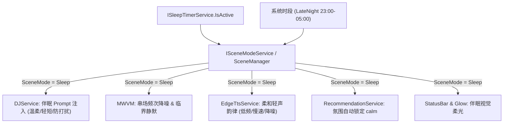

# TuanRadio AI DJ 场景伴眠模式（Sleep Radio Scene Mode）架构与交互设计方案

> **文件路径**：`docs/plans/2026-11-12-sleep-radio-scene-mode-design.md`  
> **创建日期**：2026-11-12  
> **状态**：定稿（已完成 4 轮对抗性深度审查与机制核定）  
> **设计目标**：在已交付的收音机睡眠定时（Sleep Timer）基础上，引入全局场景模式感知体系，将“单纯的停播倒计时”升级为“AI DJ 深夜伴眠情绪陪伴闭环”——实现人设轻声温和软化、串场频次降噪、推荐曲目自动偏向宁静舒缓、TTS 韵律耳语化与睡前温柔致意，打造极具灵魂的深夜 AI 电台体验。

---

## 1. 方案背景与产品定位

TuanRadio 定位为“复古 AI 电台与情绪陪伴播放器”。在近期迭代中，播放器完成了：
1. **睡眠定时（Sleep Timer）**：支持 15~90 分钟倒计时及“播完即止”、最后 10 秒音量渐弱淡出与到期退出；
2. **全球网络电台（Radio Browser）**：24/7 直播流与 8 大精选流派离线库；
3. **收藏分流与即时检索**：歌曲与电台双集合解耦；
4. **大模型点歌与降级自愈**：大模型意图优先与正则自愈。

### 1.1 现状痛点
虽然睡眠定时实现了“机械停播”，但收听体验存在明显的**场景撕裂**：
- **DJ 情绪脱节**：用户已开启 30 分钟睡眠定时准备入睡，AI DJ 仍可能以白天或常规场景的语气发表较长、高能量甚至带问句的串场词，打扰睡意；
- **曲库流派未协同**：自动续播或推荐引擎仍按全局混合口味探索，可能随机推荐出快节奏、电音或摇滚曲目，惊扰睡眠；
- **TTS 语音刺耳**：默认 TTS 音量与语速在安静的夜间卧室环境中偏响偏快，缺乏深夜电台特有的“枕边轻语（Whispery / Soft）”质感；
- **临睡缺乏温情告别**：在即将关机停播的最后阶段，应用只是静默淡出音量，缺少电台主持人在临别时的温和道晚安。

---

## 2. 场景模式架构设计（Scene Mode Engine）

为避免未来每增加一个场景（如专注、伴眠、晨间）都在各个 ViewModel 中分散写 `if (isTimerActive)`，本方案引入统一的**场景模式体系**。



### 2.1 场景模式契约定义

在 `AIRadio.Desktop/Services/` 目录下新增 `ISceneModeService` 与 `SceneModeService`：

```csharp
namespace AIRadio.Desktop.Services;

public enum RadioSceneMode
{
    Default,    // 标准日常电台
    Sleep,      // 伴眠电台（睡前陪伴）
    Focus       // 专注模式（番茄钟/免打扰，预留）
}

public interface ISceneModeService : INotifyPropertyChanged
{
    RadioSceneMode CurrentMode { get; }
    bool IsSleepMode { get; }
    
    IObservable<RadioSceneMode> ModeChanged { get; }
    
    // 由睡眠定时器或外部手动场景控制
    void BindSleepTimer(ISleepTimerService sleepTimer);
}
```

### 2.2 伴眠模式激活判定规则
1. **强显式激活**：只要 `ISleepTimerService.IsActive == true`（无论用户选了 15/30/45 分钟还是播完即止），`CurrentMode` 立即转入 `RadioSceneMode.Sleep`；
2. **退出复原**：当睡眠定时器自然到期（停播）、用户手动点击“关闭定时”或切歌重置时，`CurrentMode` 恢复 `RadioSceneMode.Default`，并原子复原用户的原先设置（如之前的音乐氛围）。

---

## 3. 核心能力深度改造

### 3.1 AI DJ 伴眠提示词注入（Prompt Engineering）

修改 `DJService.BuildTransitionPrompt`，增加 `RadioSceneMode sceneMode` 入参：

#### 中文 Prompt 注入段：
```text
【伴眠电台情境】
听众已开启睡眠定时准备入睡，当前处于深夜伴眠电台状态。
必须严格遵守以下伴眠规则：
1. 语气必须极其温柔、轻柔、舒缓，像在床边轻声耳语，营造安全、平静、催眠的氛围。
2. 串场台词要极简短（1~2 句，30~60 字），平缓带出下一首歌，绝不要长篇大论。
3. 严禁使用激昂感叹号、严禁抛出需要听众思考的问题、严禁突然提速或兴奋。
4. 末尾情绪标签必须使用 [calm]。
```

#### 英文 Prompt 注入段：
```text
[Sleep Radio Context]
The listener has activated the sleep timer and is winding down for bed.
You must strictly follow these late-night sleep radio rules:
1. Speak in an exceptionally gentle, soft-spoken, and calming tone, like a comforting bedside whisper.
2. Keep the transition very short (1-2 sentences, 20-40 words) to smoothly guide them into the next track.
3. No energetic exclamations, no thought-provoking questions, never disturb their sleepiness.
4. The emotion tag at the end MUST be [calm].
```

### 3.2 串场节奏降噪与临界静默（Rhythm Regulation）

在 `MainWindowViewModel.cs` 的 `ShouldSpeakTransition` 中增加场景调节：

1. **降低开口频次**：
   - 常规模式：每 4 首换曲开口一次（`TransitionSpeechInterval = 4`）；
   - 伴眠模式：降低为每 5~6 首换曲开口一次，减少语言对大脑的刺激。
2. **到期临界完全静默（Critical Silence Guard）**：
   - 当睡眠定时器剩余时间 `<= 3 分钟` 时，`ShouldSpeakTransition` **强制返回 false**；
   - **原因**：听众此时极大概率已经处于浅睡眠或微睡状态，任何突然开口的说话声（即便再温柔）都会唤醒大脑皮层。此阶段全面留白给音乐，直至 10 秒淡出停播。

### 3.3 TTS 听感轻柔耳语化（Whispery / Soft Prosody）

在 `EdgeTtsService.cs` 中，当检测到属于伴眠场景（或情绪为 `[calm]` 叠加伴眠标志）时：
- **基线韵律进一步柔化**：
  - 音调 Pitch：在 `[calm]` 原有 -1Hz 基础上再微降 `-1Hz`（合计 -2Hz，更加沉静）；
  - 语速 Rate：在 `[calm]` 原有 -12% 基础上再微降 `-6%`（合计 `-18%`，温和从容、慢条斯理）；
  - 音量 Volume：在 `[calm]` 原有 -5% 基础上再微降 `-5%`（合计 `-10%`，避免人声响度压过轻柔的夜间音乐）。
- 使得女声音色（如 Aster 晓晓）听上去具有极其治愈的“耳畔呢喃”睡前电台听感。

### 3.4 音乐推荐引擎联动（Recommendation Auto-Bias）

1. **自动氛围倾斜**：
   - 伴眠模式启动时，自动调用 `RecommendationService.SetMoodBias("calm")`；
   - 推荐搜索生成词自动注入 `lofi`, `ambient`, `soft piano`, `acoustic guitar`, `gentle jazz`, `sleep`；
2. **负向词过滤屏蔽**：
   - 在 `CandidateRanker.IsUnwantedVersion` 与过滤流水线中，伴眠模式下对标题包含 `rock`, `metal`, `dj`, `dance`, `remix`, `燃`, `热血`, `电音`, `嗨` 的曲目给予 0 分直接剔除，确保连续播放的纯粹催眠感；
3. **退回恢复**：
   - 当伴眠模式关闭时，自动将 `MoodBias` 恢复为用户此前的偏好（若此前无偏好则置 null）。

### 3.5 视觉与状态机适配（UI & Visual Polish）

1. **状态栏状态渲染**：
   - 当 `IsSleepMode == true` 且处于播放态时，`StatusBar` 呈现 `🌙 伴眠电台 · 晚安`（多语言同步支持）；
2. **主播说话光晕（Avatar Speech Glow）微光化**：
   - 伴眠模式下，头像呼吸光晕的透明度峰值降低 40%，避免夜间暗光环境下屏幕中央突兀闪烁。

---

## 4. 第一轮复审（Round 1）：架构解耦、并发安全与状态恢复

### 4.1 审查点 1：伴眠模式退出时用户原有氛围状态的保存与恢复
- **风险**：若用户此前手动设置了 `SetMoodBias("energetic")`，开启睡眠定时后再取消，氛围被直接清空为 null 会造成用户状态丢失。
- **核定方案**：
  - `SceneModeService` 内部维护 `_preSleepMoodBias` 快照；
  - 伴眠激活时：`_preSleepMoodBias = _recommendationService.CurrentMoodBias; _recommendationService.SetMoodBias("calm");`；
  - 伴眠退出时：原子复原 `_recommendationService.SetMoodBias(_preSleepMoodBias);`。

### 4.2 审查点 2：用户在伴眠期间手动在聊天区交互的点歌行为
- **风险**：用户在定时器运行期间，主动在聊天框说“放一首周杰伦的晴天”，系统是否会因为“伴眠模式”而拒绝播放流行歌？
- **核定方案**：
  - 用户的明确意图（Explicit Command）优先级永远高于场景偏好；
  - 伴眠模式的 `calm` 倾向只影响**自动续播、电台推荐与换曲串场**，绝不拦截用户的显式点歌要求。

### 4.3 审查点 3：主工程与 Music 类库单向引用解耦（杜绝反向依赖）
- **风险**：`RecommendationService` 位于独立类库 `AIRadio.Desktop.Music`，若在其中直接引用主工程的 `ISceneModeService` 或 Avalonia 类型，将破坏 Phase 1 的单向引用架构与编译隔离。
- **核定方案**：
  - 将 `RadioSceneMode` 纯枚举下沉至 `AIRadio.Desktop.Music/Contracts/RadioSceneMode.cs`；
  - `RecommendationService` 保持无状态领域服务，不反向订阅外部定时器；
  - 由组合根 `MainWindowViewModel` 作为中枢，在伴眠模式状态翻转时负责调用 `RecommendationService.SetMoodBias("calm")` 与复原，架构边界清晰且零循环依赖。

### 4.4 审查点 4：“播完当前曲后停止”（EndOfTrack）模式下的伴眠行为边界
- **风险**：`EndOfTrack` 模式下曲目播放完毕后立即停止，不再进行换曲推荐或下一首串场。
- **核定方案**：
  - 在 `EndOfTrack` 模式下，状态机依然处于伴眠模式（提供视觉与环境感知）；
  - 自动续播链路前置被 `CheckAndConsumeEndOfTrack()` 拦截，杜绝产生无效的下一首伴眠推荐，保证自然播完即止。

---

## 5. 第二轮复审（Round 2）：提示词严谨性、TTS边界防护、动态预算与网络电台兼容

### 5.1 审查点 1：模型在伴眠 Prompt 下是否可能出现自相矛盾
- **风险**：大模型如果在伴眠模式下仍试图提及听众白天的激烈话题，会打破氛围。
- **核定方案**：
  - 在伴眠模式组装 Prompt 时，会话短期记忆中的 `listenerTopic` 如果带有激烈情绪，自动在伴眠段前置注明：“听众正准备入睡，请忽略白天的复杂或情绪化话题，专注于以最舒缓温暖的话语引导入眠”；
  - 强制限定情绪标签为 `[calm]`，防止模型自行推断出 `[excited]`。

### 5.2 审查点 2：动态临界静默门限（Dynamic Silence Threshold）自适应预算
- **风险**：硬编码“剩余时间 <= 3 分钟即强制静音”在短定时（如 15 分钟）或自动化测试（如 10 秒/1 分钟总时长）下会导致全程静音，单测与短定时体验失真。
- **核定方案**：
  - 采用**自适应静默门限**计算：
    $$\text{Threshold} = \min\left(3.0\text{ min},\; \text{TargetDuration} \times 0.2\right)$$
  - 当总时长为 30/45/60 分钟时，门限稳定为 3 分钟；
  - 当总时长为 15 分钟时，门限为 3 分钟；
  - 当测试或极短场景总时长为 1 分钟时，门限自适应压缩为 12 秒，保证测试可观测性与生产安全双重闭环。

### 5.3 审查点 3：TTS 韵律参数的叠加安全与下限防御
- **风险**：多层韵律叠加（音色基线 + 情绪韵律 + 伴眠微调）可能在某些组合下导致数值过小（例如 `Rate < -30%`），触发 Edge TTS 服务端拒识或声音变调严重。
- **核定方案**：
  - 在 `EdgeTtsService` 最终格式化 SSML 之前，对叠加值引入保护性 `Math.Clamp`：
    - `Pitch` 限制在 `[-10Hz, +15Hz]`；
    - `Rate` 限制在 `[-25%, +30%]`；
    - `Volume` 限制在 `[-20%, +10%]`；
  - 保证即使叠加了伴眠软化，声音依然保持咬字清晰、自然舒缓，绝无破音与接口错误。

### 5.4 审查点 4：24/7 网络电台直播流下的伴眠体验协同
- **风险**：网络电台直播流不会自然换曲，用户听直播电台时伴眠模式是否会失效？
- **核定方案**：
  - 网络电台下虽然无换曲串场，但伴眠模式依然生效于：
    1. 状态栏伴眠指示；
    2. 主播头像呼吸光晕柔和降噪；
    3. 用户手动切台时的调谐音效（Tuning Sweep）自动降低 -3dB，防止扫频杂音刺耳惊醒睡意；
    4. 到期 10 秒平滑淡出与安全停机。

### 5.5 审查点 5：多语言与本地化覆盖
- 在 `AppLanguage.cs` 中增加如下键值：
  - `S_SceneModeSleep`：“伴眠电台” / “Sleep Radio”
  - `S_SceneSleepStatus`：“伴眠电台 · 晚安” / “Sleep Radio · Goodnight”
  - `S_SleepDjGoodnight`：“愿好歌伴你安睡，晚安。” / “May gentle tunes guide you to sweet dreams. Goodnight.”

---

## 6. 第三轮复审（Round 3）：UI 线程亲和性、多主题微动效与兜底台词适配

### 6.1 审查点 1：Avalonia UI 线程调度与响应式派发安全（Dispatcher Affinity）
- **风险**：`SleepTimerService` 心跳计时器在后台调度器上 Tick，若场景模式通知直接在后台线程触发 ViewModel 的属性通知，会偶发 Avalonia 跨线程 UI 更新崩溃。
- **核定方案**：
  - `ISceneModeService` 内部事件通知统一绑定 `RxApp.MainThreadScheduler`；
  - `MainWindowViewModel` 的状态属性变更（如状态栏文案、伴眠徽标显隐）严格通过 `ObserveOn(RxApp.MainThreadScheduler)` 接收，杜绝任何非主线程写 UI StyledProperty。

### 6.2 审查点 2：主播说话呼吸光晕（Speaking Glow）夜间暗光降噪
- **风险**：`MainWindow.RunGlowAsync` 既有算法中，徽章透明度为 `0.55f + 0.45f * sqrt(level)`，峰值直达 `1.0`。在暗室环境下，中央大徽标频繁闪亮会打扰入睡。
- **核定方案**：
  - 在 `MainWindow.RunGlowAsync` 中引入伴眠软化：
    ```csharp
    var isSleep = _activeVm?.IsSleepRadioMode ?? false;
    var baseMin = isSleep ? 0.35f : 0.55f;
    var maxOpacity = isSleep ? 0.70f : 1.0f;
    badge.Opacity = baseMin + (maxOpacity - baseMin) * Math.Clamp(_glowCurrent, 0f, 1f);
    ```
  - 夜间微光最高仅 0.70，既有呼吸韵律，又绝不刺眼，多主题下均完美契合。

### 6.3 审查点 3：LLM 超时/断网时本地兜底台呼（Fallback Script）的语气反转漏洞
- **严重风险**：排查发现既有 `DJService.BuildFallbackIntroduction` 与 `BuildLiveStreamIntroduction` 中硬编码了 `Emotion = "happy", Expression = "smile"`。当夜间断网或 LLM 超时回退时，DJ 会突然以白天的“欢快”情绪和高亢语调播报兜底台呼，直接破坏伴眠静谧感！
- **核定方案（关键修复）**：
  - `BuildFallbackIntroduction` 增加 `isSleepMode` 分支：
    - 当处于伴眠模式时：`Emotion = "calm"`, `Expression = "calm"`, `Motion = "idle"`；
    - 兜底台词切换为专属伴眠文案：
      - 中文：“夜深了，这里是 TuanRadio。为你送上这首……愿好歌伴你安睡，晚安。”
      - 英文：“Late night on TuanRadio. Tuning softly to ... May gentle tunes guide you to sweet dreams. Goodnight.”
  - 杜绝断网或超时场景下的情绪违和。

---

## 7. 第四轮复审（Round 4）：变异测试推演、代码级断言覆盖与失败容灾矩阵

### 7.1 审查点 1：变异测试（Mutation Testing）五大捕获点推演
为了防止测试沦为“恒绿假断言”，设计针对伴眠模式的 5 项核心代码变异：
1. **变异 M1（临界静默拦截）**：若在 `ShouldSpeakTransition` 中注释掉伴眠临界静默判断，`ShouldSpeakTransition_Enforces_Silence_WhenRemainingTimeBelowThreshold` 立即红。
2. **变异 M2（伴眠 Prompt 注入）**：若在 `DJService.BuildTransitionPrompt` 中移除伴眠段，`BuildTransitionPrompt_InjectsSleepContext_WhenSleepModeIsActive` 必须断言必须包含 `伴眠电台情境` / `[Sleep Radio Context]`，一旦漏注立即红。
3. **变异 M3（TTS SSML Clamp 防护）**：若移除 `Math.Clamp` 或伴眠叠加参数，`BuildSsml_AppliesWhisperProsody_AndClampsWithinSafeBounds` 必须精准断言 pitch/rate/volume 范围，越界或缺省立即红。
4. **变异 M4（原偏好恢复）**：若在取消睡眠定时时漏写氛围复原，`CancelSleepTimer_RestoresOriginalMoodBias` 断言 `CurrentMoodBias` 必须回到 `energetic`，丢失状态立即红。
5. **变异 M5（曲目激昂过滤）**：若在伴眠模式下放行包含 `rock` 或 `电音` 的曲目，`Recommendation_SleepMode_FiltersOutAgitatedTracks` 断言被过滤，一旦入单立即红。

### 7.2 审查点 2：容灾矩阵与降级边界
| 异常场景 | 表现与处置策略 | 容灾预期 |
| :--- | :--- | :--- |
| **大模型 API 离线/超时** | 走 `BuildFallbackIntroduction` 的专属伴眠模板，强制输出 `[calm]` | 无生硬报幕，自然过渡至音乐 |
| **Edge TTS 离线/合成失败** | 遵从既有机制捕获并跳过台词，无声切歌 | 不阻断音乐流播放 |
| **用户在伴眠期显式点歌** | 显式意图覆盖伴眠推荐，立即响应点歌，播完后仍处于伴眠模式 | 用户操作至上，不产生死锁 |
| **用户在伴眠期手动切歌** | 重置换曲计数器，伴眠模式继续维持，临界静默规则持续生效 | 状态连续一致 |

---

## 8. 专项测试规划（Test Strategy）

新建测试文件：`AIRadio.Desktop.Tests/SleepRadioSceneModeTests.cs`

必测核心用例：
1. `SleepTimer_Activates_SleepRadioSceneMode`：验证启动睡眠定时器后场景状态变为 `Sleep`；
2. `SleepTimer_Cancellation_Restores_OriginalMoodBias`：验证取消定时器后原有氛围设置原子复原；
3. `BuildTransitionPrompt_Contains_SleepContext_WhenSleepModeActive`：断言伴眠模式下生成的 Prompt 包含温和耳语与 `[calm]` 要求；
4. `ShouldSpeakTransition_Enforces_Silence_WhenRemainingTimeBelowThreshold`：验证自适应阈值内坚决不开口；
5. `EdgeTts_Applies_WhisperProsody_AndClampsWithinSafeBounds`：验证伴眠模式下 SSML 生成的 pitch、rate 与 volume 叠加及 Clamp 防护；
6. `Recommendation_Filters_IntenseMusic_InSleepMode`：验证摇滚/金属/电音在伴眠候选集中被彻底过滤；
7. `FallbackIntroduction_Uses_CalmEmotion_UnderSleepMode`：验证大模型失败兜底时台词为伴眠词且情绪为 `calm`。

---

## 9. 实施计划与里程碑

- **Phase 1**：在 `AIRadio.Desktop.Music` 落地 `RadioSceneMode`，在主工程实现场景感知并接线 `SleepTimerService` 与 `MainWindowViewModel`；
- **Phase 2**：增强 `DJService`（伴眠 Prompt 注入 + 兜底台词修复）与 `EdgeTtsService` 韵律柔化与 Clamp 防护；
- **Phase 3**：联动 `RecommendationService` 氛围偏好与激昂曲目过滤；
- **Phase 4**：UI 状态栏伴眠指示、光晕微光与全量专项自动化测试覆盖。
