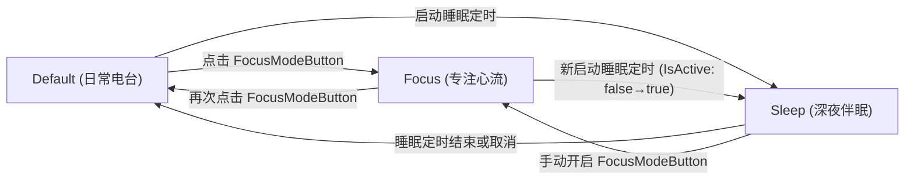

# TuanRadio AI DJ 专注场景模式（Focus Radio Scene Mode）架构与交互设计方案

> **文件路径**：`docs/plans/2026-11-17-focus-radio-scene-mode-design.md`  
> **创建日期**：2026-11-17  
> **状态**：已实施（2026-11-17）  
> **设计目标**：补齐 `RadioSceneMode.Focus` 预留场景，构建「日常（Default）/ 专注心流（Focus）/ 深夜伴眠（Sleep）」全时段广播场景闭环——支持品牌头一键切换专注模式、曲间串场全程免打扰、器乐/纯音乐/Lo-Fi 优先选曲与高噪曲目过滤、退出时原子复原用户原有氛围偏好。

---

## 1. 方案背景与场景定位

TuanRadio 此前已在 `RadioSceneMode` 中定义了 `Default`、`Sleep` 与预留枚举项 `Focus = 2`，并交付了基于 `SleepTimerService` 联动的深夜伴眠场景模式（`Sleep`）。在工作、编程与学习等日间高频陪伴场景中，听众需要的是与深夜伴眠截然不同的声学与交互体验：

- **零认知打扰（Do Not Disturb）**：专注心流期间，播放中突然响起的 AI DJ 串场人声会打断阅读与思考；仅保留开台首曲的一句简短致意（如用户刚开启电台时），曲间自动换曲保持纯音乐流淌，彻底静默免打扰。
- **器乐与纯音乐优先（Instrumental First）**：常规推荐默认过滤含「纯音乐 / Instrumental」标记的候选曲以防误选伴奏；但在专注模式下，需要显式放行高质量纯音乐、器乐、Lo-Fi、钢琴与轻爵士，同时继续精准拦截卡拉 OK 伴奏（`伴奏` / `Karaoke` / `off vocal`）以及摇滚/金属/重低音电音等激昂干扰曲目。
- **与睡眠定时无缝协同**：专注中途若用户启动睡眠定时（如工作完准备休息），系统自动将手动专注覆盖平滑让位于 `Sleep` 伴眠模式，并自始至终完整保留最原始的用户 `MoodBias`。

---

## 2. 场景模式状态机与优先级规则

### 2.1 状态流转与抢占规则

1. **只读快捷状态**：`ISceneModeService` 新增 `bool IsFocusMode { get; }` 并在 `CurrentMode` 变化时同步触发 `PropertyChanged`。
2. **睡眠定时新激活自动接管**：`SceneModeService` 跟踪 `_wasSleepTimerActive`；当检测到 `_sleepTimer.IsActive` 由 `false` 翻转为 `true` 且当前手动覆盖为 `RadioSceneMode.Focus` 时，自动清除 `_manualMode = null`，让新启动的睡眠定时平滑接管切入 `RadioSceneMode.Sleep`。
3. **原子氛围快照与跨态恢复**：
   - `MainWindowViewModel` 仅在从 `RadioSceneMode.Default` 切入任意非默认模式（`Focus` 或 `Sleep`）时记录 `_preSleepMoodBias = _recommendationService.CurrentMoodBias`；
   - 进入 `Focus` 时将推荐氛围置为 `"focus"`，进入 `Sleep` 时置为 `"calm"`；
   - 仅在回到 `RadioSceneMode.Default` 时原子复原 `_preSleepMoodBias` 并清空快照，确保 `Default -> Focus -> Sleep -> Default` 或 `Default -> Sleep -> Focus -> Default` 跨场景流转不丢失用户原始氛围。

---

## 3. 核心模块改动设计

### 3.1 串场免打扰调度（`MainWindowViewModel.ShouldSpeakTransition`）
- 新增可选参数 `RadioSceneMode sceneMode = RadioSceneMode.Default`；
- 当 `sceneMode == RadioSceneMode.Focus` 时直接返回 `stationOpening`：仅电台首次开播允许简短致意，后续全部曲间自动换曲强制返回 `false`，实现绝对免打扰。
- 注意：用户主动在聊天框点歌或点击 `STORY` 等显式交互仍正常应答，不受串场免打扰限制。

### 3.2 `DJService` 专注提示词与兜底台词
- **`BuildTransitionPrompt`**：新增 `RadioSceneMode.Focus` 分支（中英文双语），注入 `【专注电台情境】` / `[Focus Radio Context]`，要求语气沉稳克制、1~2 句简短带出曲目、不闲聊不提问，末尾情绪标签固定 `[calm]`。
- **`BuildFallbackIntroduction` & `BuildLiveStreamIntroduction`**：在 `Sleep` 分支后补齐 `Focus` 专属双语兜底台词（单曲与网络直播电台双覆盖），保持 `Emotion = "calm"`, `Expression = "calm"`, `Motion = "idle"`。

### 3.3 `CandidateRanker`、`MusicSourceBroker` 与 `RecommendationService` 专注选曲
1. **伴奏与纯音乐语义剥离（`CandidateRanker` & `MusicSourceBroker`）**：
   - 新增 `KaraokeBackingRegex` 与 `HasKaraokeBackingTag(string?)`，精准匹配卡拉 OK 伴奏（`伴奏` / `卡拉ok` / `karaoke` / `\binst\b` / `off vocal` / `minus one`）；
   - 扩展 `IsUnwantedVersion(OnlineTrack candidate, string? referenceText = null, bool allowPureInstrumental = false)` 与 `ScoreSearchResult` / `RankSearchResults`：
     - `allowPureInstrumental == false`（默认）：维持原行为，过滤所有伴奏与纯音乐；
     - `allowPureInstrumental == true`（专注模式）：放行「纯音乐 / Instrumental」器乐作品并豁免聚合搜索 `-0.70` 扣分，仍拦截卡拉 OK 伴奏、`(Inst.)` 消音伴奏、翻唱与 Remix/DJ 版；
   - `IMusicSourceBroker` 新增 `SearchAsync(..., bool allowPureInstrumental, ct)` 重载，确保多源聚合重排阶段同步放行纯音乐评分。
2. **场景独立约束与推荐查询（`RecommendationService`）**：
   - `IRecommendationService` 新增 `UpdateSceneMode(RadioSceneMode)` 与 `CurrentSceneMode`，由 `MainWindowViewModel` 同步场景变更并清空旧节目单缓存——确保专注选曲约束（放行纯音乐、屏蔽激昂曲目、`Scene = "focus"`）在临时氛围微调（如 `CALM`/`FIRE` 或聊天 `change_mood`）时依然生效；
   - `NormalizeMood` 识别 `"focus"` / `"专注"` / `"心流"` / `"学习"` / `"工作"` 归一化为 `"focus"`；
   - `BuildContext` 支持 `"focus"` 结构化氛围并将 `Scene` 同步锁定为 `"focus"`；
   - `GenerateQueriesAsync` 与 `BuildFallbackQueries` 在专注场景下优先搜索纯音乐、器乐、Lo-Fi、钢琴或轻爵士方向（离线兜底优先插入 `纯音乐 专注 轻音乐` / `lofi instrumental focus`）。

### 3.4 UI 交互与本地化（`MainWindow` & `AppLanguage`）
- **品牌头入口**：在 `BrandHeader` 右侧功能按钮簇（搜索按钮 `SearchButton` 与睡眠定时按钮 `SleepTimerButton` 之间）新增 `FocusModeButton`（双环同心靶心图标），激活态以 `AccentGreen` 高亮显示并配合双语动态 Tooltip。
- **暗室/专注微光降噪**：`MainWindow.RunGlowAsync` 在 `IsSleepRadioMode` 或 `IsFocusRadioMode` 任一激活时启用柔和微光上限（`0.35 ~ 0.70`），降低视觉闪烁干扰。
- **双语资源**：在 `AppLanguage` 成对新增 `S_SceneModeFocus`、`S_SceneFocusStatus`、`S_FocusModeTooltipOff`、`S_FocusModeTooltipOn`。

---

## 4. 测试与验证清单

在 `AIRadio.Desktop.Tests/AIRadio.Desktop.Tests/SleepRadioSceneModeTests.cs` 扩展覆盖以下场景：
1. `FocusMode_ToggleCommand_ActivatesAndRestoresMoodBias`（切换专注模式、推荐氛围锁定与原子复原）；
2. `FocusAndSleepMode_CrossTransitions_PreserveOriginalMoodBias`（`Default -> Focus -> Sleep -> Default` 与 `Default -> Sleep -> Focus -> Default` 跨态恢复验证）；
3. `ShouldSpeakTransition_FocusMode_SilencesAllMidSessionTransitions_AllowsStationOpening`（曲间免打扰验证）；
4. `BuildTransitionPrompt_InjectsFocusContext_InChineseAndEnglish`（中英文专注提示词注入）；
5. `FallbackIntroduction_Uses_FocusCopyAndCalmEmotion_UnderFocusMode`（单曲与直播电台双语兜底台词）；
6. `CandidateRanker_AllowsPureInstrumental_InFocusMode_WhileBlockingKaraokeAndAgitated`（纯音乐放行与伴奏/嗨曲拦截）；
7. `FocusModeButton_InMainWindow_TogglesFocusModeAndUpdatesTooltip`（`MainWindow` 控件绑定、`.active` 状态类及中英文 Tooltip 联动）。
